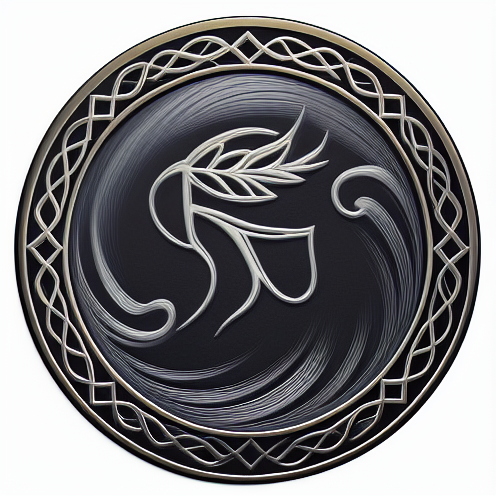
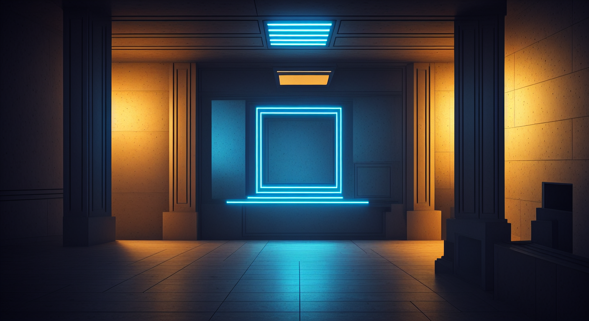

# SHINOBI ACADEMY — THE DEVELOPER'S PATH

## MISSION 02: THE LIVING MISSION BOARD

**Name:** ____________________________  **Section:** ________________________  **Date:** ___________________________

**Individual mission · 30 minutes · teacher-guided · training, not a test**

---

## Mission Briefing

The academy's digital mission terminal is **malfunctioning**. The missions are already
displayed on the board, but the terminal cannot respond. The system status never
changes, mission selections never reach the briefing line, and the intelligence
shutters stay sealed.

Your assignment: **restore the terminal's reflexes**, one circuit at a time, using
JavaScript DOM manipulation.

You work alone. Every line you run must be a line you typed. This scroll is your
learning record: **predict, observe, record one piece of evidence, and explain
briefly** — then show it to Roy. Short answers. Your thinking matters more than
length.

---

## Your workstation — read this first

| File | What it is | What you do with it |
|---|---|---|
| `dom-workshop.html` | The interactive mission terminal | **Read only** — never edit |
| `dom-workshop.css` | All the styling, including the states you will switch | **Read only** — you will open it in Circuit 3 to find the class names |
| `dom-workshop.js` | Your working file | **THE ONLY FILE YOU EDIT** |
| `dom-workshop-scroll.md` | This scroll — your learning record | Write in it as you go |

**The loop (Law 2):** edit → Save (`Ctrl+S`) → Refresh the browser (`F5`) → observe →
record what happened.

**Console:** press `F12` → Console tab. Green/white text is information. Red text is
a stop-and-read.

**When to ask Roy:** after **90 seconds** of being stuck (Law 3), raise your hand.
That is the rule, not defeat. Try the rescue cards near the end of this scroll first.

---

## Prerequisites — check before you begin

- ☐ `js-basics` complete (variables, `if`, loops, functions)
- ☐ `js-arrays-objects` complete
- ☐ Editor open with `dom-workshop.js`, browser open with `dom-workshop.html`, side by side
- ☐ Console ready: `F12` → Console tab
- ☐ No internet needed. Everything runs from this folder.

---

## Village Laws — individual training rules

1. **Predict before you run.** A wrong prediction is information, not failure.
2. **One change at a time.** Save, refresh, and observe.
3. After **90 seconds** of being stuck, raise your hand. That is the rule, not defeat.
4. **Record your evidence.** Explain what happened.
5. **Type everything yourself.** AI may explain during Apprentice, but it must not
   author your deliverable code.

---

## PHASE 0 — Briefing: Witness the frozen terminal (3 min)

**Objective:** see the broken state you are about to repair.

**Steps:**
1. Scroll to the terminal in `dom-workshop.html`.
2. Click the power button. Click every **Open Intel** button. Try each twice.
3. Open `dom-workshop.js` and read it top to bottom.

**PREDICT (P0) — write this before you judge the result:**
How many working lines of JavaScript do you think are in `dom-workshop.js` right now?

My prediction: ______________________________________________________________

**OBSERVE — expected:** nothing responds. Status stays `OFFLINE`, badges stay
`STANDBY`, shutters stay closed. The terminal looks finished but is dead inside.

What I actually saw when I clicked: __________________________________________

**REFLECT — one sentence:**
The page looks finished, yet it is inactive. What tells you the terminal is dead?

My explanation: ______________________________________________________________

---

## PHASE 1 — CIRCUIT 1 · POWER (5 min) — **Me** (Roy demonstrates)

**Objective:** select an existing element, prove it exists, and make a button change
the terminal status when clicked.

**Steps:**
1. Roy types this circuit live. You follow — every keystroke, in your own
   `dom-workshop.js`, in the **Circuit 1** area.
2. Write your PREDICT answer **before** the first Save + Refresh.
3. Copy your evidence exactly as you typed it.

**PREDICT (P1) — before your first Save + Refresh:**
When the `console.log` line runs, will it print an element, or will it print `null`?

My prediction (a few words on why): ___________________________________________

**OBSERVE — expected:** the console prints two element nodes (not `null`). After
Save (`Ctrl+S`) + Refresh (`F5`), clicking the power button flips the status from
`OFFLINE` to `ONLINE`.

What I saw — console output and status after clicking: _________________________

**EVIDENCE 1 — copy the exact selection line you typed:**

Evidence: ___________________________________________________________________

**REFLECT — one question, one or two sentences:**
How did selecting an element and attaching a click handler make the terminal respond?

My explanation: ______________________________________________________________

… __________________________________________________________________________

---

## PHASE 2 — CIRCUIT 2 · BRIEFING (6 min) — **Us** (guided together)

**Objective:** read the `textContent` of Mission 1's title and transfer it into the
terminal's briefing line.

**Steps — together, step by step:**
1. Find Mission 1's title element in the terminal HTML. Copy its `id`.
2. In `dom-workshop.js` (Circuit 2 area): store it in a variable, and store the
   briefing element too.
3. Give Mission 1's **Open Intel** button its own click handler.
4. Inside the handler: read the title's text, and write it into the briefing —
   starting with the words `Selected: `.
5. Save → Refresh → click Mission 1's button **once**.

**PREDICT (P2) — write this before you click:**
The briefing currently says *"No mission selected."* After your click it will say
exactly:

My prediction: ______________________________________________________________

**OBSERVE — expected:** the briefing line changes to `Selected:` followed by
Mission 1's title text. Nothing else on the terminal moves.

What the briefing line actually said: ________________________________________

**EVIDENCE 2 — the line where you READ the title:**

Evidence: ___________________________________________________________________

**REFLECT — one question:**
How did the mission title reach the briefing line? Name where it started, where it
ended, and what travelled between them.

My explanation: ______________________________________________________________

… __________________________________________________________________________

---

## PHASE 3 — CIRCUIT 3 · SHUTTERS (6 min) — **Us** (guided together)

**Objective:** extend the **same handler you built in Circuit 2** — use `classList`
to switch Mission 1's badge state and open its shutter, and `textContent` to update
the badge label.

**Steps — together, step by step:**
1. Open `dom-workshop.css` (read-only). Find the badge states and the shutter states.
   **They are already written there.**
2. Back in Circuit 2's handler — do **not** write a second handler — add lines that
   move Mission 1's badge from its standby state to its active state, and update its
   label so it no longer reads `STANDBY`.
3. Add lines that move Mission 1's shutter from closed to revealed.
4. Save → Refresh → click Mission 1's button **once**.

**PREDICT (P3) — write this before you click:**
Will your JavaScript assign a background colour, a border, and a font? Yes or no.

My prediction: ______________________________________________________________

So which file will decide how the active badge *looks*?

My prediction: ______________________________________________________________

**OBSERVE — expected, all three at once from one click:**
- The briefing shows `Selected: Silent Pagoda Patrol` (Circuit 2 still works).
- The badge flips `STANDBY` → `ACTIVE` with a new look.
- The shuttered intel panel appears.
- Your JavaScript contains **no colour values**.

What actually happened on that one click: ____________________________________

Does your own `dom-workshop.js` contain colour values? Yes / No — prove it:

Evidence that proves it: _____________________________________________________

**EVIDENCE 3 — the badge and shutter lines you added inside the handler**
(class switches and the label update), or a clear description of them:

Evidence: ___________________________________________________________________

**REFLECT — one question, one or two sentences:**
Why did the panel change its appearance even though your JavaScript never specified
a colour?

My explanation: ______________________________________________________________

… __________________________________________________________________________

---

## PHASE 4 — CIRCUIT 4 · TRANSFER (8 min) — **You** (independent)

**Objective:** no step-by-step this time. Give Mission 2 its own complete handler on
**its** Open Intel button: briefing update + badge swap + shutter reveal. Same pattern
you already understand — new element, new `id`s.

**Steps:**
1. Read Mission 2's block in the terminal HTML to get its element `id`s.
2. Work in the **Circuit 4** area of `dom-workshop.js`.
3. One handler for Mission 2. Save → Refresh → test with one click.

**PREDICT (P4) — write this before you click:**
After you click Mission 2's button, what will the briefing line show?

My prediction: ______________________________________________________________

Will Mission 1's badge change too? Yes / No — and why?

My prediction: ______________________________________________________________

**OBSERVE — expected:** Mission 2's badge activates, its shutter opens, and the
briefing switches to `Selected:` Mission 2's title. Mission 1 stays active, but its
briefing text is replaced — the briefing line shows only the latest selection.
Check Mission 1's badge against your P4 prediction.

What the briefing line actually said: ________________________________________

**EVIDENCE 4 — copy your Mission 2 handler's key line**
(the class switch or the briefing write):

Evidence: ___________________________________________________________________

**REFLECT — one question:**
How did you adapt the Mission 1 pattern for Mission 2? What changed, and what stayed
the same?

My explanation: ______________________________________________________________

… __________________________________________________________________________

**Finished early? — optional stretch (only if Roy says go):**
Wire Mission 3 the same way, then make its shutter **toggle**: first click opens it,
second click closes it. Roy may also introduce the optional circuits that batch all
three cards into one loop. Record any predictions and results here:

My prediction: ______________________________________________________________

What actually happened: _____________________________________________________

---

## PHASE 5 — Reflection & Mission Completion (2 min)

### Final reflection

Roy will discuss the first two **out loud** — oral discussion prompts, not written
answers. There is no multiple-choice version, and no single "right" sentence. This
scroll is your learning record, not a test.

**Oral discussion with Roy — nothing to write:**

1. Which line made the button respond?
2. Why did the panel change appearance without JavaScript assigning its colour?

**Write one short answer:**

**3. Which button or interaction in your own project could benefit from what you
learned?**

My answer: __________________________________________________________________

### Mission completion

This is **training, not an assessment**. Completing it is not a mastery-gate pass, and
it unlocks nothing. It records that you experienced every circuit — and you should be
able to show this scroll to Roy and explain your answers.

| Circuit | Done | Evidence recorded |
|---|---|---|
| Phase 0 — witnessed the frozen terminal + prediction P0 | ☐ | ☐ |
| Circuit 1 — power restored (status `ONLINE`) + P1 | ☐ | ☐ |
| Circuit 2 — briefing echoes the mission title + P2 | ☐ | ☐ |
| Circuit 3 — badge + shutter flip, zero colours in JS + P3 | ☐ | ☐ |
| Circuit 4 — Mission 2 restored independently + P4 | ☐ | ☐ |
| Final reflection — two oral prompts discussed + one written answer | ☐ | ☐ |

---

## Rescue cards — try these in order, then raise your hand

1. **Nothing happens at all?** Did you Save (`Ctrl+S`) **and** Refresh (`F5`)? (Law 2.)
2. **Console says `Cannot read properties of null`?** Your selected element does not
   exist — open the HTML and compare the `id`, letter by letter. IDs are
   case-sensitive. A missing `}` or `;` above the error line is the other usual cause.
3. **Console shows red but you don't understand it?** Copy the first red line into
   this scroll and raise your hand (Law 3 — after 90 seconds).

   First red line: ____________________________________________________________

4. **Briefing text looks wrong?** Check that you read the *title* element, and check
   your quotation marks and `+` spacing.
5. **Badge doesn't change?** Compare your class names against the ones in
   `dom-workshop.css` — one wrong letter and the class matches nothing.

---

*Terminal restored. Mission 02 complete — the DOM lecture gives official names to
everything you just did.*