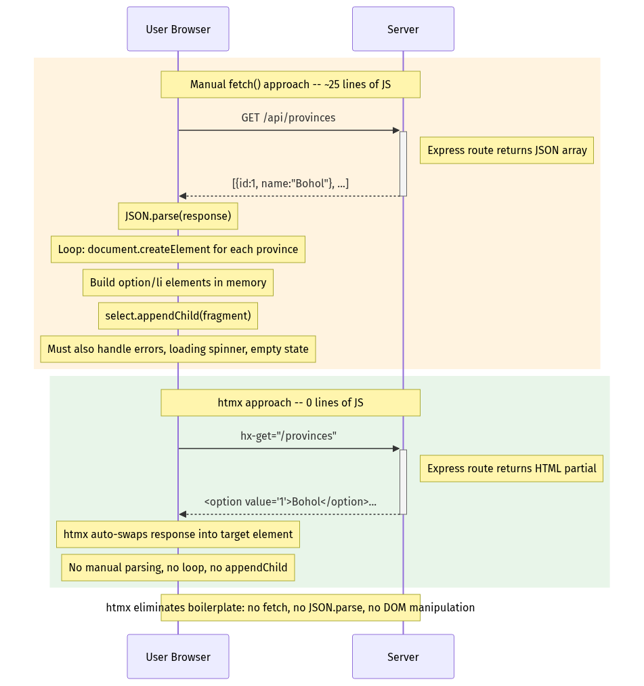
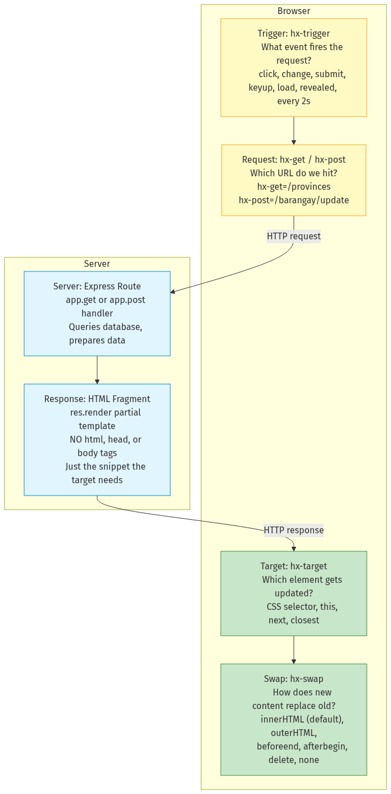
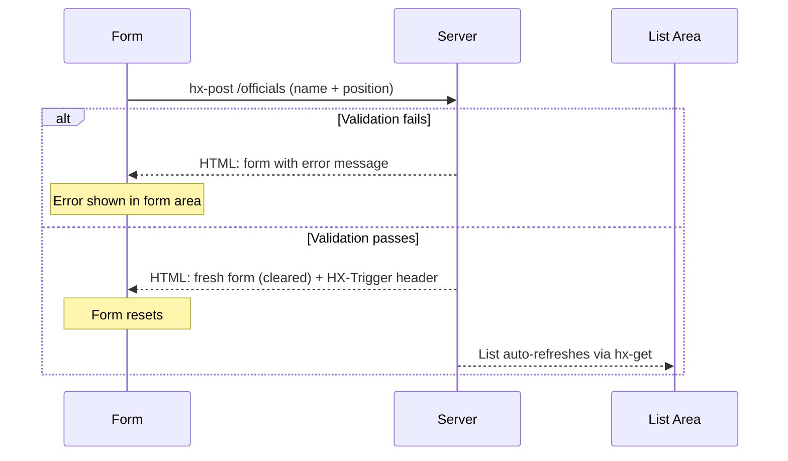
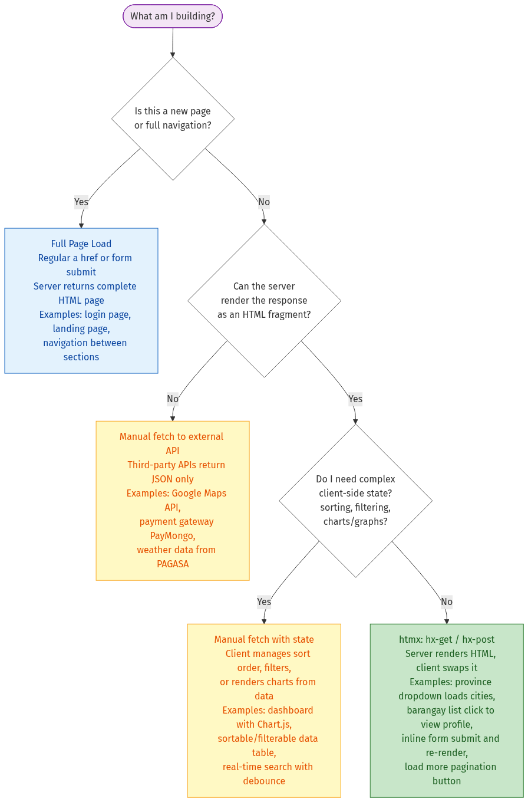

# htmx: Server-Sent HTML — Cut Out the Middleman

**Grade 10 - ICT (Full-Stack Elective)**
**Quarter 5 · Week 1–2** (Extension Lane — after G0–G6 gates)
**Duration:** 1–2 weeks
**Prerequisite:** [`ajax-fetch`](../ajax-fetch/lecture.md) (G3: you can `fetch()` + parse JSON + mutate DOM),
[`express-basics`](../express-basics/lecture.md) (G4: you can build routes that return EJS-rendered HTML)

---

## 🎯 Learning Objectives

By the end of this lecture, you will be able to:

1. ✅ Explain why manual `fetch()` → `JSON.parse()` → `createElement()` is brittle and repetitive
2. ✅ Add htmx to any page with a single `<script>` tag (no npm, no build step)
3. ✅ Use `hx-get` and `hx-post` to replace `fetch()` calls with declarative attributes
4. ✅ Control where responses land with `hx-target` and how they merge with `hx-swap`
5. ✅ Trigger requests on custom events with `hx-trigger` (including `delay` for debounce)
6. ✅ Choose between htmx, manual `fetch()`, and full-page navigation for a given scenario
7. ✅ Build a CRUD UI backed by Express+EJS using htmx instead of manual DOM manipulation

---

## 📖 Table of Contents

1. [The Problem: Manual DOM Choreography](#section-1)
2. [What Is htmx?](#section-2)
3. [hx-get — Your First htmx Attribute](#section-3)
4. [hx-target — Where Does the HTML Go?](#section-4)
5. [hx-swap — How Does It Replace?](#section-5)
6. [hx-post — Forms Without Page Reloads](#section-6)
7. [hx-trigger — When to Fire the Request](#section-7)
8. [Updating Resources with hx-post](#section-8)
9. [When to Use htmx (vs. Other Approaches)](#section-9)
10. [Mini-Projects](#section-10)
11. [Final Challenge — Barangay Announcement Board](#section-11)
12. [Troubleshooting](#section-12)
13. [What's Next?](#section-13)

---

<a name="section-1"></a>
## 1. The Problem: Manual DOM Choreography

You've already built dynamic pages the hard way. In [`ajax-fetch`](../ajax-fetch/lecture.md), you learned to:

1. Call `fetch('/api/provinces')`
2. Parse the response with `res.json()`
3. Loop through the data array
4. Create DOM elements with `document.createElement()`
5. Append each one with `appendChild()`

Here's what that looks like — 25 lines of JavaScript, repeated for every feature:

```javascript
// ❌ Manual fetch — 25 lines of JavaScript, every time
async function loadProvinces() {
  const res = await fetch('/api/provinces');
  const data = await res.json();
  const list = document.getElementById('province-list');
  list.innerHTML = '';
  data.forEach(p => {
    const li = document.createElement('li');
    li.textContent = p.name;
    list.appendChild(li);
  });
}
```

Every. Single. Time. You want to load data, you write the same choreography: fetch, parse, loop, create, append. It works, but it's brittle — change the API response shape, and you break the rendering code. Add a new field, and you're hunting through `createElement` calls.

Now look at the htmx equivalent:

```html
<!-- ✅ htmx — zero lines of JavaScript -->
<button hx-get="/provinces" hx-target="#province-list">
  Load Provinces
</button>
```

That's it. One button. Two attributes. Zero lines of JavaScript. The server sends back pre-rendered HTML, and htmx places it exactly where you want it.

Here's the key insight: your Express server **already knows how to render HTML** with EJS. You proved that in G4. Why throw away that capability, send raw JSON to the browser, and then force the browser to rebuild the DOM from scratch? The server can do the rendering — let it.

**Analogy:** "Right now, you're the messenger (`fetch`), the translator (`JSON.parse`), AND the construction worker (`createElement`). htmx lets the server send the finished HTML — you just say where it goes. It's like ordering food and having it delivered to your table, instead of receiving raw ingredients and cooking it yourself."



**✅ DO:**
- Recognize when you're writing the same `fetch→parse→createElement` pattern for the third time — it's a signal that htmx would simplify your code

**❌ DON'T:**
- Keep using `fetch()` for simple page updates that just render server data — you're doing work the server already did

**🎯 Try It:** Open [`assets/before-after-comparison.html`](assets/before-after-comparison.html) — a standalone page showing the provinces loader with `fetch()` on the left and equivalent `hx-get` on the right. Click both buttons and watch the Network tab. Notice the `fetch()` version sends JSON; the htmx version sends pre-rendered `<li>` elements.

---

<a name="section-2"></a>
## 2. What Is htmx?

htmx is a **14 KB JavaScript library**. That's smaller than most images on a website. You add it with one `<script>` tag — no npm install, no `node_modules`, no build step, no webpack, no vite.

**Setup (one-time, in your EJS layout):**

```html
<script src="https://unpkg.com/htmx.org@2.0.4"></script>
```

That's the entire installation. Refresh your page and htmx is active.

### The Philosophy

htmx extends the browser's native hypermedia model. Here's what that means:

- `<a href="/page">` already makes a GET request and swaps the **entire page**
- `<form action="/submit" method="post">` already makes a POST request and swaps the **entire page**

htmx generalizes this idea: **any element** can make **any HTTP method** request, triggered by **any event**, and swap only **part of the page**. The browser becomes a hypermedia client — it trusts the server to send ready-to-display HTML fragments.

This is the same mental model you already used in Express+EJS: the server receives a request, renders HTML, and sends it back. htmx just lets you do that for **partial** page updates instead of full page reloads.

**Analogy:** "Like ordering from Jollibee and having your food delivered to your table instead of rebuilding the entire restaurant. A `<form>` rebuilds the whole restaurant (full page reload). htmx brings just your Chickenjoy to table #5 (partial swap)."



> 📌 **Key insight:** htmx is not "just another library to learn." It's a shift in how you think — from "the browser processes data" to "the server sends HTML, the browser places it." This is the same mental model you already used in Express+EJS — now applied to partial-page updates.

htmx is **not** in the locked G0–G6 stack. It's a Q5 extension. But it composes directly with skills you've already proven: Express routes, EJS templates, and DOM fundamentals. You're not learning something foreign — you're learning a smarter way to use what you already know.

---

<a name="section-3"></a>
## 3. hx-get — Your First htmx Attribute

`hx-get="/path"` is the workhorse. Place it on any HTML element, and htmx fires a GET request to `/path` when the element is clicked (or its default trigger fires). The server responds with an **HTML fragment** — not a full page, not JSON — and htmx swaps that fragment into the element's `innerHTML` by default.

Let's build a Barangay Directory row loader. You have a table with an empty `<tbody>`. You want to load rows on demand.

**Step 1 — The button and target (page.ejs):**

```html
<button hx-get="/directory/rows" hx-target="#directory-body">
  Load Directory
</button>
<table>
  <tbody id="directory-body"></tbody>
</table>
```

**Step 2 — The Express route (app.js):**

```javascript
app.get('/directory/rows', (req, res) => {
  const officials = readJSON('officials.json');
  res.render('partials/directory-rows', { officials });
});
```

**Step 3 — The EJS partial (views/partials/directory-rows.ejs):**

```html
<% officials.forEach(o => { %>
  <tr>
    <td><%= o.name %></td>
    <td><%= o.position %></td>
  </tr>
<% }) %>
```

Notice: the partial has **no `<html>`, no `<head>`, no `<body>`**. It renders only the `<tr>` rows — exactly the fragment that gets swapped into `<tbody id="directory-body">`.

> 💡 **The EJS partial is the key.** Same EJS you know — just without the `<html>`, `<head>`, `<body>` wrapper. The partial renders *only* the fragment that gets swapped in. Create these in `views/partials/` to keep them organized.

**Analogy:** "At a sari-sari store, you don't rebuild the entire store when someone asks 'how much is the Sardinas?' You just point to the price tag. `hx-get` is pointing — the server hands you the price tag (HTML fragment), and htmx pins it to the right spot."

**✅ DO:**
- Create EJS partials (in `views/partials/`) that render only the fragment
- Keep your Express routes thin — they just fetch data and pass it to a partial

**❌ DON'T:**
- Return a full `<html>` page from an htmx route — it will nest a complete page inside your element
- Return JSON from an htmx endpoint — htmx expects HTML

---

<a name="section-4"></a>
## 4. hx-target — Where Does the HTML Go?

By default, htmx replaces the `innerHTML` of **the element that triggered the request**. That's fine if your button *is* the content area. But usually, the button should stay visible while the response goes somewhere else.

`hx-target` answers "where?" using any CSS selector. The most common pattern: `hx-target="#some-id"`.

### Common Patterns

| Pattern | Example | What happens |
|---|---|---|
| Button → result area | `hx-get="/data" hx-target="#result"` | Button stays; result div updates |
| Form → list | `hx-post="/add" hx-target="#list"` | Form stays; new item added to list |
| Link → detail pane | `hx-get="/item/42" hx-target="#detail"` | Sidebar link stays; detail area updates |

### Relative Selectors

You can also use relative CSS selectors for tighter coupling:

| Selector | Meaning |
|---|---|
| `next <selector>` | The next sibling matching the selector |
| `closest <selector>` | The nearest ancestor matching the selector |
| `find <selector>` | The first descendant matching the selector |
| `this` | The element itself |

### Worked Example — Master-Detail Pattern

A sidebar lists barangay officials. Clicking a name loads their details in the main area:

```html
<div class="columns">
  <div class="column is-4">
    <% officials.forEach(o => { %>
      <button hx-get="/official/<%= o.id %>" hx-target="#detail-pane">
        <%= o.name %>
      </button>
    <% }) %>
  </div>
  <div class="column is-8" id="detail-pane">
    <p>Select an official to see details.</p>
  </div>
</div>
```

Each button triggers `hx-get`, but the response lands in `#detail-pane` — not on the button itself. The sidebar stays intact.

**Analogy:** "You order from the counter (`hx-get`) but tell them which table to deliver to (`hx-target`). Without `hx-target`, the food lands on the counter itself."

**✅ DO:**
- Use `hx-target` when the triggering element shouldn't be replaced (buttons, links, form controls)

**❌ DON'T:**
- Forget the `#` prefix — `hx-target="result"` looks for a `<result>` HTML tag, not `id="result"`

---

<a name="section-5"></a>
## 5. hx-swap — How Does It Replace?

`hx-target` answers "where." `hx-swap` answers "how." It controls **how** the response HTML merges with the target element. Each value maps to a DOM method you already know:

| `hx-swap` value | Equivalent manual DOM | Use when… |
|---|---|---|
| `innerHTML` (default) | `el.innerHTML = html` | Replacing content of a container |
| `outerHTML` | `el.outerHTML = html` | Replacing the trigger element itself |
| `beforeend` | `el.insertAdjacentHTML('beforeend', html)` | Appending to a list (new item added) |
| `afterbegin` | `el.insertAdjacentHTML('afterbegin', html)` | Prepending (newest first) |
| `beforebegin` | `el.insertAdjacentHTML('beforebegin', html)` | Inserting above as a sibling |
| `afterend` | `el.insertAdjacentHTML('afterend', html)` | Inserting below as a sibling |

### Worked Example — Append to List

A form adds a new official. The new row should appear at the **end** of the table body — not replace existing rows:

```html
<form hx-post="/officials" hx-target="#directory-body" hx-swap="beforeend">
  <input name="name" required>
  <button type="submit">Add Official</button>
</form>
```

With `hx-swap="beforeend"`, each submission appends a new `<tr>` after the last row. Existing rows stay untouched.

**Analogy:** "`hx-swap='innerHTML'` is replacing all jeepney passengers at once. `hx-swap='beforeend'` is picking up more passengers at the next stop — existing passengers stay, new ones board at the back."

**✅ DO:**
- Use `beforeend` for "add new item" patterns — it preserves existing content
- Use `outerHTML` when replacing a form with its fresh version (see Section 6)

**❌ DON'T:**
- Use `innerHTML` when you want to *add* to a list — it will erase existing items
- Forget that `innerHTML` is the default — if you want something else, be explicit

---

<a name="section-6"></a>
## 6. hx-post — Forms Without Page Reloads

In G4, forms caused full page reloads. In G3 (ajax-fetch), you learned `preventDefault()` + `FormData` + manual JSON + error display — about 15 lines of JavaScript per form.

`hx-post` eliminates all of that. Place it on a `<form>`, and htmx serializes the form data, sends it as a POST request, and swaps the response. No `preventDefault()`. No `FormData`. No manual error rendering.

### Worked Example — Add Official with Validation

```html
<form hx-post="/officials" hx-target="#form-area" hx-swap="outerHTML">
  <input name="name" placeholder="Full Name" required>
  <input name="position" placeholder="Position" required>
  <button type="submit">Add</button>
</form>
<div id="list-area" hx-get="/directory/rows" hx-trigger="load">
  <!-- loads on page load, refreshes after add via HX-Trigger -->
</div>
```

```javascript
app.post('/officials', (req, res) => {
  const { name, position } = req.body;
  if (!name || !position) {
    return res.render('partials/official-form', { error: 'Both fields required.' });
  }
  officials.push({ id: Date.now(), name, position });
  writeJSON('officials.json', officials);
  res.set('HX-Trigger', 'officialAdded');
  res.render('partials/official-form', { error: null });
});
```

> 📌 **HX-Trigger response header:** The server can tell htmx "after you swap this response, also fire event X on element Y." In the example above, `HX-Trigger: officialAdded` fires a custom event. The `<div id="list-area">` can listen for `hx-trigger="officialAdded from:body"` to auto-refresh. This is how adding an item triggers the list to refresh — without any JavaScript.

### The Flow



**✅ DO:**
- Use `HX-Trigger` to refresh other page sections after a mutation (add, update, delete)
- Always validate server-side — exactly as you learned in G4
- Use `hx-swap="outerHTML"` on the form so the response replaces the old form

**❌ DON'T:**
- Rely on client-side `required` alone — server-side validation is mandatory
- Forget `hx-swap="outerHTML"` on the form — default `innerHTML` nests the response inside the old form

---

<a name="section-7"></a>
## 7. hx-trigger — When to Fire the Request

`hx-trigger` answers "when." Every htmx element has a default trigger, but you can override it.

### Default Triggers

| Element | Default Trigger |
|---|---|
| `<button>`, `<div>`, `<a>`, `<span>` (most elements) | `click` |
| `<form>` | `submit` |
| `<input>`, `<select>`, `<textarea>` | `change` |

### Custom Triggers and Modifiers

You can specify any DOM event: `mouseenter`, `keyup`, `load`, `focus`, `blur`. You can also add modifiers:

| Modifier | Example | Effect |
|---|---|---|
| `delay:<ms>` | `keyup delay:500ms` | Wait 500ms after last event before firing |
| `changed` | `keyup changed` | Only fire if the value actually changed |
| `once` | `click once` | Fire only once, then disable |
| `every <s>s` | `every 5s` | Poll the server every 5 seconds |

### Worked Example — Debounced Search

Here's the htmx search input — zero JavaScript:

```html
<input type="search" name="q" placeholder="Search officials..."
  hx-get="/directory/search"
  hx-trigger="keyup changed delay:300ms"
  hx-target="#search-results">
<div id="search-results"></div>
```

Compare this to the ajax-fetch version you wrote in G3:

```javascript
// ajax-fetch version: 12 lines of JavaScript (for comparison)
let timer;
input.addEventListener('input', (e) => {
  clearTimeout(timer);
  timer = setTimeout(async () => {
    const res = await fetch(`/search?q=${e.target.value}`);
    const data = await res.json();
    // ... render results ...
  }, 300);
});
```

Same behavior. Same server endpoint. Same 300ms delay. htmx: zero lines of JavaScript.

### Trigger Reference Table

| Trigger | Default on | Use when… |
|---|---|---|
| `click` | buttons, divs, links (most elements) | User clicks to load/refresh |
| `submit` | forms | Form submission |
| `change` | inputs, selects, textareas | Value changes (checkboxes, dropdowns) |
| `keyup` | inputs (must be explicit) | Search-as-you-type |
| `load` | any (must be explicit) | Load content on page load |
| `revealed` | any (must be explicit) | Lazy-load when element scrolls into view |
| `every 5s` | any (must be explicit) | Polling for live updates (dashboards) |

**Analogy:** "A tricycle terminal has different departure rules. Some leave immediately when full (`click`). Some wait until a specific time (`delay`). Some go once per hour (`once`). `hx-trigger` sets your element's departure rule."

**🎯 Try It:** Open [`assets/search-htmx.html`](assets/search-htmx.html). Same server endpoint, same 300ms delay, zero JavaScript. Open the Network tab and watch the requests — notice how they only fire after you stop typing.

**✅ DO:**
- Combine `changed` + `delay` for search inputs — only fires when value changes AND user pauses
- Use `hx-trigger="load"` to populate sections on page load

**❌ DON'T:**
- Use `keyup` without `delay` — every keystroke fires a request, wasting data and flooding your server
- Use `every Ns` for polling unless you have a specific reason (dashboard, live scores)

---

<a name="section-8"></a>
## 8. Updating Resources with hx-post

CRUD has four operations: Create, Read, Update, Delete. You've seen Create (POST) and Read (GET). Now let's handle **Update** — changing an existing resource.

We'll use `hx-post` for updates (not `hx-put`). This keeps things simple — no `method-override` middleware, no extra Express configuration. The server knows the route is for updating because of the URL pattern (`/official/:id/update`).

The canonical pattern is **inline edit**: click a name, it becomes a text input, you change it, press Tab or click away, and it saves.

### The Three-Step Inline Edit Flow

**Step 1 — Display mode (initial state):**

```html
<div hx-target="this" hx-swap="outerHTML">
  <span><%= official.name %></span>
  <button hx-get="/official/<%= official.id %>/edit">Edit</button>
</div>
```

**Step 2 — Server returns edit mode on GET /official/:id/edit:**

```html
<div hx-target="this" hx-swap="outerHTML">
  <input name="name" value="<%= official.name %>"
    hx-post="/official/<%= official.id %>/update"
    hx-trigger="blur"
    hx-swap="outerHTML">
</div>
```

**Step 3 — Server returns updated display on POST /official/:id/update:**

```javascript
app.post('/official/:id/update', (req, res) => {
  const official = officials.find(o => o.id == req.params.id);
  official.name = req.body.name;
  writeJSON('officials.json', officials);
  res.render('partials/official-display', { official });
});
```

The server renders the **same display-mode partial** as Step 1, but with the updated name. The input is replaced by the display view — seamless to the user.

> 📌 **Complexity note:** This is the most advanced pattern in this lecture. You're combining `hx-get`, `hx-post`, `hx-target="this"`, and `hx-swap="outerHTML"` in one flow. If it feels complex, that's normal. The mini-projects give you hands-on practice.

**Analogy:** "At a barangay hall, updating an address doesn't issue a new ID number. You update the existing record. Same resource, new details."

**✅ DO:**
- Use `hx-target="this"` when the same element triggers, receives, and is replaced by the response
- Use `hx-swap="outerHTML"` — you're replacing the entire element (display → input → updated display)

**❌ DON'T:**
- Use the update route for creating new resources — keep create and update as separate routes
- Forget `hx-swap="outerHTML"` — without it, the response nests inside the old element

---

<a name="section-9"></a>
## 9. When to Use htmx (vs. Other Approaches)

You now have three tools for getting data from server to screen:

1. **Full page load** — traditional `<a href>` and `<form action>`, entire page reloads
2. **htmx** — declarative attributes, server sends HTML fragments, partial page swaps
3. **Manual `fetch()`** — programmatic requests, full control over parsing and rendering

Each has a sweet spot. The skill is choosing the right one.



### Decision Table

| Scenario | Full Page Load | htmx | Manual fetch() |
|---|---|---|---|
| Navigate between pages | ✅ Best | ❌ Overkill | ❌ Wrong tool |
| Load data into a section | ❌ Page flicker | ✅ Best | ⚠️ More code |
| Submit form + show result | ❌ Lose scroll position | ✅ Best | ⚠️ More code |
| Search as you type | ❌ Page reload on every key | ✅ Best | ⚠️ Same, but more code |
| Real-time chat/messages | ❌ No | ❌ Polling possible but not ideal | ❌ No (use WebSockets) |
| Complex client-side state (sorting, filtering, graphs) | ❌ No | ❌ Wrong tool | ✅ Best |
| Offline-first / PWA | ❌ No | ❌ No | ✅ With service workers |
| Call third-party API (weather, maps) | ❌ No | ❌ No — htmx expects HTML | ✅ Best |
| File upload with progress bar | ❌ No | ⚠️ Can do `hx-post` | ✅ More control |

### Philippine Context — Data Cost

htmx sends HTML fragments (~200 bytes–2KB) instead of JSON + JavaScript rendering code. On a ₱5/MB data plan, every kilobyte counts. A typical htmx partial for a table row:

```html
<tr><td>Juan dela Cruz</td><td>Barangay Captain</td></tr>
```

That's ~60 bytes. The equivalent JSON: `{"name":"Juan dela Cruz","position":"Barangay Captain"}` → ~55 bytes. But JSON *also* requires JavaScript to parse it and build DOM elements. The htmx fragment is self-contained — it arrives ready to display. For users on prepaid data, htmx partials are lean and efficient.

### Three Questions to Ask Yourself

1. **Is this a new page or an update to the current page?**
   - New page → full page load
   - Update → htmx or fetch

2. **Does the server already render this as HTML (EJS)?**
   - Yes → htmx (reuse the template)
   - No → fetch

3. **Do I need complex client-side logic (sorting, filtering, graphs)?**
   - Yes → fetch
   - No → htmx

**Analogy:** "Jeepney for the next barangay, airplane for Cebu, motorcycle when you need full control. Full page loads are the airplane (long distance, different destination). htmx is the tricycle (short trips, same area). Manual `fetch()` is your own motorcycle (full control, more responsibility)."

### DO/DON'T Summary (Full Lecture)

| ✅ DO | ❌ DON'T |
|---|---|
| Use `hx-get` + `hx-target` for loading data into a section | Use htmx for initial page loads |
| Return HTML fragments (EJS partials), not JSON | Return full `<html>` pages from htmx routes |
| Validate server-side (same as G4) | Rely on `required` attribute alone |
| Use `hx-trigger="keyup changed delay:500ms"` for search | Use `keyup` without `delay` |
| Use `HX-Trigger` to coordinate multiple elements | Write JS to manually refresh other elements |
| Put the htmx `<script>` in your layout once | Add the script tag on every page |
| Use `hx-swap="beforeend"` when appending to lists | Use `innerHTML` (default) when you want to append |
| Use `hx-swap="outerHTML"` when replacing the trigger element | Forget `outerHTML` on forms — response nests inside old form |

---

<a name="section-10"></a>
## 10. Mini-Projects

Each mini-project builds on the previous one. Complete them in order. Starter code is in the `assets/` folder.

---

### Mini-Project A — Barangay Directory: htmx Edition ⭐ Beginner

**Goal:** Convert the existing barangay directory (from ajax-fetch Mini Project B) from manual `fetch()` to htmx.

**Starter:** [`assets/express-crud-htmx/`](assets/express-crud-htmx/) — Express app with EJS templates and working routes. The `index.ejs` uses manual `fetch()` for the directory.

**Your job:**
1. Replace the "Load Directory" button's `onclick` handler with `hx-get`
2. Replace the "Add Official" form's `submit` handler with `hx-post`
3. Add `HX-Trigger` to auto-refresh the list after adding
4. Delete ~40 lines of JavaScript that are no longer needed

**Concepts practiced:** `hx-get`, `hx-post`, `hx-target`, `hx-swap`, `HX-Trigger`

---

### Mini-Project B — Search with Instant Results ⭐ Beginner

**Goal:** Add a debounced search bar to the directory that filters officials as you type.

**Starter:** Your completed Mini-Project A directory.

**Your job:**
1. Add a search `<input>` with `hx-get="/directory/search"` and `hx-trigger="keyup changed delay:300ms"`
2. Create the Express route that filters `officials.json` by name match and returns an EJS partial
3. Add `hx-target` pointing to the table body

**Concepts practiced:** `hx-trigger`, debounce, server-side filtering, EJS partials

---

### Mini-Project C — Inline Edit Dashboard ⭐⭐ Intermediate

**Goal:** Add click-to-edit to the directory: click a name, it turns into an input, save on blur.

**Starter:** Your completed Mini-Project B directory.

**Your job:**
1. Add an "Edit" button next to each official name
2. On click, `hx-get` returns an `<input>` pre-filled with the current name
3. On blur, `hx-post` saves the new name and returns the updated display view
4. Wire everything with `hx-target="this"` and `hx-swap="outerHTML"`

**Concepts practiced:** `hx-get`, `hx-post`, `hx-target="this"`, `hx-swap="outerHTML"`, `hx-trigger="blur"`

---

<a name="section-11"></a>
## 11. Final Challenge — Barangay Announcement Board

**Scenario:** The barangay captain wants a digital announcement board. Residents should see announcements appear without refreshing the page. The captain should be able to post new announcements through a form.

### Reuses (Spaced Retrieval)

- **G2 (DOM events):** Understanding that htmx replaces manual event wiring
- **G3 (async/fetch):** Recognizing when htmx is the better choice over manual `fetch()`
- **G4 (Express+EJS request→response):** Building routes and EJS partials

### Requirements

1. A page with two sections: "Post Announcement" (form) and "Announcement Board" (list)
2. The form uses `hx-post` to submit — no page reload
3. The board auto-refreshes after a new post (via `HX-Trigger`)
4. Announcements are stored server-side in a JSON file
5. Search bar filters announcements with debounce
6. Each announcement shows: title, body, author, timestamp
7. Server-side validation: title and body required

### Pass Criteria

- [ ] Posting an announcement updates the board without page reload
- [ ] Empty form submission shows a server-side error message
- [ ] Search filters announcements as you type (with debounce)
- [ ] The page works with JavaScript disabled (progressive enhancement — the form still posts, just with a page reload)

> 💡 This challenge is designed to be gate-style (~30 min). If you've completed the mini-projects, you've already written every piece you need. This is just composing them into one integrated page.

---

<a name="section-12"></a>
## 12. Troubleshooting

| Problem | Probable Cause | Fix |
|---|---|---|
| "Nothing happens when I click" | htmx script tag missing or wrong URL | Check `<script src="...">` in layout; verify in Network tab that `htmx.org@2.0.4` loads (should return 200) |
| "The whole page appears inside my div" | Server returned a full `<html>` page instead of a fragment | Make sure the route renders a partial EJS — no `<html>`, `<head>`, `<body>` tags |
| "The old content stays and new content appears below it" | Using default `hx-swap="innerHTML"` when you meant to append | Add explicit `hx-swap="beforeend"` to the triggering element |
| "My form submits but the form area goes blank" | Forgot `hx-swap="outerHTML"` on the form; the new form HTML nested inside the old form, creating invisible nested forms | Add `hx-swap="outerHTML"` to the `<form>` tag |
| "hx-get on page load doesn't fire" | `hx-trigger="load"` is not the default for any element | Add `hx-trigger="load"` explicitly on the element |
| "POST returns 404 on update route" | Route URL mismatch between `hx-post` attribute and Express route definition | Check that the URL path in `hx-post="/official/<%= id %>/update"` exactly matches `app.post('/official/:id/update', ...)` |
| "Search fires on every keystroke" | Missing `delay` modifier on `hx-trigger` | Use `hx-trigger="keyup changed delay:300ms"` — the `delay` is what debounces |
| "HX-Trigger doesn't refresh the list" | The listening element doesn't have `hx-get` wired, or the event name doesn't match | Check that the list element has `hx-get="..."` and the `HX-Trigger` response header value exactly matches the event name in `hx-trigger` |

---

<a name="section-13"></a>
## 13. What's Next?

✅ **You can now:**
- Replace repetitive `fetch()` + manual DOM code with declarative htmx attributes
- Design Express routes that return HTML fragments (EJS partials)
- Choose between htmx, manual `fetch()`, and full-page loads based on the scenario
- Build CRUD interfaces without writing DOM manipulation code

### Where htmx Fits in Your Stack

- **Backend:** Express + EJS (G4), SQLite (G5), Auth (G6) — **unchanged.** htmx doesn't touch your server logic. It just changes what the server returns: HTML fragments instead of JSON.
- **Frontend:** htmx handles most dynamic updates. Reserve manual `fetch()` for third-party APIs (weather, maps, payment gateways) and complex client-side state (sortable tables, drag-and-drop, graphs).

### What This Unlocks

- **Faster development** — less JavaScript to write, debug, and maintain. A typical CRUD page drops from ~100 lines of JS to ~10 lines of htmx attributes.
- **Your Express+EJS skills become *more* valuable** because the server now handles more of the UI logic. The backend isn't just a data pipe — it's the rendering engine.
- **Paves the way for the Q6 capstone project**, where you'll use htmx to build a complete barangay management system with less boilerplate.

### Forward Links

- [`pwa-basics`](../pwa-basics/lecture.md) — make your htmx-powered app work offline with service workers
- **Q6 Capstone** — build a complete barangay management system using htmx + Express + SQLite
