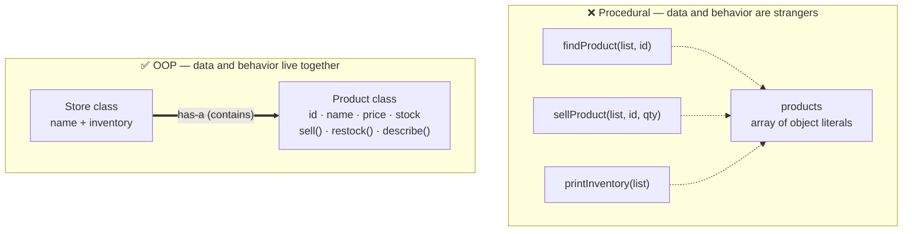
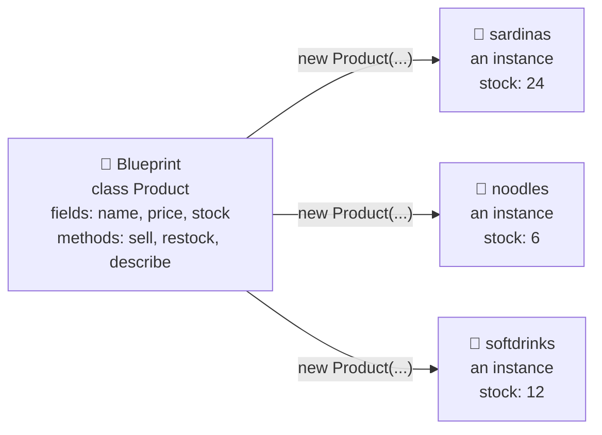
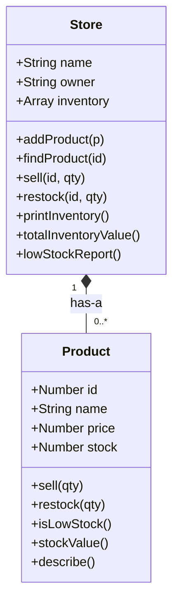

# OOP I — Classes & Objects: Refactoring Aling Nena's Store

**Grade 10 - ICT (Full-Stack Elective)**
**Quarter 5 · Weeks 9–10** (Extension Lane — self-paced, no gate)
**Duration:** 1 week
**Prerequisite:** [`js-arrays-objects`](../js-arrays-objects/lecture.md) (you can build
object literals with methods and use `this` — the Q2 store app)

---

## 🎯 Learning Objectives

By the end of this lecture, you will be able to:

1. ✅ Explain the pain of the procedural style: data and functions separated, validation scattered, duplication for a second store
2. ✅ Write a `class` with a `constructor` and methods; instantiate with `new`
3. ✅ Predict what `this` refers to inside a method called on an instance
4. ✅ Put validation inside the class (`sell()` refuses overdraws; the constructor guards bad stock) so bad state becomes impossible *by construction*
5. ✅ Refactor the procedural store tracker into `Product` + `Store` classes with identical behavior
6. ✅ Recognize the **has-a** (composition) relationship: a `Store` has `Product`s
7. ✅ Decide when a class is overkill (a plain object literal or function is fine) — classes are a modeling tool, not a lifestyle

---

## 📖 Table of Contents

1. [The Problem: A Pile of Functions and Data](#section-1)
2. [The Blueprint Idea: One Class, Many Objects](#section-2)
3. [Your First Class: `Product`](#section-3)
4. [`new` and `this`, Earned](#section-4)
5. [Class #2: `Store` — Composition Begins](#section-5)
6. [The Refactor, Step by Step](#section-6)
7. [Guarding the Data](#section-7)
8. [When to Use Classes (and When Not To)](#section-8)
9. [Mini-Projects](#section-9)
10. [Final Challenge — Aling Nena's Ledger v1](#section-10)
11. [Troubleshooting](#section-11)
12. [What's Next?](#section-12)

---

<a name="section-1"></a>
## 1. The Problem: A Pile of Functions and Data

Back in Quarter 2, you built a store inventory tracker in [`js-arrays-objects`](../js-arrays-objects/lecture.md). It looked like this: an array of object literals, plus a pile of functions that each receive the whole array as a parameter. That style is called **procedural** — the data sits in one place, and the behavior (functions) sits somewhere else.

Here is Aling Nena's sari-sari store tracker, procedural style:

```javascript
// ❌ procedural — data and behavior are strangers
const products = [
  { id: 1, name: "Sardinas 155g", price: 20, stock: 24 },
  { id: 2, name: "Instant Noodles", price: 15, stock: 6 },
  { id: 3, name: "Softdrinks 8oz", price: 18, stock: 12 },
];

function findProduct(list, id) {
  return list.find(p => p.id === id);
}

function sellProduct(list, id, qty) {
  const p = findProduct(list, id);
  if (!p || p.stock < qty) return false;   // validation, check #1
  p.stock -= qty;
  return true;
}

function restockProduct(list, id, qty) {
  const p = findProduct(list, id);
  if (p) p.stock += qty;
}

function printInventory(list) {
  list.forEach(p => console.log(`${p.name} — ₱${p.price} — ${p.stock} left`));
}

function totalInventoryValue(list) {
  return list.reduce((sum, p) => sum + p.price * p.stock, 0);
}
```

It works. You wrote it. It passed the quiz. So what's wrong?

### The Three Pain Points

1. **Every function re-receives the data.** `findProduct(list, ...)`, `sellProduct(list, ...)`, `printInventory(list)` — the array is passed around like a bayong from hand to hand. Nothing connects the functions to the data except the discipline of the programmer.

2. **Nothing protects the data.** This line runs without any error:

   ```javascript
   products[0].stock = -999;   // 💥 negative stock — nobody stopped it
   ```

   The validation inside `sellProduct` only protects stock *if everyone goes through `sellProduct`*. Anyone — including future you at 11 PM — can reach around it and mutate the object directly.

3. **A second store means copying the functions.** Aling Nena opens a second branch. Now you need `sellProductBranch2(...)`? Copy the whole file? The functions are not reusable because they are glued to one `list` variable shape, not to a *thing* that knows how to sell.

**Analogy:** "Procedural style is like a barangay hall where the records office (data) and the processing desk (functions) are in different buildings. Every transaction, someone walks the folder across the street. Sometimes the folder comes back with doodles on it (`stock = -999`) because nobody guards the records room. Object-oriented programming puts the records and the officer who guards them in **one office** — you talk to the officer, never to the filing cabinet."



### Quick Recap: `this` from Q2

You already know the seed of OOP. In [`js-arrays-objects`](../js-arrays-objects/lecture.md) you wrote object literals **with methods**, and `this` meant "this very object":

```javascript
const sardinas = {
  name: "Sardinas 155g", price: 20, stock: 24,
  describe() { return `${this.name} — ₱${this.price}`; }  // this = sardinas
};
```

The problem: every object literal carries its **own copy** of the method, and you build each object by hand, one `const` at a time. If Aling Nena stocks 200 products, are you writing 200 object literals? Classes fix exactly this.

**🎯 Try It:** Open [`assets/procedural-store.html`](assets/procedural-store.html) — the runnable "before" app. Sell some items, try the "Break the data 💥" button (it sets stock to -999 and nothing complains), and watch the inventory log. This is the app we will refactor all lecture.

---

<a name="section-2"></a>
## 2. The Blueprint Idea: One Class, Many Objects

A **class** is a *blueprint* for objects. You write the blueprint once — the fields each object will have, and the methods (behavior) every object shares — then stamp out as many objects as you need. Each object made from the blueprint is called an **instance**.

**Analogy:** "A class is the architectural plan for a house in the subdivision; instances are the actual houses built from it. Every house has the same rooms (fields) and the same wiring (methods), but each family fills the rooms with their own stuff (values). You never say 'the plan has 24 sardines in stock' — a *house* has sardines in its pantry."



One blueprint. Many instances. Methods written once, shared by all — *where* they're shared from is Lecture 3's mystery to solve.

### Class Syntax Anatomy

```javascript
class Product {
  // runs ONCE when a new instance is created
  constructor(id, name, price, stock) {
    this.id = id;          // this = the new object being built
    this.name = name;
    this.price = price;
    this.stock = stock;
  }

  // methods — no "function" keyword needed
  sell(qty) { /* ... */ }
  restock(qty) { /* ... */ }
  describe() { /* ... */ }
}
```

| Piece | What it is | Rule of thumb |
|---|---|---|
| `class Product` | The blueprint's name | Nouns, PascalCase (`Product`, not `productFactory`) |
| `constructor(...)` | Setup code that runs at creation time | Assign the starting fields |
| `this.field = value` | Attaching data to *this* instance | `this` = "the one being built / called" |
| `sell(qty) { }` | A method — behavior shared by all instances | Verbs: `sell`, `restock`, `describe` |

> 📌 **Key insight:** A class is *not* an object. It's a description of objects. No product exists until you write `new Product(...)` — just like no house exists until construction crews follow the plan.

**✅ DO:**
- Name classes as singular nouns in PascalCase: `Product`, `Store`, `Sale`
- Keep the constructor small: validate inputs, assign fields, nothing else

**❌ DON'T:**
- Reach for a class when you only need one object and always will (see Section 8)
- Put computation-heavy work in the constructor — that's what methods are for

---

<a name="section-3"></a>
## 3. Your First Class: `Product`

Here is the full `Product` class we will use for the rest of the set. Read it slowly — every method earns its place.

```javascript
class Product {
  constructor(id, name, price, stock) {
    if (stock < 0) throw new Error(`Stock can't be negative (got ${stock})`);
    if (price <= 0) throw new Error(`Price must be above zero (got ${price})`);
    this.id = id;
    this.name = name;
    this.price = price;
    this.stock = stock;
  }

  // Sell only if there is enough stock. Returns true/false.
  sell(qty) {
    if (qty > this.stock) {
      console.log(`⚠️ Not enough ${this.name}: ${this.stock} left, asked for ${qty}`);
      return false;
    }
    this.stock -= qty;
    return true;
  }

  restock(qty) {
    this.stock += qty;
  }

  isLowStock(threshold = 5) {
    return this.stock <= threshold;
  }

  stockValue() {
    return this.price * this.stock;
  }

  describe() {
    return `₱${this.price} · ${this.name} — ${this.stock} left`;
  }
}
```

Using it:

```javascript
const sardinas = new Product(1, "Sardinas 155g", 20, 24);
const noodles  = new Product(2, "Instant Noodles", 15, 6);

sardinas.sell(2);            // true  → stock is now 22
sardinas.sell(99);           // false → refused, stock stays 22
console.log(sardinas.describe());   // "₱20 · Sardinas 155g — 22 left"
console.log(noodles.isLowStock());  // true (6 ≤ … wait, 6 > 5 → false! check it)
```

Notice what the constructor guards do:

```javascript
const bogus = new Product(9, "Mystery Item", 0, -5);
// 💥 Error: Stock can't be negative (got -5)
```

Bad data now dies **at creation**, not three weeks later when the inventory report looks weird. That's what "impossible by construction" means.

**✅ DO:**
- Make methods return useful values (`sell` returns `true`/`false`) so callers can react
- Validate in the constructor — refuse to build a broken object

**❌ DON'T:**
- Mutate `stock` from outside the class (`sardinas.stock = 999;`) — call a method instead. The class is only as safe as the discipline of its callers *until* Section 7 tightens the screws

**🎯 Try It:** Before running anything, predict the console output of this script on paper. Then open your browser console (or DevTools in any HTML page) and run it. Every line you predicted correctly is a point of understanding; every miss tells you which section to re-read.

```javascript
const coke = new Product(3, "Softdrinks 8oz", 18, 12);
coke.sell(10);
coke.sell(5);
console.log(coke.describe());
console.log(coke.isLowStock());
console.log(coke.stockValue());
```

<details>
<summary>Check your predictions (click to expand)</summary>

```text
⚠️ Not enough Softdrinks 8oz: 2 left, asked for 5   ← second sell fails: 12−10=2 left
₱18 · Softdrinks 8oz — 2 left
true                                                ← 2 ≤ 5, low stock!
36                                                  ← 18 × 2
```
</details>

---

<a name="section-4"></a>
## 4. `new` and `this`, Earned

Two keywords do all the wiring: `new` builds, `this` points.

### What `new Product(...)` actually does

1. Creates a fresh, empty object `{}` behind the scenes
2. Runs the `constructor(...)` with that empty object as `this`
3. Hands you back the finished object

```javascript
const sardinas = new Product(1, "Sardinas 155g", 20, 24);
//              └─ new: build it, run constructor, return it
```

### What `this` means in a method

**`this` = the instance that received the call.** The dot is the whole story:

```javascript
sardinas.sell(2);   // inside sell(), this === sardinas
noodles.sell(2);    // inside sell(), this === noodles  ← same method, different "this"
```

One method definition, `sell(qty)`. It is not born knowing whose stock to decrease — the **receiver** of the call decides. `sardinas.sell(2)` means "hey sardinas, sell 2 of you."

### Q2 vs Now — Same `this`, New Home

| | Q2: object literal (js-arrays-objects) | Now: class |
|---|---|---|
| Method lives | inside each literal — its own copy | in the class — shared by all instances |
| Build a new one | hand-write another literal | `new Product(...)` |
| `this` means | the literal the method was called on | the instance the method was called on — **same rule!** |
| Validation | none — data is naked | constructor + methods guard it |

> 📌 **Key insight:** Classes didn't change what `this` means. You already earned `this` in Q2. Classes change *where methods live* (one shared place instead of per-object copies) and *how objects get built* (a constructor instead of hand-written literals).

**✅ DO:**
- Read method calls right-to-left: "sardinas ← sell 2" — receiver first, message second

**❌ DON'T:**
- Detach a method from its receiver: `const s = sardinas.sell; s(2);` — `this` is lost, the call breaks. Methods want to be called *through* their instance: `sardinas.sell(2)`

---

<a name="section-5"></a>
## 5. Class #2: `Store` — Composition Begins

A single `Product` knows how to sell itself. But a store is more than products: it has a name, an owner, and — crucially — a *collection* of products. Meet composition:

> **A `Store` HAS-A collection of `Product`s.**

"Has-a" is the first big relationship in object-oriented design. The store doesn't *copy* product behavior; it *contains* products and **delegates** work to them.

```javascript
class Store {
  constructor(name, owner) {
    this.name = name;
    this.owner = owner;
    this.inventory = [];          // starts empty — the Store OWNS this array
  }

  addProduct(product) {
    this.inventory.push(product);
  }

  findProduct(id) {
    return this.inventory.find(p => p.id === id);
  }

  sell(id, qty) {
    const p = this.findProduct(id);
    if (!p) return false;
    return p.sell(qty);          // ← DELEGATION: the Store doesn't sell — the Product does
  }

  restock(id, qty) {
    const p = this.findProduct(id);
    if (p) p.restock(qty);
  }

  printInventory() {
    console.log(`— ${this.name} (Tindera: ${this.owner}) —`);
    this.inventory.forEach(p => console.log("  " + p.describe()));
  }

  totalInventoryValue() {
    return this.inventory.reduce((sum, p) => sum + p.stockValue(), 0);
  }

  lowStockReport() {
    return this.inventory
      .filter(p => p.isLowStock())
      .map(p => p.name);
  }
}
```

Using it:

```javascript
const store = new Store("Aling Nena's Sari-Sari Store", "Aling Nena");
store.addProduct(new Product(1, "Sardinas 155g", 20, 24));
store.addProduct(new Product(2, "Instant Noodles", 15, 6));

store.sell(1, 2);                     // true
store.sell(2, 100);                   // false — refused, stock protected
store.printInventory();
console.log(store.totalInventoryValue());
console.log("Low stock:", store.lowStockReport());
```

### The Composition Diagram

This is **class diagram notation** — a box per class, top compartment = name, then fields, then methods. You'll become fluent in it in the next lecture. For now, meet the arrow:



Read the bottom line aloud: "**one** Store has-a **zero or more** Products." The `*--` line with a filled diamond is UML's symbol for composition — you'll learn to draw this yourself in the next lecture.

### Delegation — the move that makes OOP click

Look at `Store.sell()` again:

```javascript
sell(id, qty) {
  const p = this.findProduct(id);
  if (!p) return false;
  return p.sell(qty);      // Store hands the job to the Product
}
```

The Store never touches `p.stock -= qty`. It finds the right product and says "you handle it." Rules about stock live in exactly one place: `Product`. In the procedural version, that rule was pasted into whichever function remembered to check it.

**Analogy:** "The storekeeper (Store) doesn't reach into the shelf and count the sardines herself while the cashier (Product) watches. She says 'vote 2 sardinas sold' and the shelf-in-charge updates itself. One officer per responsibility."

**✅ DO:**
- Model *containment* with composition: a store has products, a class schedule has subjects, a playlist has songs
- Delegate downward: the container coordinates, the contained objects do their own work

**❌ DON'T:**
- Write `store.inventory[0].stock -= 5;` — that's the procedural reach-around again, now with extra steps. Call `store.sell(1, 5)`

**🎯 Try It:** Open [`assets/class-refactor-starter.html`](assets/class-refactor-starter.html). It contains the procedural store from Section 1 plus a skeleton `class Product` with `TODO` comments. Convert the app step by step, then self-check against [`assets/class-refactor-solution.html`](assets/class-refactor-solution.html).

---

<a name="section-6"></a>
## 6. The Refactor, Step by Step

Refactoring means **changing structure without changing behavior**. The console output before and after must match, line for line. Here is the full mapping:

### The Mapping Table

| Procedural (before) | OOP (after) | What happened |
|---|---|---|
| `{ id, name, price, stock }` literal | `Product` `constructor` | The shape is now *guaranteed* by the blueprint |
| `findProduct(list, id)` | `Store.findProduct(id)` | The `list` parameter became `this.inventory` |
| `sellProduct(list, id, qty)` | `Store.sell(id, qty)` → `Product.sell(qty)` | Split in two: store finds, product sells |
| `restockProduct(list, id, qty)` | `Store.restock(id, qty)` → `Product.restock(qty)` | Same delegation split |
| `printInventory(list)` | `Store.printInventory()` | Loop stays; each product `describe()`s itself |
| `totalInventoryValue(list)` | `Store.totalInventoryValue()` | Delegates math to each `Product.stockValue()` |
| *(didn't exist)* | `Product.isLowStock()` + `Store.lowStockReport()` | New capability falls out almost free |

### The Pain Points, Re-Checked

| Section 1 pain point | After the refactor |
|---|---|
| Every function re-receives the data | Methods live *with* the data — no `list` parameter anywhere |
| `products[0].stock = -999` runs silently | `sell()` refuses overdraws; constructor refuses negative stock (and Section 7 tightens further) |
| Second store = copy the functions | `const branch2 = new Store(...)` — one line. The blueprint is reusable |

### Proving Behavior Didn't Change

Run this same script against the procedural app and the class app — the output must be identical:

```javascript
// — the test script —
console.log(store.sell(1, 2));        // true
console.log(store.sell(2, 100));      // false
store.restock(2, 10);
store.printInventory();
console.log(store.totalInventoryValue());
```

```text
true
false
— Aling Nena's Sari-Sari Store (Tindera: Aling Nena) —
  ₱20 · Sardinas 155g — 22 left
  ₱15 · Instant Noodles — 16 left
660
```

> 📌 **Key insight:** Refactoring is not rewriting. You moved responsibilities (find/sell/restock moved into classes) while the *observable behavior* stayed frozen. Professional developers refactor in exactly these small, provable steps — that's why you wrote the test script *before* moving anything.

---

<a name="section-7"></a>
## 7. Guarding the Data

Section 3's rules protect stock *as long as callers behave*. `sardinas.stock = -999` still runs — the field is public. Real OOP cultures solve this with a convention you can adopt today, plus a language feature you should *recognize* (not required to write).

### The Underscore Convention

Mark "handle with care" fields with a leading underscore — a signal that means *"talk to my methods, don't edit me directly"*:

```javascript
class Product {
  constructor(id, name, price, stock) {
    // ...validation from Section 3...
    this._stock = stock;        // underscore = "private by agreement"
    this._price = price;
  }

  get stock() { return this._stock; }          // read: allowed
  get price() { return this._price; }

  sell(qty) {
    if (qty > this._stock) return false;
    this._stock -= qty;
    return true;
  }
  // ...
}
```

Now `sardinas.stock` still *reads* fine (the getter answers), but the only writers are the class's own methods. The convention is a promise among teammates — JavaScript (before private fields) did not enforce it.

> 💡 **Heads-up — real private fields:** Modern JavaScript has truly enforced privacy: `#stock` (hash prefix) can only be touched from inside the class — outside code gets a syntax error, not just a stern look. You will *meet* `#fields` in libraries and MDN. We won't use them in this set: the underscore convention is enough for us, and it keeps the code closer to what you've been writing since Q2.

### Invariants — the word for what you're guarding

An **invariant** is a statement that must *always* be true about an object. Ours: **stock is never negative**. The procedural style leaves invariants to hope; the class style assigns them a home — the constructor validates at birth, the methods validate at every change. One sentence to remember:

> 📌 **Bad state should be hard to build, not caught later.**

---

<a name="section-8"></a>
## 8. When to Use Classes (and When Not To)

Classes are a **modeling tool**, not a lifestyle. Most code you've written in this course — Express routes, DOM handlers, fetch scripts — should stay exactly as it is: plain functions over data. Reach for a class when the shape of the *problem* says so.

### Decision Table

| Situation | Use | Why |
|---|---|---|
| One settings/config object | Object literal | There's only one — a blueprint for one house is a drawing of that house |
| A page needs a click handler | Function | Behavior, no state to model |
| Many things of the same kind, each with data + rules (`Product`s, `Sale`s, `Tricycle`s) | **Class** | Blueprint pays for itself from the second instance |
| Data with an invariant to protect (stock ≥ 0, balance ≥ 0) | **Class** | The class gives the rule a home |
| A group of pure calculations (`formatPeso`, `parseDate`) | Functions | No state — nothing to encapsulate |
| You want to *draw and reason about* a system's structure | **Class model** | Classes + a class diagram (next lecture!) make the whole system visible on one page |

> ⚠️ **Course framing:** This course's own server code is deliberately **plain functions + data** — and that remains a perfectly professional style. We teach OOP because modeling systems as classes is how you *understand* and *communicate* structure: entities, relationships, one diagram of the whole. When you meet `class` in MDN docs or a library, you'll now read it fluently. When your system grows tangled, you now have a second tool. Use judgment, not fashion.

**Analogy:** "A class is a rolling pin. If you bake pandesal every morning, owning one is genius. If you bake once a year, a wine bottle works — buying a rolling pin for one croissant is ceremony, not cooking."

---

<a name="section-9"></a>
## 9. Mini-Projects

Each mini-project builds on the previous. Starter code is in the `assets/` folder.

---

### Mini-Project A — Product Catalog ⭐ Beginner

**Goal:** Build a small catalog page powered by a `Product` class.

**Your job:**
1. Create 5 products with `new Product(...)` — include at least 2 with a *special rule* of your invention (e.g., "buy-2-get-1" — `sell(2)` removes 3 from stock)
2. Render the catalog as a table: name, price, stock, value
3. Add a **low-stock report** button that lists items with `isLowStock()`
4. Prove your rule methods refuse impossible operations (selling 100 must fail cleanly)

**Concepts practiced:** `class`, `constructor` validation, methods, `new`, rendering instance data

---

### Mini-Project B — Refactor Your Own Q2 App ⭐⭐ Intermediate

**Goal:** Take a tracker **you** built in Q2 (store, grades, allowance budget — anything with an array of object literals + functions) and refactor it into classes.

**Your job:**
1. Copy your old app into a fresh HTML file
2. Write the **test script first**: 4–5 console lines capturing its current behavior
3. Identify the nouns (they become classes) and the functions (they become methods)
4. Refactor until the test script's output is byte-for-byte identical to the original
5. Add one capability that's now nearly free (a `lowStockReport()`-style summary for your domain)

**Concepts practiced:** the full refactor arc — mapping table, delegation, proving behavior didn't change

> 💡 Stuck choosing nouns? Nouns in the problem statement are classes waiting to happen: "the **student** has **grades**" → `Student` has-a `Grade[]`.

---

<a name="section-10"></a>
## 10. Final Challenge — Aling Nena's Ledger v1

**Scenario:** Aling Nena wants a working store tracker page — not a demo, a tool she can actually use at the counter.

### Reuses (Spaced Retrieval)

- **Q2 (js-arrays-objects):** object literals, methods, `this` — the style being upgraded
- **Q2 (DOM events):** buttons, forms, rendering arrays into tables
- **This lecture:** `Product` + `Store` classes, delegation, guarded data

### Requirements

1. A page with a product form (name, price, stock) that creates `new Product(...)` and `store.addProduct(...)`-es it — invalid input (negative stock, zero price) must show an error, never build a broken object
2. An inventory table rendered from `store.inventory`, with each row using `describe()` / field values
3. Sell and restock controls per row, wired to `store.sell(id, qty)` / `store.restock(id, qty)` — a refused sale must show a message, not crash
4. A running total using `totalInventoryValue()` and a low-stock alerts panel using `lowStockReport()`
5. **Stretch:** a `greet()` method on `Store` → `"Maligayang pagdating sa {name}! Tindera: {owner}"`

### Pass Criteria

- [ ] Creating a product with negative stock is refused with a visible error
- [ ] Selling more than available stock is refused, and the table still shows correct numbers after
- [ ] Selling/restocking updates the table, the total, and the low-stock panel without page reload
- [ ] The words `function sellProduct`, `function restockProduct`, and `function printInventory` appear **nowhere** in your file — that behavior lives in classes now
- [ ] (Stretch) The greeting appears when the page loads

> 💡 This challenge is designed to take ~45–60 minutes. Every piece of it has been built once already in this lecture's examples and Try Its — the work is composition, not invention.

---

<a name="section-11"></a>
## 11. Troubleshooting

| Problem | Probable Cause | Fix |
|---|---|---|
| `TypeError: Product is not a constructor` | Class used before it's defined, or a typo (`product` vs `Product`) | Classes must be declared before the first `new`. Check capitalization — class names are PascalCase |
| `TypeError: Cannot read properties of undefined (reading 'stock')` | `findProduct(id)` returned `undefined` (no match) and you called a method on it | Guard the lookup: `const p = store.findProduct(id); if (!p) return false;` |
| `this` is `undefined` inside a method | Method got detached from its instance: `const s = sardinas.sell; s(2)` | Call methods through the instance: `sardinas.sell(2)`. If passing to a listener: `() => sardinas.sell(2)` |
| `Uncaught Error: Stock can't be negative` | The constructor guard fired — you passed bad data | That's the guard *working*. Fix the data at the source (the form), don't delete the guard |
| Nothing happens when I click sell | Method called as a property: `store.sell` without `(qty)` | Methods need call parentheses and arguments: `store.sell(1, 2)` |
| Two instances seem to share data | Assigning a shared array/object in the constructor body wrongly (e.g., `this.inventory = sharedArray`) | Each instance should get a **fresh** container: `this.inventory = []` inside the constructor |
| My table shows the old values after selling | You re-rendered from a stale copy, or mutated a copy of the array | Render from `store.inventory` itself, after each operation — one source of truth |

---

<a name="section-12"></a>
## 12. What's Next?

✅ **You can now:**
- Explain why the procedural style scatters validation and duplicates functions
- Write a class with a guarded constructor and methods, and create instances with `new`
- Predict what `this` is inside any method call (the receiver!)
- Refactor a procedural app into classes with provably identical behavior
- Recognize and draw a first **has-a** (composition) relationship

### The Big Idea

> Classes give data a **guardian**. Instead of a pile of functions passing a pile of data around, each *thing* in your system — a product, a store, a sale — owns its own fields, enforces its own rules, and answers messages through its methods. Structure stops being invisible and starts being **drawable**. That drawing is the next lecture.

### Forward Links

- [`oop-inheritance-diagrams`](../oop-inheritance-diagrams/lecture.md) — OOP II: grow the store with inheritance (`extends`, `super`, overriding) and learn to **draw the UML class diagram** of the whole system — then use the diagram to reason about changes before writing code

---

**📝 Quick Reference Card**

```javascript
class Product {                       // blueprint (PascalCase, singular noun)
  constructor(id, name, price, stock) {  // runs once per new Product(...)
    if (stock < 0) throw new Error("..."); // guard: refuse broken objects
    this.id = id;                     // this = the instance being built
    this._stock = stock;              // underscore = "edit via methods only"
  }
  sell(qty) {                         // method = shared behavior
    if (qty > this._stock) return false;
    this._stock -= qty;
    return true;
  }
}

const p = new Product(1, "Sardinas", 20, 24);  // 1 build 2 construct 3 return
p.sell(2);                                      // this === p (the receiver)
```

| Concept | One-liner |
|---|---|
| `class` | A blueprint for objects — fields + methods, written once |
| Instance | One object built from the blueprint via `new` |
| `constructor(...)` | Setup that runs at creation; validate here |
| `this` | The instance that received the method call |
| **has-a** (composition) | One class contains instances of another (`Store` has `Product[]`) |
| Delegation | Container finds the object, object does its own work |
| Invariant | A rule that must always hold (stock ≥ 0) — guard it in the class |
| When *not* to | One object, no rules to protect, pure functions → literal/functions are fine |

*Created for Grade 10 Filipino Students — Filipino examples, world-class skills.* 🇵🇭
