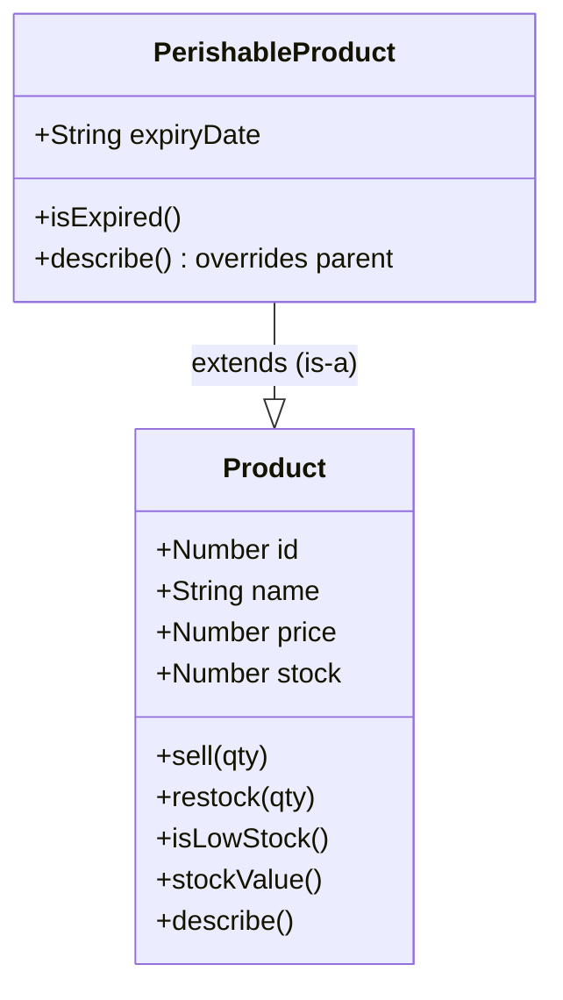
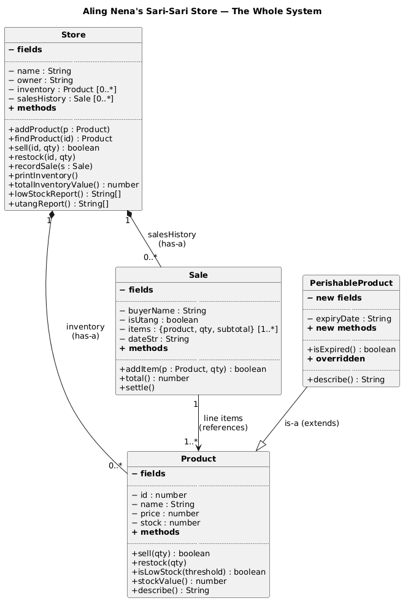
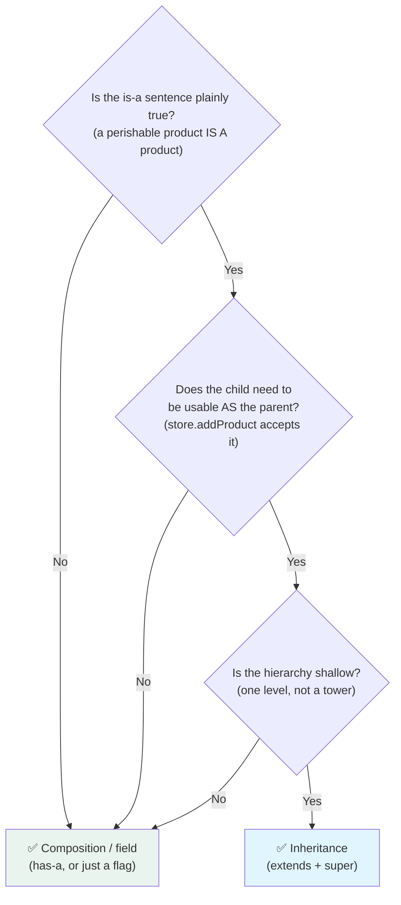
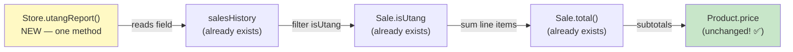

# OOP II — Inheritance vs Composition & UML Class Diagrams: Growing the Store

**Grade 10 - ICT (Full-Stack Elective)**
**Quarter 6 · Weeks 1–2** (Extension Lane — self-paced, no gate)
**Duration:** 1 week
**Prerequisite:** [`oop-classes`](../oop-classes/lecture.md) (you built `Product` + `Store`
classes and know the has-a relationship)

---

## 🎯 Learning Objectives

By the end of this lecture, you will be able to:

1. ✅ Explain the copy-paste trap that motivates inheritance (bread and eggs expire — canned goods don't)
2. ✅ Extend a class with `extends`, call the parent with `super(...)`, and **override** a method (calling `super.describe()` inside the override)
3. ✅ Read and draw a UML class diagram: 3-compartment boxes, `−`/`+` visibility, hollow-triangle inheritance, filled-diamond composition, multiplicities
4. ✅ Distinguish **is-a** (inheritance) from **has-a** (composition) and choose deliberately — with a bias toward composition
5. ✅ Model a whole small system (4 classes) and draw its UML diagram from scratch
6. ✅ Use a class diagram to reason about change: trace where a new feature ripples, *before* writing code
7. ✅ Keep inheritance shallow — recognize when a subclass is really just a flag/field instead

---

## 📖 Table of Contents

1. [The Problem: Copy-Pasting `Product`](#section-1)
2. [Inheritance: is-a](#section-2)
3. [Overriding — Same Message, Better Answer](#section-3)
4. [UML Class Diagrams: Drawing Your System](#section-4)
5. [Composition: has-a — the `Sale` Class](#section-5)
6. [Reading Relationships Like a Map](#section-6)
7. [Inheritance vs Composition: Choosing](#section-7)
8. [Use the Diagram to Reason](#section-8)
9. [Mini-Projects](#section-9)
10. [Final Challenge — The Store, Diagrammed](#section-10)
11. [Troubleshooting](#section-11)
12. [What's Next?](#section-12)

---

<a name="section-1"></a>
## 1. The Problem: Copy-Pasting `Product`

Aling Nena's store is growing. Fresh bread from the bakery, eggs from the farm — these products **expire**. Canned sardinas don't. The inventory list must now answer a new question: *is this item still safe to sell?*

Your `Product` class from [`oop-classes`](../oop-classes/lecture.md) has no `expiryDate`. Two tempting "fixes" appear — and both are traps.

### Naive Fix #1: Add the field to everyone

```javascript
class Product {
  constructor(id, name, price, stock, expiryDate) {
    // ...
    this.expiryDate = expiryDate;   // ❌ now EVERY product carries this
  }
}
```

Now the sardinas has an `expiryDate` of… what, `null`? Forever? Every `new Product(...)` call across the whole app needs a fifth argument. The 200 canned goods carry a meaningless field. The class is lying: it *says* products expire, but most don't.

### Naive Fix #2: Duplicate the class

```javascript
class PerishableProductCopy {          // ❌ copy-paste inheritance, by hand
  constructor(id, name, price, stock, expiryDate) { /* ...same 4 fields... */ }
  sell(qty) { /* ...exact copy of Product's sell... */ }
  restock(qty) { /* ...exact copy... */ }
  isExpired() { /* ...new! the only real addition... */ }
}
```

It works — today. Next week you fix a bug in `Product.sell()` (say, allowing qty 0). The copy still has the bug. The copies **drift apart**, and every fix must be made twice, thrice, forever. This is the copy-paste trap, and it's the exact pain inheritance was invented to remove.

**Analogy:** "Fix #2 is photocopying the barangay clearance form because one applicant needs an extra field — now there are two forms, and when the barangay updates its logo, one form is suddenly wrong. The real solution was a *special* form that starts as the standard one and adds one box."

---

<a name="section-2"></a>
## 2. Inheritance: is-a

**Inheritance** lets one class be built *on top of* another. The child (`PerishableProduct`) automatically receives every field and method of the parent (`Product`), then adds or changes what makes it special.

```javascript
class PerishableProduct extends Product {
  constructor(id, name, price, stock, expiryDate) {
    super(id, name, price, stock);     // ← build the Product part FIRST
    this.expiryDate = expiryDate;      // then add the new part
  }

  isExpired() {
    return new Date(this.expiryDate) < new Date();
  }
}
```

Two new keywords, one rule each:

| Keyword | What it does | The rule |
|---|---|---|
| `extends Product` | Declares the is-a relationship: a perishable product **is a** product | Everything true of `Product` is now true of `PerishableProduct` — `sell()`, `restock()`, `stockValue()`, all of it, for free |
| `super(id, name, price, stock)` | Calls the **parent's constructor** to set up the inherited fields | Must be the **first line** of the child constructor, before touching `this` |

Using it — and the payoff line:

```javascript
const bread = new PerishableProduct(4, "Tasty Bread", 35, 10, "2026-08-20");

bread.sell(2);                    // ✅ inherited — you did not write this
bread.restock(5);                 // ✅ inherited
console.log(bread.isExpired());   // ✅ new behavior
console.log(bread.stockValue());  // ✅ inherited, works on the child

store.addProduct(bread);          // 🎯 THE PAYOFF: Store takes it happily!
```

That last line is why is-a matters. `store.addProduct(p)` pushes into `inventory: Product[]` — and a `PerishableProduct` *is a* `Product`, so it belongs in that array. `Store.sell()`, `printInventory()`, `totalInventoryValue()` — all your existing Store code works with the new kind **without changing one character**.

**✅ DO:**
- Say the sentence out loud before writing `extends`: "a perishable product **is a** product" ✅ — if the sentence sounds false, don't inherit (Section 7)
- Call `super(...)` first in the child constructor

**❌ DON'T:**
- Inherit just to *reuse* one method when no is-a holds — that's what composition (Section 5) or plain functions are for
- Forget `super(...)` — JavaScript refuses to let you touch `this` before the parent is built (see Troubleshooting)

**🎯 Try It:** Open [`assets/inheritance-starter.html`](assets/inheritance-starter.html) — the L1 store plus a `PerishableProduct` skeleton with TODOs. Fill in `super(...)`, `isExpired()`, and the `describe()` override, then check yourself against [`assets/inheritance-solution.html`](assets/inheritance-solution.html).

---

<a name="section-3"></a>
## 3. Overriding — Same Message, Better Answer

The child inherits `describe()` from `Product`:

```text
₱35 · Tasty Bread — 10 left
```

True… but incomplete. For a perishable, the expiry is the most important fact. **Overriding** means the child provides its own version of an inherited method — same name, same job, better answer for this kind of object.

```javascript
class PerishableProduct extends Product {
  // constructor + isExpired() from Section 2 ...

  describe() {                                    // ← OVERRIDE
    const badge = this.isExpired()
      ? " ⚠️ EXPIRED — pull from shelf!"
      : ` (expiry: ${this.expiryDate})`;
    return super.describe() + badge;              // ← call the parent's version
  }
}
```

```javascript
const bread = new PerishableProduct(4, "Tasty Bread", 35, 10, "2026-08-20");
console.log(bread.describe());
// "₱35 · Tasty Bread — 10 left (expiry: 2026-08-20)"
```

Read `return super.describe() + badge` carefully — it's the pattern that makes overriding safe:

1. `super.describe()` runs the **parent's** logic (`₱${price} · ${name} — ${stock} left`) — you don't copy it, you *call* it
2. Your override adds only what's new (the badge)
3. If `Product.describe()` ever changes format, the child automatically follows — **no drift**

### Which `describe()` runs? The receiver decides.

```javascript
const sardinas = new Product(1, "Sardinas 155g", 20, 24);
const bread    = new PerishableProduct(4, "Tasty Bread", 35, 10, "2026-08-20");

sardinas.describe();   // Product's version      — no expiry to show
bread.describe();      // PerishableProduct's    — override wins
store.printInventory(); // prints each item with ITS OWN describe() — mixed, correctly
```

One message (`describe()`), different answers per kind of object. That's **polymorphism** — the word to impress your classmates with — and it's why `printInventory()` never needed an `if (perishable)` branch.



The `--|>` arrow with the **hollow triangle** is UML's inheritance arrow — triangle points at the parent. You'll draw this properly in Section 4.

**✅ DO:**
- Start overrides with `super.methodName(...)` and add your part — reuse, don't repeat
- Keep the override's *contract*: same job, same return type (a string that describes the product)

**❌ DON'T:**
- Override a method you don't understand — read the parent's code first, or your "improvement" will break its promises

---

<a name="section-4"></a>
## 4. UML Class Diagrams: Drawing Your System

You now have four classes: `Product`, `PerishableProduct`, `Store` — and `Sale` arrives in Section 5. Six classes from now, nobody will hold this system in their head. This is where **UML class diagrams** earn their keep: one page, whole system, every class and relationship visible. It's the same "see the structure" move as the ER diagrams you drew in [`data-modeling`](../data-modeling/lecture.md) — but for code instead of databases.

### The Notation, Piece by Piece

A class is a box with three compartments:

```text
┌────────────────────────────┐
│      PerishableProduct     │  ← name (bold, PascalCase)
├────────────────────────────┤
│ − expiryDate : String      │  ← fields (− private, + public)
├────────────────────────────┤
│ + isExpired() : boolean    │  ← methods
│ + describe() : String «O»  │     «O» = overrides parent
└────────────────────────────┘
```

The two relationships you know, drawn:

```text
  PerishableProduct                              Store "1"
        │                                          ◆
        ▽ (hollow triangle)                        │ 0..*
        │                                       Product
      Product                          (filled diamond on the WHOLE)
   INHERITANCE: is-a                    COMPOSITION: has-a
```

| Symbol | Name | Means | Read aloud |
|---|---|---|---|
| `--▷` hollow triangle | Inheritance / generalization | is-a | "a perishable product **is a** product" |
| `◆--` filled diamond | Composition | has-a, whole-part, the part lives inside the whole | "a store **has** zero or more products" |
| `1`, `0..*`, `1..*` | Multiplicities | How many on each end | "**one** store, **zero or more** products" |
| `−` / `+` | Visibility | private (guarded) / public | "stock is `−` — reach it through methods" |
| `-->` plain arrow | Association | uses / references | "a sale **references** products" (Section 5) |

> 💡 **Diamond goes on the whole.** The filled diamond sits on the `Store` end, not the `Product` end — the diamond marks the *owner*. If your diamond is on the wrong side, readers will think products own stores, which is how horror movies start.

### The Centerpiece — Aling Nena's Whole System

Here is the full domain you have built across two lectures — `Sale` included (next section). This is the diagram to keep:



Read every edge aloud with a classmate — this *is* the system, in one picture:

- `PerishableProduct --▷ Product` — *a perishable product **is a** product*
- `Store "1" ◆-- "0..*" Product` — *one store **has** zero-or-more products*
- `Store "1" ◆-- "0..*" Sale` — *one store **has** zero-or-more sales*
- `Sale "1" --> "1..*" Product` — *one sale **references** one-or-more products*

> 📌 **Key insight:** The diagram is not decoration after the code — it's a **thinking tool before and during** the code. Section 8 uses exactly this picture to predict where changes ripple. When you refactor your own projects into classes, draw this diagram first and the structure of your system becomes inspectable at a glance.

---

<a name="section-5"></a>
## 5. Composition: has-a — the `Sale` Class

Time for the fourth class. At the counter, Aling Nena's real superpower isn't inventory — it's the **listahan ng utang**: the little notebook of credit. A sale can be paid now, or *utang* (paid later). Here's the shape of a sale: it has a buyer, maybe-credit, and a list of items bought.

Nouns first: a `Sale` is its own thing — its own fields, its own rules. And it doesn't inherit from `Product` (a sale is *not* a product!). It **references** products and **has** line items. Composition again:

```javascript
class Sale {
  constructor(buyerName, isUtang = false) {
    this.buyerName = buyerName;
    this.isUtang = isUtang;         // true → goes in the listahan
    this.items = [];                // plain data: { product, qty, subtotal }
    this.dateStr = new Date().toISOString().slice(0, 10);
  }

  addItem(product, qty) {
    if (!product.sell(qty)) return false;      // ← DELEGATION: stock rules live in Product
    this.items.push({ product, qty, subtotal: product.price * qty });
    return true;
  }

  total() {
    return this.items.reduce((sum, li) => sum + li.subtotal, 0);
  }

  settle() {
    this.isUtang = false;           // 💵 utang paid — rule lives where the field lives
  }
}
```

And `Store` grows two members — note how small the change is:

```javascript
// inside class Store ...
  this.salesHistory = [];                    // constructor: starts empty

  recordSale(sale) {
    this.salesHistory.push(sale);
  }

  utangReport() {                            // the listahan, as a report
    return this.salesHistory
      .filter(s => s.isUtang)
      .map(s => `${s.buyerName} — ₱${s.total()} (${s.dateStr})`);
  }
```

A day at the counter:

```javascript
const store = new Store("Aling Nena's Sari-Sari Store", "Aling Nena");
store.addProduct(new Product(1, "Sardinas 155g", 20, 24));
store.addProduct(new PerishableProduct(4, "Tasty Bread", 35, 10, "2026-08-20"));

const sale = new Sale("Mang Tomas", true);    // utang!
sale.addItem(store.findProduct(1), 3);        // ₱60 — stock drops 24 → 21
sale.addItem(store.findProduct(4), 1);        // ₱35 — bread: 10 → 9
store.recordSale(sale);

console.log(sale.total());                    // 95
console.log(store.utangReport());             // ["Mang Tomas — ₱95 (2026-08-16)"]
sale.settle();
console.log(store.utangReport());             // [] — paid, off the list
```

Watch the delegation chain: `sale.addItem(...)` → `product.sell(qty)` → the *only* code in the universe allowed to touch stock. Three classes cooperated, nobody reached around anybody.

> 💡 **Why line items are plain `{product, qty, subtotal}` objects and not a `SaleItem` class:** each class must earn its keep. A line item has no rules of its own — nothing to guard, no behavior anyone calls. Plain data is *correct* here. (When would it earn classhood? If rules appear — say, per-item discounts — that's the moment. The worksheet asks you to argue it.)

**✅ DO:**
- Model transactions (`Sale`, `Loan`, `Reservation`, `ServiceRequest`) as their own class that **references** the things involved
- Let `addItem` delegate the stock check to the product — one rule, one home

**❌ DON'T:**
- `class Sale extends Product` — a sale is not a product; say the sentence and hear how false it sounds
- Duplicate price math in the sale: `subtotal` uses `product.price` once, at add time

---

<a name="section-6"></a>
## 6. Reading Relationships Like a Map

Three relationships now exist in the domain. Here is the full decoder, with examples you could meet anywhere in the Philippines:

| Relationship | Notation | Meaning | Barangay-flavored examples |
|---|---|---|---|
| **Inheritance (is-a)** | `--▷` hollow triangle | The child is a *kind of* the parent — inherits everything, adds/changes behavior | `SeniorResident --▷ Resident` · `PerishableProduct --▷ Product` · `EmergencyVehicle --▷ Vehicle` |
| **Composition (has-a)** | `◆--` filled diamond | The whole *contains and owns* the parts — parts live and die with it | `Barangay ◆-- Resident[]` · `Store ◆-- Product[]` · `ClassSchedule ◆-- Subject[]` |
| **Association (references)** | `-->` plain arrow | One object *uses/knows about* another — no ownership, just a connection | `ServiceRequest --> Resident` (made-by) · `Sale --> Product[]` (line items) |

The **test question** for each, in order:

1. **Is it a kind of it?** (senior resident… is a resident ✅) → inheritance
2. **Does it live inside it, owned by it?** (residents… belong to the barangay ✅) → composition
3. **Does it just need to point at it?** (a request needs to name *who* asked ✅) → association

**Analogy:** "In your barangay: you **are a** resident (inheritance — you get all resident rights). Your household **has** members (composition — the roster owns the list). A complaint letter **references** the purok leader (association — points at, doesn't contain)."

---

<a name="section-7"></a>
## 7. Inheritance vs Composition: Choosing

You now have both tools. Which to reach for? The working rule used by most professional teams:

> 📌 **"Has-a wins when unsure."** Composition is flexible; inheritance is rigid. Inherit only when the is-a sentence is *plainly true*.

### Why the bias? The fragile parent.

Inheritance is a **tight coupling** — the child is welded to the parent's insides. Change `Product.describe()`'s format, and every child's override output shifts (that time it helped us, Section 3!). But change something subtler — say `sell()` starts rounding stock differently — and a child somewhere may break in ways its author never imagined. The parent becomes **fragile**: seemingly safe edits shatter unknown descendants. One level of `extends` with a true is-a? Fine. Towers of subclasses? A trap you can't get out of later.

### The subclass-that-should've-been-a-field smell

Watch how quickly "just add a subclass" spirals. Aling Nena offers a senior discount:

```javascript
class SeniorSale extends Sale { ... }      // ❌ what about senior + utang?
class UtangSale extends Sale { ... }       // ❌ senior + utang + delivery…?
class SeniorUtangSale extends UtangSale { ... }  // 💥 combination explosion
```

Discount and credit are *variations along two independent axes* — subclasses can only stack one axis. The right model:

```javascript
class Sale {
  constructor(buyerName, isUtang = false, isSenior = false) {
    // ...
    this.isSenior = isSenior;             // ✅ a FIELD, not a subclass
  }
  total() {
    const gross = this.items.reduce((s, li) => s + li.subtotal, 0);
    return this.isSenior ? gross * 0.95 : gross;   // 5% — one line
  }
}
```

**Rule of thumb:** *a kind of thing* → subclass. *a way a thing can be* → field.

### The Decision Flowchart



**✅ DO:**
- Default to composition/fields; let is-a prove itself through the flowchart
- Keep inheritance one level deep in this course — deeper hierarchies need experience you're currently building

**❌ DON'T:**
- Build `X extends Y extends Z` towers — each level multiplies the ways change can break things
- Use inheritance to share one helper method between unrelated classes (that's not is-a — make a function or a shared module)

---

<a name="section-8"></a>
## 8. Use the Diagram to Reason

Everything so far used the diagram to *describe*. Now the payoff — the reason professionals draw these at all: **predicting change before touching code.**

### Trace #1: "Aling Nena wants an utang report."

Scroll back to the centerpiece diagram. Don't read code — trace **arrows**. A new method `utangReport()` on `Store` needs… what data can `Store` even reach?



The trace *proves* the feature is cheap: one new method on `Store`, everything else already exists. **`Product` is untouched** — and since every child of `Product` (perishables…) works through it, they're untouched too. That's the diagram telling you the blast radius *before* you open the editor.

### Trace #2: "Add a 5% senior discount — where does it ripple?"

Trace the `Sale.total()` path: discount is computed at total time from a field (Section 7's fix). Ripples: `Sale` constructor (+1 field), `Sale.total()` (+1 line). `Store`, `Product`, `PerishableProduct`: **zero changes**. Compare with the subclass spiral (`SeniorUtangSale...`) — the diagram shows a tower of boxes that must each be maintained; the field shows one box with one new line. On paper, before code.

### Do this with YOUR systems

This is the habit this whole lecture set exists to build:

1. **Model**: pick the nouns, give each its fields and rules → classes
2. **Draw**: one box per class, one arrow per relationship, multiplicities on the ends
3. **Reason**: for each new feature, trace the arrows — which boxes change? which provably don't?
4. *Then* write code

**🎯 Try It:** Open [`assets/uml-worksheet.html`](assets/uml-worksheet.html) — a mutated domain (Aling Nena adds **deliveries**: a driver picks up a `Sale` and bikes it home for a fee). Your job: complete the UML — fill the class boxes, draw the edges, set the multiplicities, and defend each edge choice. Then run Trace #2-style reasoning on it: "add 'cod delivery fee waived for seniors' — what changes?"

---

<a name="section-9"></a>
## 9. Mini-Projects

Each mini-project builds on the previous. Starter patterns come from this lecture's assets and your Lecture 1 store.

---

### Mini-Project A — Weighed Goods ⭐ Beginner

**Goal:** The store now sells sugar and rice by the ½ kilo. Model them right.

**Your job:**
1. Write `LooseProduct extends Product` — price is *per kilo*, stock is in *kilos* (decimals allowed)
2. Override `describe()` to append `(per kilo)` — calling `super.describe()` first, of course
3. Add `sellByKilo(kilos)` with a rule: minimum purchase 0.25 kg, and refuse overdraws
4. Prove a `LooseProduct` can be `store.addProduct(...)`-ed alongside everything else

**Concepts practiced:** `extends`, `super(...)`, overriding, is-a substitutability

---

### Mini-Project B — Model Barangay Services ⭐⭐ Intermediate

**Goal:** Leave the store. From this feature list, design a barangay services domain and draw its UML:

> *"Residents request clearances and certificates. Seniors get priority numbers. Each request is made by one resident, has a type and status, and can be marked claimed only from ready."*

**Your job:**
1. Pick the classes (`Resident`, `SeniorResident`, `ServiceRequest`, …) — justify each
2. Decide each edge: is-a, has-a, or references — **defend every arrow** using the Section 6 test questions
3. Draw the full UML on paper or the worksheet layout: boxes, compartments, `−/+`, triangles, diamonds, multiplicities
4. Implement `SeniorResident` and `ServiceRequest.markClaimed()` (invariant: only from `ready`)

**Concepts practiced:** domain modeling from a brief, the three relationships, invariant guarding, UML authorship

> 💡 You designed pieces of this on the Lecture 1 worksheet — now it's inheritance-aware. `SeniorResident --▷ Resident` is the honest is-a here; priority is *behavior*, not a subclass of `ServiceRequest`.

---

<a name="section-10"></a>
## 10. Final Challenge — The Store, Diagrammed

**Scenario:** Grow your Lecture 1 store into the full four-class domain — then prove you understand it by drawing and defending its picture.

### Reuses (Spaced Retrieval)

- **OOP I**: `Product` + `Store` classes, delegation, guarded data
- **This lecture**: `extends`/`super`, overriding, `Sale`, the three relationships, UML notation
- **Q3 data-modeling**: thinking in entities + relationships (same discipline, new diagram type)

### Requirements

1. Implement `PerishableProduct` (with `isExpired()` and the `describe()` override) and `Sale` (with `addItem` delegating to `product.sell`, `total()`, `settle()`)
2. Extend `Store` with `salesHistory`, `recordSale()`, and a working `utangReport()`
3. A working page: make a sale (paid or utang), see stock drop live, see the utang report update, settle an utang and watch it leave the list
4. **Draw the UML diagram of your final system** — all classes you actually wrote, correct notation, multiplicities on every association end
5. **Defend each edge**: for every arrow, one sentence — "this is inheritance because…", "composition because…"
6. **Stretch:** expired items are refused at `sale.addItem()` — where did that rule *live*, and why there?

### Pass Criteria

- [ ] A `PerishableProduct` instance enters `store.inventory` with zero changes to `Store`
- [ ] Selling through `sale.addItem()` drops stock correctly and refuses overdraws — no direct stock mutation anywhere
- [ ] `utangReport()` lists unsettled sales; `settle()` removes them
- [ ] Your UML matches your code: every class on paper exists in code, every code relationship is on paper — and each edge is labeled with its defense sentence
- [ ] (Stretch) The refusal rule is in `PerishableProduct`/`Sale.addItem` — say which, and why that class owns it

> 💡 ~60–90 minutes. The build reuses two lectures of parts; the new skills being tested are #4 and #5 — the drawing and the defense.

---

<a name="section-11"></a>
## 11. Troubleshooting

| Problem | Probable Cause | Fix |
|---|---|---|
| `ReferenceError: Must call super constructor before accessing 'this'` | Child constructor assigns `this.expiryDate` before calling `super(...)` | Make `super(...)` the first line; add child-only fields after |
| `TypeError: super is not a constructor` / crash on `super(...)` | Parent class name typo'd in `extends`, or parent defined *after* the child | Classes must exist before `extends` runs; check spelling and order |
| Child "inherits nothing" — `bread.sell is not a function` | Forgot `extends Product` in the class declaration | The is-a link is created by `extends`, not by naming or file proximity |
| Override never runs — parent's `describe()` prints instead | Method name mismatch (`describ`, `toDescribe`), or you call `super.describe()` but return nothing | Names must match exactly; your override must `return` the combined string |
| `isExpired()` is always true/false | Comparing strings (`"2026-08-20" < now` mixes types) | Wrap both sides in `new Date(...)`, or compare `dateStr` slices consistently |
| `store.utangReport()` returns empty though sales exist | Sales never `recordSale(...)`-ed, or `settle()` called too early | The report filters `salesHistory` — check the sale actually entered the list, and `isUtang` is still true |
| Your diagram and code disagree | Diagram drawn once, then code drifted | Redraw after refactors — a stale diagram is worse than none; make it part of the Definition of Done |
| Multiplicity confusion (`0..*` on the wrong end) | Multiplicities sit at the *far* end of the line from the class reading them | "Store 1 ◆-- 0..* Product" reads: ONE store has ZERO-OR-MORE products — numbers describe the other side |

---

<a name="section-12"></a>
## 12. What's Next?

✅ **You can now:**
- Extend classes with `extends`, build the parent part with `super(...)`, and override methods that call `super` first
- Draw and read a UML class diagram — boxes, `−/+`, hollow triangles, filled diamonds, multiplicities
- Choose between is-a, has-a, and references deliberately — with "has-a wins when unsure"
- Use the diagram to reason about change: trace arrows, predict the blast radius, *then* code

### The Big Idea

> One page of boxes and arrows can hold a whole system. Classes make structure **buildable**; the diagram makes it **visible** — and visible structure can be argued about, defended, and changed with confidence. When your own projects grow tangled, this is the lens that untangles them: nouns → classes, sentences → edges, traces → impact.

### Forward Links

- [`oop-prototypes`](../oop-prototypes/lecture.md) — OOP III: open the hood. Where do methods *actually live* when you write `class`? (Spoiler: the instances are sharing something.) `Object.create`, the prototype chain, and why `class` is just prototypes wearing a nice shirt

---

**📝 Quick Reference Card**

```javascript
class PerishableProduct extends Product {
  constructor(id, name, price, stock, expiryDate) {
    super(id, name, price, stock);     // 1st line — build the parent part
    this.expiryDate = expiryDate;      // then the child's own fields
  }
  isExpired() { return new Date(this.expiryDate) < new Date(); }
  describe() {                          // override — same job, better answer
    return super.describe() + (this.isExpired() ? " ⚠️ EXPIRED" : ` (expiry: ${this.expiryDate})`);
  }
}
```

| Symbol / keyword | Meaning |
|---|---|
| `extends` | is-a — child inherits all fields + methods of parent |
| `super(...)` | Call the parent constructor (first line!) |
| `super.method()` | Call the parent's version inside an override |
| Override | Child redefines an inherited method — receiver decides which runs |
| `--▷` hollow triangle | UML inheritance (is-a); triangle points at parent |
| `◆--` filled diamond | UML composition (has-a); diamond sits on the *whole* |
| `1`, `0..*`, `1..*` | Multiplicities — how many at each end |
| `-->` plain arrow | Association — uses/references |
| "Has-a wins when unsure" | Composition is flexible; inherit only for plainly-true is-a |
| Subclass vs field | *A kind of thing* → subclass; *a way a thing can be* → field |

*Created for Grade 10 Filipino Students — Filipino examples, world-class skills.* 🇵🇭
