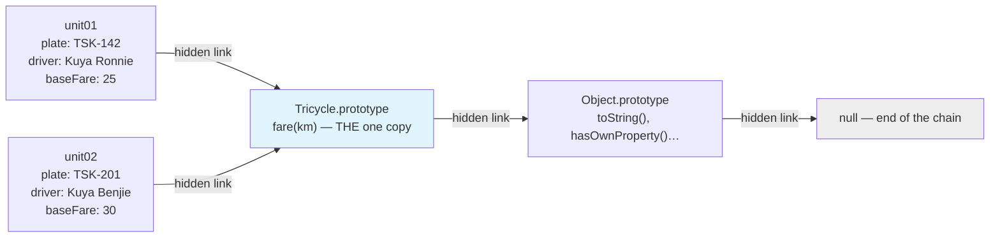
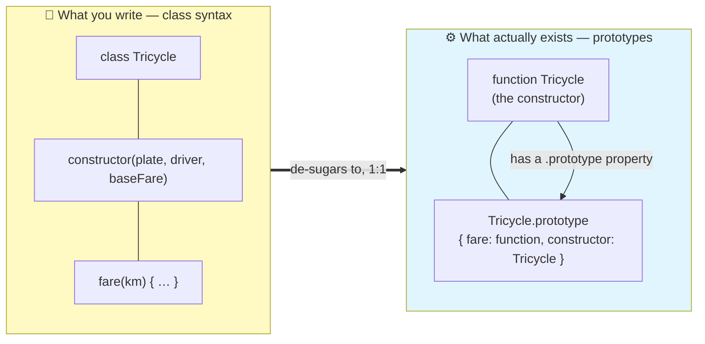
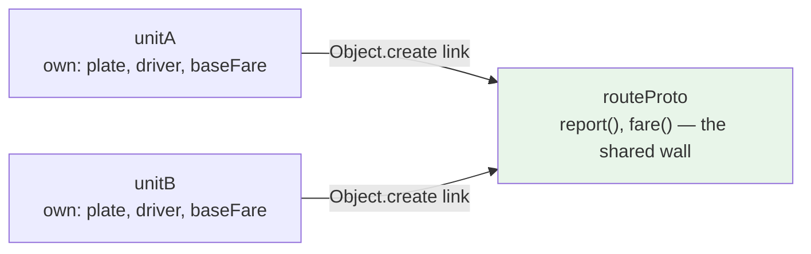

# OOP III — Prototypes Under the Hood: What `class` Really Does

**Grade 10 - ICT (Full-Stack Elective)**
**Quarter 6 · Weeks 3–4** (Extension Lane — self-paced, no gate)
**Duration:** 1 week
**Prerequisite:** [`oop-inheritance-diagrams`](../oop-inheritance-diagrams/lecture.md)
(you can write classes with `extends` and `super` — now see what they compile down to)

---

## 🎯 Learning Objectives

By the end of this lecture, you will be able to:

1. ✅ Demonstrate where class methods really live: on a shared **prototype**, not copied into each instance (`Object.getPrototypeOf(unit01) === Tricycle.prototype` → `true`)
2. ✅ Walk an object's prototype chain in the console (`instance → Class.prototype → Object.prototype → null`)
3. ✅ Rewrite a class as a pre-2015 constructor function + `prototype` assignments with identical behavior (the de-sugar)
4. ✅ Explain the four steps `new` performs with a constructor function
5. ✅ Link objects directly with `Object.create()` — behavior sharing without any `class`
6. ✅ Read MDN and library docs that mention `prototype`, `__proto__`, or `Object.create` without panic — and know `__proto__` is legacy (look, don't write)

> **Design covenant for this lecture:** every single concept lands on a **console-demonstrable snippet**. If a claim can't be shown with a `console.log`, we cut it. Open DevTools now — this lecture is a lab, not a reading.

---

## 📖 Table of Contents

1. [The Mystery: Where Do Methods Live?](#section-1)
2. [Every Object Has a Hidden Link](#section-2)
3. [Classes Before 2015: Constructor Functions](#section-3)
4. [What `new` Actually Does](#section-4)
5. [`class` Is Sugar](#section-5)
6. [`Object.create`: Objects Without Classes](#section-6)
7. [The Full Chain](#section-7)
8. [When Does This Matter?](#section-8)
9. [Mini-Projects](#section-9)
10. [Final Challenge — De-sugar the Store](#section-10)
11. [Troubleshooting](#section-11)
12. [What's Next?](#section-12)

---

<a name="section-1"></a>
## 1. The Mystery: Where Do Methods Live?

New domain, deliberately: a **tricycle fleet**. You've never seen these classes before, so nothing here leans on store memories. One tiny class, straight from the terminal:

```javascript
class Tricycle {
  constructor(plate, driver, baseFare) {
    this.plate = plate;
    this.driver = driver;
    this.baseFare = baseFare;
  }
  fare(km) {
    return this.baseFare + Math.ceil(km) * 8;   // +₱8 per kilometer, rounded up
  }
}

const unit01 = new Tricycle("TSK-142", "Kuya Ronnie", 25);
const unit02 = new Tricycle("TSK-201", "Kuya Benjie", 30);

console.log(unit01.fare(3));   // 49  (25 + 3×8)
console.log(unit02.fare(1.4)); // 38  (30 + 2×8 — 1.4 rounds up to 2)
```

Two instances, one `fare` method. Now the question this whole lecture answers. **Where does that method live?** Each instance carrying its own copy? Somewhere else? Ask JavaScript directly — this is the experiment that starts everything:

```javascript
console.log(unit01.fare === unit02.fare);   // ??? — predict before running!
```

If each instance carried its own private copy of `fare`, this would print `false`. Run it.

```text
true
```

**One and the same function.** Not copies — a single `fare` that both instances reach. So it lives *somewhere neither instance owns*… and both can still call `unit01.fare(3)` as if it were theirs. Something connects them. That something is called the **prototype**.



**Analogy:** "Two tricycles, one route map bolted to the terminal wall. Neither driver carries a copy — each walks to the wall when a passenger asks the fare. The wall is the prototype: shared, singular, always current. Update the wall, and *every* driver is instantly up to date."

**🎯 Try It:** Open [`assets/prototype-explorer.html`](assets/prototype-explorer.html) — a button-driven lab that runs this experiment and the rest of the lecture's demos with visible output. Press **"Where do methods live?"** first.

---

<a name="section-2"></a>
## 2. Every Object Has a Hidden Link

The connection from an object to its prototype is a real, inspectable link. Modern JavaScript gives you a clean way to see it:

```javascript
Object.getPrototypeOf(unit01);              // the object behind the hidden link
Object.getPrototypeOf(unit01) === Tricycle.prototype;   // true ← THE identity check
```

That second line is the most important line of this lecture. **`Tricycle.prototype`** is a plain object that JavaScript created for you the moment you declared `class Tricycle` — and `new` wires every instance's hidden link to *that exact object*. Not a copy — identity (`===`).

### Walking the chain by hand

```javascript
let node = unit01;
while (node !== null) {
  console.log(node);
  node = Object.getPrototypeOf(node);
}
// unit01                     ← the instance (plate, driver, baseFare)
// Tricycle.prototype         ← fare(km) lives HERE
// Object.prototype           ← toString, hasOwnProperty, …
// null                       ← chain ends. Full stop.
```

Four stops: **instance → `Tricycle.prototype` → `Object.prototype` → `null`**. Every regular object in JavaScript sits at the end of a chain like this — usually short, never circular, always ending in `null`.

### `__proto__` — the legacy window

You will meet this in the wild:

```javascript
unit01.__proto__ === Tricycle.prototype;    // true — same link, older spelling
```

⚠️ **Treat `__proto__` as a museum piece: look, don't write.** It's the old accessor for the hidden link, kept for compatibility. Reading it is harmless, but never *assign* to it — modern code uses `Object.getPrototypeOf()` to read and `Object.create()` (Section 6) to build links. You'll recognize it in old tutorials and Stack Overflow answers; that's the only reason we show it.

### The classic confusion, untangled

Two things are called "prototype" and they are NOT the same:

| Name | What it is | Lives on |
|---|---|---|
| `Tricycle.prototype` | The shared object holding `fare` — created with the class | The **constructor/class** (a property of it) |
| The hidden link ("the prototype **of** unit01") | The arrow from `unit01` to that shared object | Each **instance** |

Say it with objects: `unit01` doesn't *have* a `.prototype` property — instances have the *hidden link*. `Tricycle` (the class) has the `.prototype` *object*. `Object.getPrototypeOf(unit01)` hands you what the link points at: `Tricycle.prototype`. Same destination, two different doors.

> 📌 **Key insight:** "Where do methods live?" now has a precise answer: on `Tricycle.prototype`, one copy, shared by every instance through the hidden link. When you call `unit01.fare(3)`, JavaScript looks at `unit01`, doesn't find `fare`, follows the hidden link, and finds it there. That lookup-by-following-the-chain is the whole mechanism — there is nothing else.

---

<a name="section-3"></a>
## 3. Classes Before 2015: Constructor Functions

`class` syntax arrived in 2015. JavaScript had objects and prototypes from the beginning (1995!), and for twenty years developers wrote them like this. Here is `Tricycle`, de-sugared — **constructor function style**:

```javascript
function Tricycle(plate, driver, baseFare) {
  this.plate = plate;
  this.driver = driver;
  this.baseFare = baseFare;
}

Tricycle.prototype.fare = function (km) {          // ← methods assigned EXPLICITLY
  return this.baseFare + Math.ceil(km) * 8;        //    onto the prototype object
};

const unit01 = new Tricycle("TSK-142", "Kuya Ronnie", 25);
console.log(unit01.fare(3));                        // 49 — identical
```

Read what changed and what didn't:

| | `class` (2015+) | constructor function (pre-2015) |
|---|---|---|
| The "blueprint" itself | `class Tricycle { … }` | `function Tricycle(…) { … }` — just a function |
| Fields | set in `constructor` | set in the function body, via `this` |
| Methods | declared inside the braces | **assigned to `Tricycle.prototype.x = …`**, one by one |
| Creating instances | `new Tricycle(...)` | `new Tricycle(...)` — same keyword, same behavior |
| Where methods live | `Tricycle.prototype` | `Tricycle.prototype` — **the same place!** |

The last row is the reveal. `class` never created a new place for methods to live. It created a **nicer spelling** for exactly this arrangement. Verify identity across styles in your console:

```javascript
class TricycleC { constructor(p, d, b) { this.plate = p; } fare(km) { return 1; } }
function TricycleF(p, d, b) { this.plate = p; }
TricycleF.prototype.fare = function (km) { return 1; };

Object.getPrototypeOf(new TricycleC("a","b",1)) === TricycleC.prototype;  // true
Object.getPrototypeOf(new TricycleF("a","b",1)) === TricycleF.prototype;  // true
```

Two spellings, one mechanism. You'll read constructor-function style in older libraries, older tutorials, and a lot of production code — now you can read it fluently.

**✅ DO:**
- Recognize `X.prototype.method = function...` as "the pre-2015 way to say what `class` says"

**❌ DON'T:**
- Write new code in constructor-function style — use `class`; we learn this style to *read* the old world, not to live in it
- Put fields on the prototype — data belongs per-instance (`this.x = ...`), shared behavior on the prototype

---

<a name="section-4"></a>
## 4. What `new` Actually Does

You've used `new` since [`oop-classes`](../oop-classes/lecture.md). Now you can watch it work. With a constructor function, `new` performs exactly four steps — and each is observable:

```javascript
function Tricycle(plate, driver, baseFare) {
  // ⚡ new has ALREADY done steps 1–2 by the time this body runs:
  //    1. Create a fresh empty object: { }
  //    2. Link it: fresh.__proto__ = Tricycle.prototype
  //    3. Run this function with `this` = the fresh object   ← you are here
  //    4. Return `this` (unless the function returned an object itself)

  console.log(Object.getPrototypeOf(this) === Tricycle.prototype);  // true — proof of step 2!
  this.plate = plate;
  this.driver = driver;
  this.baseFare = baseFare;
}

const unit03 = new Tricycle("TSK-777", "Kuya Jun", 20);
console.log(unit03.plate);    // "TSK-777" — step 4 handed back the built object
```

That `console.log` *inside* the constructor prints `true` — the link was welded **before** the constructor body ran. `new` is not magic; it is a precise four-step recipe:

| Step | What happens | Observable proof |
|---|---|---|
| 1 | Create a fresh empty object `{}` | The constructor's `this` is not `undefined` |
| 2 | Set its hidden link to `Constructor.prototype` | `Object.getPrototypeOf(this) === X.prototype` → `true`, *inside* the body |
| 3 | Run the constructor with `this` = fresh object | Your `this.plate = plate` assignments land on the new object |
| 4 | Return the object | `const u = new Tricycle(...)` — `u` has the fields |

> 📌 **Why forgetting `new` explodes:** call `Tricycle("TSK-142", "Kuya Ronnie", 25)` *without* `new` and steps 1, 2, 4 never happen. `this` points at whatever the caller's `this` is (in a script, often `window`/`globalThis`) — your fields get sprayed onto the wrong object, and the call returns `undefined`. One missing word, three broken steps. (`class` constructors actually *protect* you here: calling them without `new` throws immediately.)

---

<a name="section-5"></a>
## 5. `class` Is Sugar

"Syntactic sugar": a sweeter way to write something the language could already do. Here is the full mapping between the syntax you've written for two lectures and the prototype machinery underneath — **verify every row in your console**:

| You write (`class`) | Under the hood (prototypes) | Verify with |
|---|---|---|
| `class Tricycle { … }` | Creates a function `Tricycle` + an object `Tricycle.prototype`, and links them | `typeof Tricycle` → `"function"` |
| `constructor(…) { this.x = … }` | The function body — runs as step 3 of `new` | `Tricycle === Tricycle.prototype.constructor` → `true` |
| `fare(km) { … }` inside the braces | `Tricycle.prototype.fare = function (km) { … }` | `Object.getPrototypeOf(unit01).fare === unit01.fare` → `true` |
| `extends Product` | Links the two **prototype objects** (chain-building between blueprints) | `Object.getPrototypeOf(PerishableProduct.prototype) === Product.prototype` → `true` |
| `super(...)` | Calls the parent constructor on the same fresh object | behavior identical — de-sugar it in the Final Challenge |



Every row of that table is a pair: sweet spelling on the left, long-standing reality on the right. Nothing new was added to the language in 2015 — a costume was fitted over machinery that already existed. When the class says `fare(km) { … }`, JavaScript quietly executes `Tricycle.prototype.fare = function (km) { … }` — the exact statement you wrote by hand in Section 3.

**🎯 Try It:** The **"class is sugar"** demo in [`assets/prototype-explorer.html`](assets/prototype-explorer.html) builds a class and its hand-written twin side by side and asserts every mapping row with `===` checks.

---

<a name="section-6"></a>
## 6. `Object.create`: Objects Without Classes

If prototypes are the real mechanism, can you use them *directly* — no `class`, no constructor function? Yes. `Object.create(someObject)` returns a fresh object whose hidden link points at `someObject`. You just met the terminal's shared wall, built from scratch:

```javascript
// The wall: a plain object holding the SHARED behavior
const routeProto = {
  report() {
    return `${this.driver} (${this.plate}) — base ₱${this.baseFare}`;
  },
  fare(km) {
    return this.baseFare + Math.ceil(km) * 8;
  },
};

// The units: linked to the wall at creation — no class keyword anywhere
const unitA = Object.create(routeProto);
unitA.plate = "TSK-142"; unitA.driver = "Kuya Ronnie"; unitA.baseFare = 25;

const unitB = Object.create(routeProto);
unitB.plate = "TSK-201"; unitB.driver = "Kuya Benjie"; unitB.baseFare = 30;

console.log(unitA.fare(3));        // 49 — found by following the link
console.log(unitA.report());       // "Kuya Ronnie (TSK-142) — base ₱25"
console.log(Object.getPrototypeOf(unitA) === routeProto);   // true — direct link, no class
```



### Shadowing: own properties win first

What if an object defines something the prototype also defines? The **own property shadows** the inherited one — lookup checks the instance *first*, then walks the chain:

```javascript
const unitC = Object.create(routeProto);
unitC.plate = "TSK-999"; unitC.driver = "Ate Glo"; unitC.baseFare = 20;
unitC.fare = function (km) {                       // own property — shadows routeProto.fare
  return "Negotiated!";                            // special arrangement with regulars
};

console.log(unitC.fare(5));        // "Negotiated!" — own copy found first
console.log(unitB.fare(5));        // 70 — B has no own fare, chain is consulted
console.log(Object.keys(unitC));   // ["plate", "driver", "baseFare", "fare"] — own only
```

This is the whole lookup algorithm in one demo: **own properties first; hidden link as fallback; stop at the first hit; `null` ends the search.**

**✅ DO:**
- Use `Object.create(proto)` when you want a few objects sharing behavior *without* ceremony — no constructor, no `class`
- Check "own vs inherited" with `Object.keys(obj)` (own) vs the chain walk (inherited)

**❌ DON'T:**
- Confuse this with classes "under the hood" — `Object.create` is a first-class tool in its own right, not merely a de-sugar target

---

<a name="section-7"></a>
## 7. The Full Chain

Three tools now — `class`, constructor functions, `Object.create` — and one chain underneath them all. Two final demonstrations that tie everything together:

### `instanceof` reads the chain

```javascript
unit01 instanceof Tricycle;    // true — is Tricycle.prototype ON unit01's chain?
unit01 instanceof Object;      // true — Object.prototype is further down the SAME chain
unit01 instanceof Array;       // false — Array.prototype is not on this chain
```

`instanceof` doesn't check a tag or a type field — it literally walks the hidden links asking "is this prototype somewhere in there?"

### The live prototype wow-moment

Add a method to the prototype **after** instances exist:

```javascript
const unitX = new Tricycle("TSK-404", "Kuya Rey", 25);

Tricycle.prototype.honk = function () {
  return `${this.plate}: brrrrp! 🛺`;
};

console.log(unitX.honk());    // "TSK-404: brrrrp! 🛺" — INSTANTLY, no re-creation
```

`unitX` was created *before* `honk` existed — and it can call it. This only makes sense with what you now know: instances never held copies; they hold a *link to a shared object*. Change the shared object, and everyone sees the change. (Compare `Object.keys(unitX)` before and after: `honk` never appears — it isn't own property, it's a wall update.)

> ⚠️ **Cool ≠ advisable.** Patching prototypes after the fact ("monkey-patching") makes code hard to reason about — *where* a method came for becomes a history question. The wow-moment is for *understanding*; your code should define methods in one place, up front.

### `hasOwnProperty`: own vs inherited, cleanly

```javascript
unit01.hasOwnProperty("plate");               // true  — own field
unit01.hasOwnProperty("fare");                // false — inherited from Tricycle.prototype
Object.prototype.hasOwnProperty.call(unit01, "fare");   // false — same answer, safest spelling
```

---

<a name="section-8"></a>
## 8. When Does This Matter?

Honest question. Day to day you'll keep writing `class` — so why spend a week on prototypes? Because the machinery leaks through the syntax in exactly these places:

1. **Reading MDN.** The docs say `map` is "a method of `Array.prototype`", `toFixed` "lives on `Number.prototype`". After today, those sentences are *directions*, not riddles — you know the object they name and why your array can call it.
2. **Older code and tutorials.** `X.prototype.method = function...` is everywhere in pre-2015 code, older libraries, and Stack Overflow answers. You can now read it natively.
3. **Debugging weird lookups.** "Where did this method even come from?!" — walk the chain (`Object.getPrototypeOf`, `hasOwnProperty`) and the answer falls out: own, or inherited-from-where.
4. **Understanding the tools.** `Object.create(null)` makes a dictionary with *no chain* — no inherited `toString`, nothing. Libraries use this for pure data maps. You now know why that's different from `{}`.
5. **Interviews and further study.** "Explain prototypes and the chain" remains the canonical JS interview question. You can now answer it with a console demo, which is the strongest possible form of the answer.

And the honest close, worth saying twice:

> 📌 In this course you may keep writing `class` — now you know it's prototypes wearing a nice shirt. The shirt is *good*: `class` reads better, guards better (no accidental `new`-less calls), and matches how everyone writes modern JS. But you're no longer mystified by the body underneath.

---

<a name="section-9"></a>
## 9. Mini-Projects

Each mini-project builds on the previous. Starters are in the `assets/` folder.

---

### Mini-Project A — De-sugar the Trike ⭐ Beginner

**Goal:** Rewrite `Tricycle` (class) as a constructor function + prototype assignments — and *prove* equivalence.

**Your job:**
1. Start from `assets/desugar-starter.html` — it contains the class version plus a frozen test script
2. Write `function Tricycle(...)` + `Tricycle.prototype.fare = ...` (and a `report()` method)
3. Run the test script: every assertion must pass exactly as it did for the class version
4. Finish the identity checks: `Object.getPrototypeOf(unit01) === Tricycle.prototype` → `true`

**Concepts practiced:** the de-sugar, `new`'s four steps, identity checks

---

### Mini-Project B — Fleet Registry ⭐⭐ Intermediate

**Goal:** A registry of trikes sharing behavior two ways — first prototype-assignments, then `Object.create`.

**Your job:**
1. Give every unit a shared `describeFleet()`-style registry method via `Tricycle.prototype` (add it *after* creating the units — the wow-moment, used deliberately)
2. Rebuild the same registry using `Object.create(fleetProto)` — no constructor function at all
3. Add one unit with a **shadowed** method (a negotiated-fare special) and prove the others are unaffected
4. Console-prove both registries share behavior: `unitA.fare === unitB.fare` in each design

**Concepts practiced:** prototype assignment, `Object.create`, shadowing, shared-vs-own

---

<a name="section-10"></a>
## 10. Final Challenge — De-sugar the Store

The arc comes home. Take **your Lecture 1 `Product` class** — the class you refactored Aling Nena's store into — and rewrite it as a constructor function + prototype methods. Same behavior, no `class` keyword anywhere.

### Reuses (Spaced Retrieval)

- **OOP I**: the `Product` class itself — constructor guards, `sell`/`restock`/`isLowStock`/`stockValue`/`describe`
- **OOP III**: the de-sugar mapping, `new`'s four steps, identity checks

### Requirements

1. Reimplement `Product` as `function Product(id, name, price, stock)` — including the validation guards (`stock < 0` and `price <= 0` must still throw at creation)
2. Assign every method to `Product.prototype` — behavior identical to the class version
3. Write a frozen test script **before** you start: create a product, sell, overdraw-refuse, restock, `describe()`, `stockValue()`
4. Run the script against BOTH versions (class and de-sugared) — outputs must match line for line
5. Prove the machinery: `Object.getPrototypeOf(sardinas) === Product.prototype` → `true`, and `sardinas.hasOwnProperty("sell")` → `false` with a one-sentence explanation of *why*

### Pass Criteria

- [ ] Overdraws are still refused and negative stock still throws — the guards survived the de-sugar
- [ ] Test script output is identical between class and constructor-function versions
- [ ] Identity check passes; `hasOwnProperty("sell")` is `false` and you can say why in one sentence
- [ ] Zero occurrences of the token `class` in your final file
- [ ] Your one-sentence "why": methods live on `Product.prototype`, not on the instance

> 💡 ~45–60 minutes. If you completed Mini-Project A, you have already done every step once — this is the same move on your own class, which is the whole point: the arc ends where it began.

---

<a name="section-11"></a>
## 11. Troubleshooting

| Problem | Probable Cause | Fix |
|---|---|---|
| `unit01.fare is not a function` | Method assigned to the *instance* or the *constructor* instead of the prototype — or a typo in `Tricycle.prototype.fare = ...` | Check the assignment target: `X.prototype.name = fn`. Verify: `typeof X.prototype.fare` |
| I set `fare` on `unit01` but other units didn't get it | You created an **own property** on one instance — that's shadowing, not sharing | Shared behavior goes on the prototype (`X.prototype.fare = ...`) or the `Object.create` proto object |
| `TypeError: Cannot set properties of undefined` after calling `Tricycle(...)` | Constructor function invoked **without `new`** — steps 1/2/4 skipped, `this` is wrong | Call with `new Tricycle(...)`. (Classes throw immediately without `new` — one reason to prefer them) |
| `unit01.__proto__ = something` "didn't work right" | Assigning to `__proto__` — legacy, deprecated, and a known performance trap | Build links at creation with `Object.create(proto)`; read with `Object.getPrototypeOf(x)` |
| `Tricycle.prototype` and "the prototype of unit01" have me twisted | The naming collision — property-of-constructor vs hidden-link-of-instance | Table in Section 2: instances have the *link*; the class/constructor has the `.prototype` *object* |
| `Object.keys(unit)` shows fields but not methods | Own properties only — inherited methods aren't listed | That's correct! Methods live up the chain; use `hasOwnProperty`/chain-walk to locate them |
| Added to the prototype, but one object "didn't update" | That object *shadows* the method with an own property | Check `obj.hasOwnProperty("fare")` — if true, its own copy is answering, not the prototype's |

---

<a name="section-12"></a>
## 12. What's Next?

✅ **You can now:**
- Prove methods live on a shared prototype, not inside each instance
- Walk any object's prototype chain to `null`, and read `__proto__` without touching it
- De-sugar a `class` into constructor function + prototype assignments — and back
- Explain `new`'s four steps, `instanceof`'s chain-walk, and shadowing on lookup
- Share behavior with no class at all, via `Object.create`

### The Big Idea — four lenses, one system

> Three lectures, one system seen four ways. **Procedural**: data and functions, strangers. **Classes**: every noun a guardian, every rule at home. **Diagram**: the whole system on one page, edges you can defend. **Prototypes**: the machinery under all of it — objects linked to objects, lookup by following links. A system you can see from four angles is a system you *own*.

### Where this fits in your stack

- **Day to day:** keep writing `class` — the shirt is good. You now read MDN's "method of `X.prototype`" as a location, and old code as a dialect.
- **Your own systems:** when a library or tutorial hands you `Object.create`, prototype patches, or constructor functions — no panic, full fluency.

### Forward Links

- This set closes the vanilla-JS extension lane. The natural next depths — each outside our locked stack, each now *reachable* on your own: reading a tiny framework's source (they're all prototypes and closures), JavaScript's type coercion rules, and async iteration
- Revisit [`oop-classes`](../oop-classes/lecture.md) §7 — the `#private` field callout will now read differently: privacy is a language feature, but the *reason* it's needed is exactly the public-everything prototype world you just explored

---

**📝 Quick Reference Card**

```javascript
// The chain every instance hangs from:
//   unit01 → Tricycle.prototype → Object.prototype → null

Object.getPrototypeOf(unit01) === Tricycle.prototype;  // true — identity check
unit01.__proto__ === Tricycle.prototype;               // same, legacy spelling — READ ONLY

// De-sugar: class method ⇔ prototype assignment (identical behavior)
Tricycle.prototype.fare = function (km) {
  return this.baseFare + Math.ceil(km) * 8;
};

// new's four steps: 1 create {} → 2 link to X.prototype → 3 run ctor (this=fresh) → 4 return it

// Sharing without classes:
const routeProto = { fare(km) { return this.baseFare + Math.ceil(km) * 8; } };
const unitA = Object.create(routeProto);   // hidden link → routeProto, no class anywhere

// Lookup: own properties first → follow hidden link → first hit wins → null = end
unit01.hasOwnProperty("plate");            // true  (own)
unit01.hasOwnProperty("fare");             // false (inherited — it lives on the prototype)
```

| Term | One-liner |
|---|---|
| Prototype | The shared object where a class's methods actually live |
| Hidden link (`[[Prototype]]`) | Every object's private pointer to its prototype |
| `X.prototype` | The prototype *of instances created by X* — a property of the class/constructor |
| Chain walk | `getPrototypeOf` repeatedly: instance → … → `Object.prototype` → `null` |
| De-sugar | `class` method ≡ `X.prototype.m = fn` — sugar over prototypes |
| `Object.create(p)` | New object whose hidden link points at `p` — sharing without classes |
| Shadowing | Own property beats the chain — checked first |
| `instanceof` | "Is this prototype anywhere on that object's chain?" |

*Created for Grade 10 Filipino Students — Filipino examples, world-class skills.* 🇵🇭
