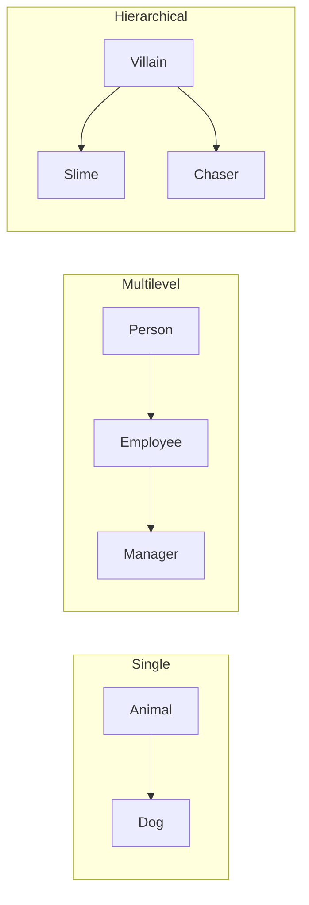

# Inheritance

> Roy Canseco

## About this deck

**RogueEdu Grade 9 Computer Science** · **Study Guide 9: Inheritance** · one parent, many children — and the game engine you already run.

## From lockers to family trees

Last week was encapsulation: bundle your data and behavior together, then guard it behind getters, setters, and properties — valuables in a locker, only the right people can open it. Inheritance is the next idea: a family-tree picture where a parent class passes its traits down, so a child starts with what the parent already knows rather than writing it again.

## Why inherit at all?

Three payoffs, one rule of thumb. You write the parent's attributes and methods once, and every child receives them automatically — code reusability. The code relationship mirrors real life, so a dog is an animal, and programs stay readable. Maintenance gets cheaper too: fix the parent, and every child improves. The rule of thumb — if you catch yourself copying a whole class just to change one small thing, think inheritance first.

## Animal, Dog, and Cat

```python
class Animal:
    def __init__(self, name):
        self.name = name
    def eat(self):
        print(self.name, "is eating.")

class Dog(Animal):
    pass          # adds nothing — inherits it all

class Cat(Animal):
    pass
```

The name in parentheses — Animal — is where Python looks when something is missing. A dog named Bruno can already eat, because Python searches the family line before giving up. Dog and Cat add zero new methods and gain a full set of behavior: two children, zero new code.

## PREDICT: Is a Dog really an Animal?

```python
dog1 = Dog("Bruno")
print(isinstance(dog1, Animal))
```

isinstance asks: was this object built from that class, or from one of its children? It answers true or false. Commit out loud before the reveal — true, or false? Thinking time: five, four, three, two, one. Advance when your answer is locked in.

## The answer: true

Every Dog object is also a fully valid Animal object, so Python answers true. This matters: code written to work with Animals can work with Dogs, Cats, and any future child — nobody edits the old code. In RogueEdu, the engine's turn loop already works on villains the same way: your new child classes ride that loop for free.

## Three generations: Person, Employee, Manager

```python
class Person:
    def __init__(self, name, age):
        self.name = name
        self.age = age

class Employee(Person):
    def __init__(self, name, age, job_title, salary):
        super().__init__(name, age)   # parent handles these two
        self.job_title = job_title    # employee handles what is new
        self.salary = salary

class Manager(Employee):
    pass
```

This is multilevel inheritance: Person is the grandparent, Employee the parent, Manager the child. Each class handles only its own extras — the job title and salary live on Employee, while name and age come from Person. One chain, three generations, none of the setup duplicated.

## super() and constructor chaining

When you construct a Manager, super() sends the work upward — Manager to Employee to Person. Person creates the name and age, then control returns downward, and each child finishes its own lines on the way back. That upward jump and downward return is constructor chaining: the reading order here matches the execution order in the program.

## PREDICT: delete the super() line

```python
class Goblin(Villain):
    def __init__(self, x, y):
        pass              # super().__init__ was HERE

g = Goblin(1, 1)
print(g.name)
```

The parent's constructor is what creates name and hp for every villain. If that super() call is gone, what happens when we print g.name — nothing at all, a default name, or an AttributeError? Pick one: thinking time is five, four, three, two, one. Advance when you are ready.

## The answer: AttributeError

Python raises AttributeError: 'Goblin' object has no attribute 'name'. The engine asks for g.name the moment it registers the Goblin — the crash is just where Python notices first. The __init__ that creates name and hp lives in the parent, so skipping super() means the parent's setup never runs. super() is not a ritual — it is how the parent's work gets done.

## Three structures to master



Single means one parent feeds one child — Animal to Dog. Multilevel means a child becomes a parent itself — Person to Employee to Manager. Hierarchical means one parent feeds several children — one Villain class with Slime and Chaser as siblings. Master these three. Multiple inheritance, where a child has two parents at once, and hybrid combinations are recognition-only in this lesson: you will meet their names, not their mechanics.

## Inheritance in the village

Shipped engine examples are real: Villain is the parent, and Slime — plus the demo's Chaser, Coward, and Patroller — are its children, all hierarchical. Be honest about the gap: no existing mission yet asks you to write a child class. The Goblin Dynasty is a worked draft the teacher can create — Goblin from Villain, and a one-line GoblinKing from Goblin. Verified live, the King has a name, eight hit points, and an inherited attack. The engine loop never changes: you decide, the engine acts.

## Takeaways and what comes next

Inheritance means a child gets the parent's attributes and methods — write them once. Parent equals superclass equals base; child equals subclass equals derived; the parent sits in the parentheses of class Dog(Animal). A pass child already works because Python searches the family line. super().__init__() lets each class handle only what is new — skip it and the parent's setup never runs. Single, multilevel, hierarchical: you have now built all three. Next, the problem every inherited method meets — when the parent's version no longer fits, the child replaces it: method overriding.