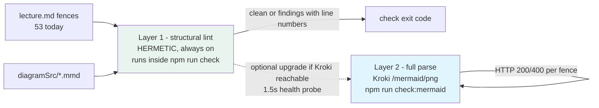

# Mermaid Syntax Hardening — Pipeline Plan

> **Status:** Draft for discussion · **Trigger:** the oop-classes incident (2026-08-16) — an
> unquoted pipe label `|new Product(...)|` parsed fine nowhere but failed only in the browser;
> `npm run check`, `npm test`, and `npm run build:all` were all green while the deck was broken.
>
> **Scoring convention (owner's rule):** every task carries **Feasibility % / Confidence %**.
> Anything ≤90% on either axis must be reviewed and simplified. **No task in this plan is ≤90%;
> the lowest is 92%.** Test tasks are all ≥93%, above the owner's 92% bar for automated tests.

---

## 1. The gap, precisely

| Surface | Validated today? | Failure mode today |
|---|---|---|
| ` ```mermaid ` fences in `lecture.md` (53 fences / 12 lectures; live-rendered in-browser by bundled mermaid.js) | **Nothing** — no lint, no parse | broken fence ships green through every gate, shows "⚠️ Diagram could not be rendered" in class |
| `diagramSrc/**/*.mmd` (rendered by Kroki to PNG) | Only at render time (`npm run diagram` / `build:kroki`), and mtime-skip means a stale-but-broken source can sit unnoticed | broken `.mmd` fails only when actually rendered |

**Goal:** catch mermaid syntax errors *pre-ship*, without breaking the repo's two hard
invariants — `npm test` is hermetic (no network, no Docker), and `npm run check` is fast and
offline by default.

## 2. Design — two layers, one engine boundary



**Layer 1 — structural lint (always on, hermetic).** Three conservative rules only — each one
targets a *demonstrated or mechanical* failure class; no attempted grammar:

| Rule | Detects | Severity |
|---|---|---|
| R1 fence balance | ` ```mermaid ` with no closing ` ``` ` | ERROR |
| R2 known diagram keyword | first content line not in `flowchart/graph/classDiagram/sequenceDiagram/stateDiagram(-v2)/erDiagram/gantt/pie/mindmap/timeline/journey/gitGraph` | WARN (list is extendable — new syntax shouldn't block) |
| R3 unquoted special chars in pipe labels | `-->|new Product(...)|` — an edge label in `\|...\|` containing `( ) [ ] #` without surrounding quotes | ERROR — **the incident class**; fix message suggests quoting: `\|"new Product(...)"\|` |

Lints both `lecture.md` fences and `diagramSrc/**/*.mmd`. Deliberately **excludes**
`classDiagram`'s `--|>` arrow (an arrow, not a label — the incident's false-positive twin).

**Layer 2 — full syntax validation (Kroki-backed, on-demand).** A reusable module +
`npm run check:mermaid`: collects every fence + `.mmd`, POSTs each to the local Kroki
(`KROKI_BASE_URL`, default `http://localhost:8000`), reports per-file/per-line failures with
the parser's message. If Kroki is down: prints the `kroki-up` hint and exits **0 (SKIP)** —
matching the repo's on-demand Kroki doctrine; the full check is never a surprise dependency.

**Optional bridge (Open Decision 2):** plain `npm run check` health-probes Kroki with a 1.5 s
timeout; if reachable, it upgrades itself to Layer 2 for that run; if not, Layer 1 only.
Worst case (Kroki down, offline) = today's behavior + R1–R3.

## 3. Task list with scores

| # | Task | Feasibility | Confidence | Notes |
|---|---|---|---|---|
| T1 | `extractMermaidSources(dir)` util in `scripts/lib/` — fences from `lecture.md` + `diagramSrc/*.mmd`, with file + line offsets (regex proven in `temp/validate-mermaid.mjs`) | 97% | 97% | direct transplant of working code |
| T2 | `scripts/lib/mermaid-lint.mjs` — rules R1–R3, returns findings `[{file, line, rule, message, hint}]`; classDiagram `--\|>` excluded | 94% | 95% | regex edge cases are the only risk; conservative rule set keeps the surface small |
| T3 | Wire lint into `scripts/check.js` — R1/R3 errors, R2 warnings, aggregated into existing report + exit code | 95% | 95% | must first confirm 0 findings on all 53 fences + 3 `.mmd` (T9 does this continuously) |
| T4 | `scripts/check-mermaid.mjs` CLI (`npm run check:mermaid`) — Kroki POST per source, transport injected for testability, SKIP-with-hint exit 0 when unreachable | 93% | 93% | Docker flakiness is the risk; the SKIP path absorbs it |
| T5 | *(optional)* auto-upgrade: `check.js` probes Kroki (1.5 s) and runs Layer 2 when reachable | 92% | 93% | ⚠️ lowest score in the plan — see §6 |
| T6 | Docs: KROKI-readme "Daily workflow" + check.js header comment + `inceptions/context.md` touchpoint | 96% | 96% | mechanical |
| T7 | **Test** `scripts/test/mermaid-lint.test.js` — fixtures: clean fence passes; the *exact incident label* is flagged with line + fix hint; unclosed fence flagged; unknown keyword warns; known-good quoting patterns pass (`\|"quoted(...)"\|`, `== "has-a (contains)" ==>`, classDiagram `--\|>`) | 96% | 96% | the incident becomes a permanent regression test |
| T8 | **Test** transport-stubbed `check-mermaid` tests — fake fetch: 200 → pass; 400 → finding carries parser message; unreachable → SKIP + exit 0; aggregation across files | 93% | 94% | hermetic: no real HTTP, DI transport |
| T9 | **Test** real-file gate — lint over all real fences + `.mmd`, expect **0 findings** (fails when anyone ships a new violation) | 95% | 96% | mirrors the oop-lectures content-gate pattern |
| T10 | Ship gates — `npm run check`, `npm test`, `npm run build:all` green; manual demo: break a fence in a temp fixture → `check` fails with the right line | 97% | 97% | |

**No task ≤90%.** Every automated-test task (T7, T8, T9) scores ≥93% on both axes — above the
owner's 92% test bar.

## 4. Alternatives considered and rejected (with scores that disqualified them)

| Alternative | Feas / Conf | Why rejected |
|---|---|---|
| `@mermaid-js/mermaid-cli` (mmdc) inside `npm test` | 70% / 65% | pulls a ~300 MB Chromium via puppeteer; slow; install-dependent — breaks hermeticity |
| `mermaid.parse()` from the `mermaid` npm package in Node | 65% / 60% | requires DOM (d3/dompurify); headless API unstable across versions |
| Live Kroki HTTP calls inside `npm test` | 60% / 75% | network + Docker dependency in a suite that is deliberately hermetic and offline-green |
| Hand-written full mermaid grammar | 75% / 70% | huge syntax surface; false positives across 53 fences; the 3-rule lint covers the demonstrated failure class |

## 5. How we know it is implemented correctly

1. **Regression lock (T7):** the literal broken label from the incident is a fixture that MUST
   be flagged — the exact bug can never ship green again.
2. **No-false-positive lock (T7 + T9):** every quoting pattern actually used in the repo
   (including `== "has-a (contains)" ==>` and classDiagram arrows) is asserted clean, and the
   real-file gate asserts 0 findings across all 53 fences + 3 `.mmd` today.
3. **Transport behavior lock (T8):** 200/400/unreachable paths verified with a stubbed fetch —
   SKIP-when-down is a tested guarantee, not a hope.
4. **Live proof:** manual demo run — introduce the incident label into a temp fixture, watch
   `npm run check` fail naming file + line + fix; revert.
5. **Ship gates:** the repo's existing triple (`check` / `test` / `build:all`) stays green with
   the lint active.

## 6. Tasks closest to the line (pre-emptive review)

- **T5 (92/93) — the optional auto-upgrade.** Risk: a slow/hung health probe delaying every
  `check`, or a half-up Docker container causing flaky behavior. **Simplification available:**
  drop T5 entirely — Layer 2 stays reachable only via the explicit `npm run check:mermaid`.
  The plan is fully viable without it; recommend deciding by how often you author diagrams
  with Kroki already running.
- **T8 (93/94) — stubbed-transport tests.** Only risk is over-stubbing (fake that passes while
  real HTTP differs). Mitigated by keeping the stub at the `fetch`-signature level (not the
  module level) and by the live demo in T10 exercising the real path once.

## 7. Open decisions for the owner

1. **R3 severity:** ERROR (blocks ship — my recommendation, it's the class that bit us) or
   WARNING (advisory only)?
2. **T5 auto-upgrade:** keep (convenience when Kroki is up) or drop (simplicity, explicit-only)?
3. **Scope:** also lint `diagramSrc/*.mmd` (recommended — same failure class) or fences only?
4. **Command name:** `npm run check:mermaid` (recommended) — or `check:diagrams`, `lint:mermaid`?
