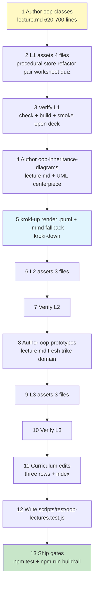
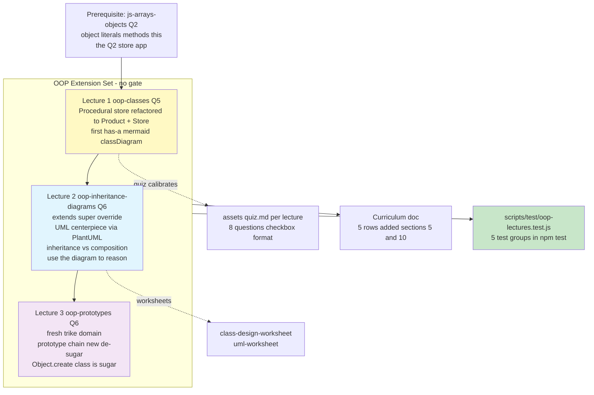

# OOP in JavaScript — Three-Lecture Extension Set: Content Outline & Implementation Plan

> **Status:** Draft for discussion · **Targets:** `lectures/oop-classes/`, `lectures/oop-inheritance-diagrams/`, `lectures/oop-prototypes/` · **~600–750 lines each**
>
> **Structural model:** [`htmx-lecture-plan.md`](htmx-lecture-plan.md) · **House-style models:** [`lectures/data-modeling/lecture.md`](lectures/data-modeling/lecture.md:1) (new-style, 426 lines) and [`lectures/htmx/lecture.md`](lectures/htmx/lecture.md:1) (implemented at 680 lines — proves the ~600–750 norm)

**Scoring convention (per owner's rule):** every task below carries a **Feasibility %** and **Confidence %**. Any task scoring ≤90% on either axis must be reviewed and simplified before implementation — §10 shows the current task table with **no item ≤90%** (two items sit at 92% with named mitigations). The "how do we know it's correct" question is answered by §7: per-lecture `npm run check` + `npm run build -- <slug>`, a new automated test file wired into `npm test` (all test tasks ≥93%), and the ship gates `npm test` + `npm run build:all`.

---

## 1. Overview & Rationale

### What this adds

A **three-lecture OOP extension set** for the Q5/Q6 extension lane, student-facing, **no gate**:

| # | Slug | Focus | Quarter |
|---|---|---|---|
| 1 | `oop-classes` | Classes & objects fundamentals — the refactor arc begins | Q5 (self-paced) |
| 2 | `oop-inheritance-diagrams` | Inheritance vs composition + UML class diagrams | Q6 (self-paced) |
| 3 | `oop-prototypes` | Prototypes under the hood — how `class` really works | Q6 (self-paced) |

Prerequisite chain: **js-arrays-objects (Q2) → oop-classes → oop-inheritance-diagrams → oop-prototypes**.

### Why OOP, and why now

- **The course's own code style is plain functions + data.** That stays true. This set teaches OOP as a **modeling and comprehension tool** — students will meet `class` syntax in libraries, MDN docs, and future coursework (and in the data-modeling way of thinking: entities, relationships, one diagram of the whole system). It is explicitly NOT "always write classes now" — Lecture 1 §8 ("When to Use Classes") draws that line, and a quiz item tests it.
- **The bridge already exists.** [`lectures/js-arrays-objects/lecture.md`](lectures/js-arrays-objects/lecture.md:856) already teaches object literals with methods, `this` (lines 856–980), an "object anatomy" diagram (`diagrams/js-arrays-objects/object-anatomy.png`, line 786), and a full store-inventory object-literal app with `sellProduct`/`restock`/`getByCategory` methods and an architecture diagram (lines 1209–1310). OOP lecture 1 picks up **exactly that app**. No new context to invent — students refactor something they already wrote.
- **Extension lane fit.** Q5 = "Engineering Depth", Q6 = "Specialization". OOP is qualitatively harder abstraction — precisely the lane's charter. No gate means no mastery claim is made; the self-quiz remains a calibration anchor per [`references/quiz-authoring-guide.md`](references/quiz-authoring-guide.md:16).

### The signature pedagogical arc (central to all three lectures)

**Procedural app → refactor into classes → draw the class diagram → use the diagram to reason about the system.**

1. **Lecture 1** hands students a working *procedural* sari-sari store tracker (plain functions + an array of object literals — the style they mastered in Q2) and refactors it into `Product` + `Store` classes, behavior identical.
2. **Lecture 2** grows the domain (a perishables subclass, a utang ledger), then **draws the UML class diagram** of the whole system — and closes by *using the diagram*: "Aling Nena wants an utang report — trace on the diagram what changes."
3. **Lecture 3** opens the hood: where do methods *actually live*? The same classes dissolve into prototypes, proving `class` is sugar. Fresh mini-domain (tricycle fleet) so prototypes aren't tangled with the now-familiar store classes.

---

## 2. Unifying Example Domain — "Aling Nena's Sari-Sari Store" (Lectures 1–2)

Chosen over barangay services for one decisive reason: **students already wrote a procedural version of it in Q2** (the store-inventory example in js-arrays-objects). The refactor arc starts from real prior work, not a hypothetical. *(Owner decision: sari-sari store for lectures 1–2; a fresh small domain for lecture 3.)*

### The procedural "before" app (Lecture 1 §1 — the refactor target)

Mirrors the js-arrays-objects style exactly, so it reads as "your own Q2 code":

```javascript
// ❌ procedural — data and behavior are strangers
const products = [
  { id: 1, name: "Sardinas 155g", price: 20, stock: 24 },
  { id: 2, name: "Instant Noodles", price: 15, stock: 6 },
  { id: 3, name: "Softdrinks 8oz", price: 18, stock: 12 },
];

function findProduct(list, id) { /* ... */ }
function sellProduct(list, id, qty) { /* find, check stock, decrement */ }
function restockProduct(list, id, qty) { /* ... */ }
function printInventory(list) { /* ... */ }
function totalInventoryValue(list) { /* price * stock, summed */ }
```

Pain points the lecture surfaces: every function re-receives `list`; nothing stops `products[0].stock = -999`; adding a second store means copying the functions.

### The class model (the set's backbone — 4 classes)

| Class | Fields | Methods | Introduced |
|---|---|---|---|
| `Product` | `id`, `name`, `price` (₱), `stock` | `sell(qty)` → bool, `restock(qty)`, `isLowStock(threshold = 5)`, `stockValue()`, `describe()` → `"₱20 · Sardinas 155g — 24 left"` | L1 §3 |
| `Store` | `name`, `owner`, `inventory: Product[]` | `addProduct(p)`, `findProduct(id)`, `sell(id, qty)`, `restock(id, qty)`, `printInventory()`, `totalInventoryValue()`, `lowStockReport()` | L1 §5 |
| `PerishableProduct extends Product` | + `expiryDate` (ISO string) | + `isExpired()`, **overrides** `describe()` (appends ⚠ expiry badge, calls `super.describe()`) | L2 §2–3 |
| `Sale` | `buyerName`, `isUtang` (credit — *"listahan ng utang"*), `items: {product, qty, subtotal}[]`, `dateStr` | `addItem(product, qty)` (delegates to `product.sell` + computes subtotal), `total()`, `settle()` | L2 §5 |

`Store` gains `salesHistory: Sale[]` + `recordSale(sale)` + `utangReport()` in L2.

### Relationships (exactly what the UML centerpiece must show)

| Relationship | Edge | UML notation |
|---|---|---|
| **Inheritance (is-a)** | `PerishableProduct` —▷ `Product` | hollow triangle arrow |
| **Composition (has-a, whole-part)** | `Store` ◆— `Product` (1 to 0..*), `Store` ◆— `Sale` (1 to 0..*) | filled diamonds + multiplicities |
| **Association (uses/references)** | `Sale` — `Product` via line items (1 Sale references 1..* Products) | plain arrow |

This satisfies the design brief: 2–4 classes, a natural inheritance edge AND composition edges, over a procedural app students could already have written. Line items are kept as plain data (`{product, qty, subtotal}`) to hold the class count at 4 — "make `SaleItem` a class too" is posed as an extension question in L2's worksheet, not taught.

### Lecture 3's fresh mini-domain — the tricycle fleet

One tiny class, chosen because it is console-demonstrable, unmistakably Filipino, and unburdened by store-class memories:

```javascript
class Tricycle {
  constructor(plate, driver, baseFare) { /* ... */ }
  fare(km) { return this.baseFare + Math.ceil(km) * 8; } // +₱8 per km
}
const unit01 = new Tricycle("TSK-142", "Kuya Ronnie", 25);
```

Lecture 3 then **de-sugars exactly this** into a constructor function + `Tricycle.prototype.fare`, links objects with `Object.create` (a terminal of shared-route trikes), and walks the prototype chain in the console at every step.

---

## 3. Lecture 1 Spec — `oop-classes`

**Target line count:** 620–700 · **Quarter:** Q5, Weeks 9–10 (Extension Lane, self-paced — alongside `pwa-basics`) · **Duration:** ~1 week self-paced

### Metadata block

```
# OOP I — Classes & Objects: Refactoring Aling Nena's Store

**Grade 10 - ICT (Full-Stack Elective)**
**Quarter 5 · Weeks 9–10** (Extension Lane — self-paced, no gate)
**Duration:** 1 week
**Prerequisite:** [`js-arrays-objects`](../js-arrays-objects/lecture.md) (you can build
object literals with methods and use `this` — the Q2 store app)
```

*(Prerequisite path verified: [`lectures/js-arrays-objects/lecture.md`](lectures/js-arrays-objects/lecture.md:1) exists. Nominal week numbers are flagged as Open Decision 1.)*

### 🎯 Learning objectives (7)

1. ✅ Explain the pain of the procedural style: data and functions separated, validation scattered, duplication for a second store
2. ✅ Write a `class` with a `constructor` and methods; instantiate with `new`
3. ✅ Predict what `this` refers to inside a method call on an instance
4. ✅ Put validation inside the class (`sell()` refuses overdraws; constructor guards bad stock) so bad state becomes impossible *by construction*
5. ✅ Refactor the procedural store tracker into `Product` + `Store` classes with identical behavior
6. ✅ Recognize the **has-a** (composition) relationship: a `Store` has `Product`s
7. ✅ Decide when a class is overkill (a plain object literal or function is fine) — classes are a modeling tool, not a lifestyle

### Section-by-section outline

| § | Section | Key beats | Diagram / Try It |
|---|---|---|---|
| 1 | The Problem: A Pile of Functions and Data | Run the procedural store (asset); name the 3 pain points; recap `this` from js-arrays-objects' object-anatomy | 🎯 Try It: `assets/procedural-store.html` · Diagram: procedural-vs-oop-structure (mermaid) |
| 2 | The Blueprint Idea: One Class, Many Objects | Class = blueprint, instances = built units; class syntax anatomy (name, constructor, methods); naming: `Product` not `productFactory` | Diagram: blueprint-instances (mermaid) |
| 3 | Your First Class: `Product` | Full worked class: constructor with validation (`stock >= 0`, `price > 0`), `sell/restock/isLowStock/stockValue/describe`; ✅/❌ DO-DON'T (❌ don't mutate `stock` from outside — call a method) | 🎯 Try It: predict console output before running |
| 4 | `new` and `this`, Earned | What `new` does (creates, runs constructor, returns); `this` = the instance receiving the call; table: literal-method `this` (Q2) vs class-method `this` (now) | — |
| 5 | Class #2: `Store` — Composition Begins | `Store` has `name`/`inventory[]`; methods delegate to `Product` methods (`sell(id, qty)` → `findProduct` → `p.sell(qty)`); **has-a** named and drawn | Diagram: store-composition-first-look (mermaid classDiagram fence) · 🎯 Try It: `assets/class-refactor-starter.html` |
| 6 | The Refactor, Step by Step | Mapping table: each procedural function → the class method that ate it; before/after diff blocks; "behavior identical — structure changed"; test-by-console script | — |
| 7 | Guarding the Data | Why methods (not raw access) keep invariants: `sell()` is the *only* way stock drops; underscore convention `_field` + a 💡 callout on `#private` fields (mention only — not taught) | — |
| 8 | When to Use Classes (and When Not To) | Decision table: one object → literal; data + shared behavior, many instances, invariants → class; throwaway script → functions; ⚠️ course-code framing: most of this course still writes functions + data — classes are for *modeling* things with rules | — |
| 9 | Mini-Projects | ⭐ **A — Product Catalog** (beginner): 5 products incl. 2 with rules (e.g., "buy-2-get-1"), low-stock report. ⭐⭐ **B — Refactor Your Own Q2 App** (intermediate): take a Q2 tracker the student built (store, grades, budget) and refactor to classes | 🎯 starters in `assets/` |
| 10 | Final Challenge — Aling Nena's Ledger v1 | `Product` + `Store` classes power a working tracker page: add/restock/sell, inventory table, low-stock alerts; stretch: `owner` greeting method | Pass criteria checklist |
| 11 | Troubleshooting | Table: `TypeError: Product is not a constructor` (calling before definition / typo); `this` is `undefined` (detached method); forgot `new`; method called as property (missing `()`) | — |
| 12 | What's Next? + 📝 Quick Reference Card | Card: class anatomy snippet, `new` steps, has-a definition, when-not-to-use; forward links to `oop-inheritance-diagrams` | — |

### Quiz topics (8 → `assets/quiz.md`)

| # | Topic | Type |
|---|---|---|
| 1 | Keyword that defines a class / creates an instance | MC |
| 2 | What `new Product(...)` evaluates to | MC |
| 3 | What `this` means inside a class method | MC |
| 4 | Where "stock can't go negative" validation belongs | MC |
| 5 | Code-reading: `p.sell(99)` when `stock = 10` — result? | MC (code block) |
| 6 | Store-has-Products relationship name | MC |
| 7 | Scenario: is a class warranted (one config object)? | MC |
| 8 | Instances are created with `___` | Fill-in |

Format per [`references/quiz-authoring-guide.md`](references/quiz-authoring-guide.md:93): `# OOP I Self-Quiz` title, `## N.` questions, `* [x]` single correct answer, 4 options, varied answer position.

### Assets

| File | Purpose | Scores |
|---|---|---|
| `assets/procedural-store.html` | The runnable "before" app (procedural tracker with console-style output panel) | 97 / 97 |
| `assets/class-refactor-starter.html` | 🎯 Try It starter: procedural store + TODO comments converting to `class Product` | 95 / 95 |
| `assets/class-refactor-solution.html` | Completed refactor (self-check, not gated) | 96 / 96 |
| `assets/class-design-worksheet.html` | Transfer worksheet: pick nouns/rules out of a *different* domain (barangay services) → sketch classes (precedent: [`lectures/data-modeling/assets/schema-worksheet.html`](lectures/data-modeling/assets/schema-worksheet.html)) | 94 / 94 |
| `assets/quiz.md` | 8-question self-quiz | 98 / 98 |

All assets are standalone HTML + vanilla JS (no server, no Express) — deliberately simpler than htmx's borderline Express app.

### Diagrams

| Diagram | Format | Why this format |
|---|---|---|
| `procedural-vs-oop-structure` | **Mermaid fence** (flowchart) | Two-panel comparison, will be iterated during authoring; mermaid renders live in the offline deck, zero render dependency |
| `blueprint-instances` | **Mermaid fence** (flowchart) | Simple boxes; kills the "each object re-explains itself" misconception |
| `store-composition-first-look` | **Mermaid fence** (classDiagram) | First taste of class-box notation; stays a *fence* because it's a teaching beat, not the formal UML (that's L2's centerpiece) |

---

## 4. Lecture 2 Spec — `oop-inheritance-diagrams`

**Target line count:** 620–700 · **Quarter:** Q6, Weeks 1–2 (Extension Lane, self-paced) · **Duration:** ~1 week self-paced

### Metadata block

```
# OOP II — Inheritance vs Composition & UML Class Diagrams: Growing the Store

**Grade 10 - ICT (Full-Stack Elective)**
**Quarter 6 · Weeks 1–2** (Extension Lane — self-paced, no gate)
**Duration:** 1 week
**Prerequisite:** [`oop-classes`](../oop-classes/lecture.md) (you built `Product` + `Store`
classes and know the has-a relationship)
```

### 🎯 Learning objectives (7)

1. ✅ Explain the copy-paste trap that motivates inheritance (bread/eggs expire — canned goods don't)
2. ✅ Extend a class with `extends`, call the parent with `super(...)`, and **override** a method (calling `super.describe()` inside the override)
3. ✅ Read and draw a UML class diagram: 3-compartment boxes, `−`/`+` visibility, hollow-triangle inheritance, filled-diamond composition, multiplicities
4. ✅ Distinguish **is-a** (inheritance) from **has-a** (composition) and choose deliberately — with a bias toward composition ("has-a wins when unsure")
5. ✅ Model a whole small system (4 classes) and draw its UML diagram from scratch
6. ✅ Use a class diagram to reason about change: trace where a new feature ("utang report") ripples, *before* writing code
7. ✅ Keep inheritance shallow — recognize when a subclass is really a flag/field instead

### Section-by-section outline

| § | Section | Key beats | Diagram / Try It |
|---|---|---|---|
| 1 | The Problem: Copy-Pasting `Product` | Naive fix #1: add `expiryDate: null` to every product (mess); naive fix #2: duplicate the class (`PerishableProductCopy`) — drift begins; ✅/❌ both | — |
| 2 | Inheritance: is-a | `PerishableProduct extends Product`; what's inherited; `super(id, name, price, stock, expiryDate)`; "a perishable product IS A product — everything true of `Product` is true of it" | 🎯 Try It: `assets/inheritance-starter.html` |
| 3 | Overriding + `super.describe()` | Override `describe()` to append ⚠ badge; call `super.describe()` inside; add `isExpired()`; DO-DON'T: ❌ don't override without understanding the parent's contract | Diagram: inheritance-chain-uml (mermaid classDiagram) |
| 4 | UML Class Diagrams: Drawing Your System | UML notation taught piece by piece: box compartments, `−`/`+`, hollow triangle, filled diamond, multiplicities; **centerpiece diagram revealed — the whole 4-class store domain**; how to read `1 —◆ 0..*` aloud | 🎨 **Centerpiece: `store-domain-class-diagram`** (PlantUML via Kroki) |
| 5 | Composition: has-a — the `Sale` class | `Sale` holds line items that reference `Product`s; `addItem` delegates stock changes to `product.sell`; utang = `isUtang` + `settle()`; `Store.salesHistory` + `recordSale()` | — |
| 6 | Reading Relationships Like a Map | Table: inheritance vs composition vs association — notation, meaning, PH-domain examples (Resident/SeniorResident; Barangay-has-Residents; Request-references-Resident) | — |
| 7 | Inheritance vs Composition: Choosing | "Prefer composition"; fragile-base-class-lite (change `Product.describe()`, children break); when inheritance is *right* (true is-a, shallow); decision flowchart | Diagram: isa-vs-hasa-decision (mermaid) |
| 8 | Use the Diagram to Reason | The arc's payoff: "Aling Nena wants an utang report" — trace on the UML: `Store.utangReport()` → reads `salesHistory` → filter `Sale.isUtang` → **no changes to `Product`**; second trace: "add senior-discount" — ripple analysis shows *why* discount-as-field beats subclassing (`SeniorBuyer extends Buyer` spiral) | Diagram: diagram-impact-reasoning (mermaid) · 🎯 Try It: `assets/uml-worksheet.html` |
| 9 | Mini-Projects | ⭐ **A — Weighed Goods** (beginner): `LooseProduct extends Product` — sugar/rice by the ½ kilo; price per kilo, stock in kilos. ⭐⭐ **B — Model Barangay Services** (intermediate): from a feature list, design `Resident`/`SeniorResident`/`ServiceRequest` + draw the UML | — |
| 10 | Final Challenge — The Store, Diagrammed | Grow your L1 store: add `PerishableProduct` + `Sale` (utang), **draw the UML diagram of your final system, then defend each edge** (why inheritance here, composition there); implement `utangReport()` | Pass criteria checklist |
| 11 | Troubleshooting | `Must call super constructor` error; override that silently breaks parent contract; deep-inheritance smell; diagram/behavior drift (diagram says one thing, code another) | — |
| 12 | What's Next? + 📝 Quick Reference Card | Card: UML notation mini-legend, `extends`/`super` snippets, is-a vs has-a one-liner; forward link to `oop-prototypes` | — |

### Quiz topics (8 → `assets/quiz.md`)

| # | Topic | Type |
|---|---|---|
| 1 | What `extends` establishes (is-a) | MC |
| 2 | What `super(...)` does in a subclass constructor | MC |
| 3 | Code-reading: override calls `super.describe()` — what prints | MC (code block) |
| 4 | UML hollow-triangle arrow means | MC |
| 5 | UML filled diamond means | MC |
| 6 | Reading multiplicity `1 —◆ 0..*` | MC |
| 7 | "A Sale references Products but is not a Product" — which relationship | MC |
| 8 | When unsure between is-a and has-a, prefer `___` | Fill-in |

### Assets

| File | Purpose | Scores |
|---|---|---|
| `assets/inheritance-starter.html` | 🎯 Try It starter: L1 store + `PerishableProduct` skeleton with TODOs (`super`, override) | 95 / 95 |
| `assets/inheritance-solution.html` | Completed version for self-check | 96 / 96 |
| `assets/uml-worksheet.html` | Complete-the-UML worksheet: a mutated store domain (add `Delivery` — driver, fee, references `Sale`) — student fills class boxes, edges, multiplicities | 93 / 93 |
| `assets/quiz.md` | 8-question self-quiz | 98 / 98 |

### Diagrams — UML featured prominently (per locked decision)

| Diagram | Format | Why this format |
|---|---|---|
| **`store-domain-class-diagram`** (centerpiece) | **diagramSrc/ `.puml` (PlantUML) via Kroki → `diagrams/…png`**, **plus same-stem `.mmd` fallback** | PlantUML renders authentic UML — `−`/`+` visibility, filled composition diamonds with multiplicities, proper generalization arrows — that mermaid's `classDiagram` approximates but can't fully express. This is the lecture where students meet *the real notation*. The same-stem `.mmd` is a first-class fallback in the pipeline (verified: multi-format sources render in priority order, never a collision — [`scripts/check.js`](scripts/check.js:21) header notes) so if Kroki/PlantUML is unavailable, the build still ships a mermaid-rendered PNG. Kroki is only needed during authoring (`kroki-up` per [`KROKI-readme.md`](KROKI-readme.md:12)) |
| `inheritance-chain-uml` | Mermaid fence (classDiagram) | Teaching-sequence diagram of `PerishableProduct —▷ Product` with the override marked; a fence keeps it live and iterated cheaply |
| `isa-vs-hasa-decision` | Mermaid fence (flowchart) | Decision tree — pure boxes/arrows |
| `diagram-impact-reasoning` | Mermaid fence (flowchart) | Trace of the "utang report" ripple across the 4 classes |

---

## 5. Lecture 3 Spec — `oop-prototypes`

**Target line count:** 600–680 · **Quarter:** Q6, Weeks 3–4 (Extension Lane, self-paced) · **Duration:** ~1 week self-paced

### Metadata block

```
# OOP III — Prototypes Under the Hood: What class Really Does

**Grade 10 - ICT (Full-Stack Elective)**
**Quarter 6 · Weeks 3–4** (Extension Lane — self-paced, no gate)
**Duration:** 1 week
**Prerequisite:** [`oop-inheritance-diagrams`](../oop-inheritance-diagrams/lecture.md)
(you can write classes with extends and super — now see what they compile down to)
```

**Design covenant (drives every section): every concept lands on a console-demonstrable snippet.** Fresh domain — the tricycle fleet (§2) — so nothing is tangled with the familiar store classes.

### 🎯 Learning objectives (6)

1. ✅ Demonstrate where class methods really live: on a shared **prototype**, not copied into each instance (`Object.getPrototypeOf(unit01) === Tricycle.prototype` → `true`)
2. ✅ Walk an object's prototype chain in the console (`instance → Class.prototype → Object.prototype → null`)
3. ✅ Rewrite a class as a pre-2015 constructor function + `prototype` assignments with identical behavior (the de-sugar)
4. ✅ Explain the four steps `new` performs with a constructor function
5. ✅ Link objects directly with `Object.create()` — behavior sharing without any `class`
6. ✅ Read MDN/library docs that mention `prototype`, `__proto__`, or `Object.create` without panic — and know `__proto__` is legacy (look, don't write)

### Section-by-section outline

| § | Section | Key beats | Diagram / Try It |
|---|---|---|---|
| 1 | The Mystery: Where Do Methods Live? | Two `Tricycle` units; `unit01.fare === unit02.fare` → `true`?! If methods were copied, this would be `false`. Console proof — one shared thing exists somewhere | 🎯 Try It: `assets/prototype-explorer.html` · Diagram: prototype-chain-lookup (mermaid) |
| 2 | Every Object Has a Hidden Link | `Object.getPrototypeOf()`, the chain walk to `null`; `__proto__` shown as the legacy accessor (⚠️ read-only in our code); `.prototype` (a property of the constructor) vs "the prototype" (the hidden link) — the classic confusion, untangled with a naming table | — |
| 3 | Classes Before 2015: Constructor Functions | `function Tricycle(plate, driver, baseFare) {...}` + `Tricycle.prototype.fare = ...`; instantiate with `new`; identical behavior to L3 §1's class | — |
| 4 | What `new` Actually Does | Four steps: create `{}` → link to `Tricycle.prototype` → run constructor with `this` → return `this`; console-demo each observable effect | — |
| 5 | `class` Is Sugar | The mapping table + diagram: class method → lives on `Class.prototype`; `constructor()` → the function body; `extends`/`super` → prototype linkage; `static` → own property of the constructor/class; verify every row in console | Diagram: class-sugar-mapping (mermaid) |
| 6 | `Object.create`: Objects Without Classes | A terminal of trikes sharing route methods via `Object.create(routeProto)` — no class keyword anywhere; shadowing (own property wins before the chain is consulted) | Diagram: object-create-linking (mermaid) |
| 7 | The Full Chain | `instanceof` reads the chain; `hasOwnProperty` distinguishes own vs inherited; method added to `Tricycle.prototype` *after* instances exist — old instances get it (live console wow-moment) | — |
| 8 | When Does This Matter? | Reading MDN pages that say "method of Array.prototype"; understanding why `Object.create(null)` dicts have no `toString`; interviews/further study; and the honest close: **in this course you may keep writing `class` — now you know it's prototypes wearing a nice shirt** | — |
| 9 | Mini-Projects | ⭐ **A — De-sugar the Trike** (beginner): rewrite `Tricycle` as constructor + prototype; prove equivalence with console assertions. ⭐⭐ **B — Fleet Registry** (intermediate): shared `describeFleet()` on a prototype; `Object.create` variant | 🎯 starters |
| 10 | Final Challenge — De-sugar the Store | Take **your Lecture 1 `Product` class** (the arc comes home): rewrite as constructor function + prototype methods; run the same console test script — outputs identical | Pass criteria checklist |
| 11 | Troubleshooting | Assigning to `__proto__` (don't); method on the instance vs on the prototype (one copies, one shares); forgetting `new` with constructor functions (silent `undefined`); `Class.prototype` vs `__proto__` mixups | — |
| 12 | What's Next? + 📝 Quick Reference Card | Card: chain diagram, `new`'s 4 steps, sugar-mapping table; close the set: procedural → classes → diagram → prototypes = the same system, four lenses | — |

### Quiz topics (8 → `assets/quiz.md`)

| # | Topic | Type |
|---|---|---|
| 1 | Where class methods actually live | MC |
| 2 | `Object.getPrototypeOf(unit01)` returns | MC |
| 3 | The four things `new` does | MC |
| 4 | What sits at the end of every prototype chain | MC |
| 5 | Code: method added to `Class.prototype` after instantiation — do existing instances get it? | MC (code block) |
| 6 | What `Object.create(proto)` returns | MC |
| 7 | Instance method vs prototype method — which is shared as one copy | MC |
| 8 | `class` syntax is `___` over prototypes | Fill-in |

### Assets

| File | Purpose | Scores |
|---|---|---|
| `assets/prototype-explorer.html` | 🎯 Try It playground: button-driven console demos (chain walk, `===` identity checks, live prototype additions) with visible output panel | 93 / 93 |
| `assets/desugar-starter.html` | Starter: `class Tricycle` + test script + TODO skeleton for the constructor-function version | 94 / 94 |
| `assets/desugar-solution.html` | Completed de-sugar for self-check | 95 / 95 |
| `assets/quiz.md` | 8-question self-quiz | 98 / 98 |

### Diagrams

| Diagram | Format | Why this format |
|---|---|---|
| `prototype-chain-lookup` | Mermaid fence (flowchart) | The lecture's spine: `unit01 → Tricycle.prototype → Object.prototype → null` with the `fare` lookup arrows; fences render in-browser, stay live |
| `class-sugar-mapping` | Mermaid fence (flowchart, two columns) | Left: class syntax elements; right: prototype reality — matched pairs |
| `object-create-linking` | Mermaid fence (flowchart) | Linked objects without classes; shadowing shown |

*(Deliberate: lecture 3 uses NO diagramSrc/Kroki sources — its diagrams are explanatory and high-churn; fences keep authoring loop tight.)*

---

## 6. Curriculum Touchpoints — exact edits in [`web-lectures/full-stack-g10/full-stack-g10-curriculum.md`](web-lectures/full-stack-g10/full-stack-g10-curriculum.md:1)

Section numbers verified by reading the file: **§5 "Quarter-by-quarter detail"** (Q5 table lines 155–160; Q6 table lines 167–171) and **§10 "Quarter → lecture index (quick reference)"** (table lines 239–264, last row `pwa-basics`).

### Edit 1 — §5, Q5 table: add after the `pwa-basics` row (line 160)

```markdown
| woven | **NEW `oop-classes`** — OOP I: Classes & Objects (self-paced extension; refactors the Q2 sari-sari store app into `Product` + `Store` classes) |
```

*Why "woven": Q5 weeks 1–10 are fully allocated (testing 1–3, production 4–6, git 7–8, pwa 9–10). The "woven" row pattern is the doc's own precedent for self-paced parallel content — see Q1's `| woven | git-github (subset: §1–§5) |` (line 97). No renumbering of existing rows.*

### Edit 2 — §5, Q6 table: add after the `ai-assisted-development` row (line 170), before the capstone row

```markdown
| woven | **NEW `oop-inheritance-diagrams`** + **NEW `oop-prototypes`** — OOP II & III (self-paced extension: UML class diagrams, inheritance vs composition, prototypes under the hood) |
```

### Edit 3 — §10 index: add three rows after `pwa-basics` (line 264)

```markdown
| **oop-classes** | Q5 | 🆕 | — |
| **oop-inheritance-diagrams** | Q6 | 🆕 | — |
| **oop-prototypes** | Q6 | 🆕 | — |
```

### Preexisting inconsistency noticed (flagged, not auto-fixed)

`htmx` (Q5 extension, implemented in `lectures/htmx/`) is **absent from both §5 and §10** of the curriculum doc. Fixing that is a one-row opportunistic edit — owner's call (Open Decision 3). **Task score for the three planned edits: 96 / 96** (mechanical, exact anchors known).

---

## 7. Verification — How We Know It's Implemented Correctly

### Per-lecture pipeline checks (manual, during authoring)

```bash
npm run check                      # integrity: image refs, diagramSrc↔diagrams mirror
npm run build -- oop-classes       # one deck; repeat per slug
# L2 diagram session only (PlantUML centerpiece):
kroki-up && npm run diagram -- lectures/oop-inheritance-diagrams && kroki-down
```

`npm run check` exits non-zero on any broken ref ([`scripts/check.js`](scripts/check.js:1)); a diagram ref missing on disk but having a `diagramSrc` source is **not** broken — the build renders it (this is what makes the `.puml` + `.mmd` same-stem pair safe).

### Automated tests — new file `scripts/test/oop-lectures.test.js` (added to `npm test`)

Follows the repo's hermetic `withLectures()` fixture convention (verified in [`scripts/test/cli.test.js`](scripts/test/cli.test.js:44) and [`scripts/test/check-diagrams.test.js`](scripts/test/check-diagrams.test.js:33)) and the per-concern test-file pattern. Parametrized over the three slugs. **All test tasks ≥93% — above the owner's 92% bar.**

| # | Test | Mode | Feasibility | Confidence |
|---|---|---|---|---|
| 1 | **Pipeline — scanLecture:** temp fixture `lectures/oop-*/lecture.md` + placeholder images → `scanLecture(slug, {lecturesDir})` → `ok: true, missing: []` (per slug) | fixture | 97% | 97% |
| 2 | **Pipeline — buildOne:** temp fixture → `buildOne(slug, …)` → output exists, non-empty, contains `<html>`/`</html>` (per slug) | fixture | 96% | 96% |
| 3 | **Gate — quiz format (real files):** for each real `assets/quiz.md`: one `#` title; 7–10 `##` questions; every MCQ has exactly one `[x]`; fill-ins have ≥1 `Answer:` line | real | 95% | 95% |
| 4 | **Gate — lecture structure (real files):** per real `lecture.md`: metadata lines (`**Grade 10`, `**Quarter`, `**Duration:**`, `**Prerequisite:**`); `## 🎯 Learning Objectives` with 5–8 ✅ items; `## 📖 Table of Contents`; every TOC `(#section-N)` link has a matching `<a name="section-N">`; contains `Troubleshooting`, `What's Next?`, `Quick Reference Card`, Mini-Projects, Final Challenge; every `assets/…` link inside `lecture.md` resolves on disk | real | 94% | 94% |
| 5 | **Gate — curriculum consistency (real file):** parse curriculum §10 table → all three OOP slugs present; §5 Q5 block contains `oop-classes`; §5 Q6 block contains the other two | real | 93% | 93% |

Tests 1–2 verify the *tooling* works for the new slugs; tests 3–5 are the *content gates* — they turn "the plan was followed" into a runnable assertion. Test 4's asset-link check is deliberately a test-local feature (check.js's own TODO notes Try-It link scanning as future scope — we don't modify `scripts/check.js` in this effort).

**Ship gates:** `npm test` (whole suite green) → `npm run build:all` (all 30 decks build). Scores 97 / 97.

---

## 8. Delivery & Sequencing



- **Author one lecture at a time, fully** (lecture.md → assets → quiz → diagrams → verify), exactly the htmx precedent. L1 first (it defines the domain vocabulary L2/L3 inherit), L2 second (its UML is referenced by L3's closing), L3 last.
- **Kroki is only needed once**, during step 5 (`kroki-up` → render → `kroki-down`, per the on-demand workflow). After the PNG exists, mtime-skip means normal builds never re-render.
- **Curriculum edits late** (step 11), after slugs are final, so §10 rows never reference a renamed folder.
- Tests written after content exists (they gate real files), then run in the ship gate.
- **Out of scope by default:** regenerating the deployed `web-lectures/full-stack-g10/*.html` export set and student zips — follow [`inceptions/deploy-full-stack-g10-lectures.md`](inceptions/deploy-full-stack-g10-lectures.md) when the owner ships (`npm run stage` refreshes student assets).

---

## 9. Risks & Mitigations

| # | Risk | Likelihood | Mitigation (built into the specs above) | Residual |
|---|---|---|---|---|
| 1 | **Grade 10 abstraction risk** — classes/prototypes are the most abstract content in the course | High | Every concept lands on a runnable console snippet (L3's design covenant); domains are physical and familiar (store shelves, trike fares); the arc starts from code students already wrote; no gate lowers the stakes | Low |
| 2 | **OOP vs plain-functions course tension** — students conclude "classes are the pro way, functions are beginner" | Medium | L1 §8 "When to Use Classes" + quiz item 7 explicitly rule on it; Quick Reference Cards repeat the framing; lecture copy consistently says *modeling tool*, and the course's own later examples stay function-first | Low |
| 3 | **Lecture 3 difficulty spiral** — prototypes can slide into internals trivia | Medium | Fresh 1-class domain; console-demonstrable covenant; hard scope cuts (see §12: no mixins, no `new.target`, no engines/optimization lore); `__proto__` is demonstrated read-only with a ⚠️ | Low |
| 4 | **Kroki/Docker dependency** for the UML centerpiece | Medium | Same-stem `.mmd` fallback renders if PlantUML path fails (pipeline-verified); fallback option to ship mermaid-only raises T5 to 96/96 (Open Decision 6) | Low |
| 5 | **Curriculum table saturation** — Q5/Q6 weeks fully allocated | Low | "woven" rows (doc's own precedent); no renumbering; nominal weeks flagged for owner | Low |
| 6 | **Prerequisite fade** — Q2 store app is 3 quarters back by Q5 | Medium | L1 §1 re-runs the procedural store on-screen (asset) and recaps object-literal `this` with a table linking Q2 memory → class syntax | Low |
| 7 | **Quiz drift from the format spec** | Low | Test 3 enforces the [`references/quiz-authoring-guide.md`](references/quiz-authoring-guide.md:93) format mechanically | Minimal |

---

## 10. Task Summary with Feasibility & Confidence Scores

*Owner's rule: every task scored; anything ≤90% requires review + simplification. Current table: **no task ≤90%**. Two tasks sit at 92% — shown with mitigations; both stay above the line as specced.*

| # | Task | Feasibility | Confidence | Flag |
|---|---|---|---|---|
| T1 | Write `lectures/oop-classes/lecture.md` (620–700 lines) | 95% | 95% | ✅ |
| T2 | Create L1 assets (procedural-store, refactor starter+solution, worksheet, quiz) | 94% | 95% | ✅ |
| T3 | Write `lectures/oop-inheritance-diagrams/lecture.md` (620–700 lines) | 94% | 94% | ✅ |
| T4 | Create L2 assets (inheritance starter+solution, uml-worksheet, quiz) | 94% | 94% | ✅ |
| T5 | UML centerpiece: `.puml` + `.mmd` fallback via Kroki | 92% | 93% | ⚠️ closest to line — see below |
| T6 | Write `lectures/oop-prototypes/lecture.md` (600–680 lines) | 92% | 92% | ⚠️ closest to line — see below |
| T7 | Create L3 assets (prototype-explorer, desugar starter+solution, quiz) | 93% | 93% | ✅ |
| T8 | Author 10 mermaid fence diagrams (3/4/3 across lectures) | 97% | 97% | ✅ |
| T9 | Curriculum edits (2 §5 rows + 3 §10 rows) | 96% | 96% | ✅ |
| T10 | Write `scripts/test/oop-lectures.test.js` (5 test groups) | 94% | 94% | ✅ |
| T11 | Per-lecture verification (check + build per slug) | 97% | 97% | ✅ |
| T12 | Ship gates: `npm test` + `npm run build:all` green | 97% | 97% | ✅ |

**T5 (92/93)** — the only Kroki-dependent artifact. Mitigations already in the design: (a) same-stem `.mmd` fallback is a supported pipeline feature, not a hack; (b) if PlantUML output is unsatisfactory, shipping the mermaid render alone loses only notational fidelity (diamonds/multiplicities), and T5 rises to 96/96. **Fallback decision pre-authorized at authoring time; do not block the set on it.**

**T6 (92/92)** — conceptually the hardest lecture to pitch at Grade 10. Mitigations already in the design: fresh single-class domain; console-demonstrable covenant; §12's hard scope cuts; the sugar-mapping table gives every abstraction a one-to-one concrete referent. If a dry-run of §1–2 leaves the target student behind, the pre-authorized simplification is to fold §7 (`instanceof`/`static`) into a 💡 callout and re-invest the lines in §2's chain-walk — score impact +2%.

**Verification of correct implementation** = T11 (per-lecture `check` + `build`) + T10's five test groups asserting quiz format, lecture structure, anchor integrity, asset-link resolution, and curriculum consistency + T12's full-suite ship gates.

---

## 11. Set Architecture Overview



---

## 12. Decisions Made & Rationale

1. **Slugs stay `oop-classes` / `oop-inheritance-diagrams` / `oop-prototypes`.** Suggested set verified collision-free against all 27 existing slugs in `lectures/`; names sort adjacently in listings.
2. **Sari-sari store for L1–L2, tricycle fleet for L3** — owner decision (this session). Store = continuity with the Q2 app; the L3 switch keeps prototypes from being seen as "the store classes, again".
3. **Line items inside `Sale` stay plain data** (`{product, qty, subtotal}`) — holds the class count at 4 per the brief; `SaleItem`-as-class is an L2 worksheet stretch question, not taught content.
4. **UML centerpiece is PlantUML-via-Kroki with a same-stem mermaid fallback; every other diagram is a mermaid fence.** Authentic notation where it matters (L2), zero render dependencies everywhere else. L3 deliberately uses no Kroki at all.
5. **No Express assets anywhere.** All practice files are standalone HTML + vanilla JS. This is the set's biggest feasibility win over the htmx plan (whose Express app was the sole ≤90% item).
6. **One test file, parametrized over three slugs** — matches the per-concern test-file convention and keeps `npm test` surface small.
7. **Hard scope cuts (L3 esp.):** no mixins, no `new.target`, no `Symbol.hasInstance`, no engine/V8 optimization lore, no `class` fields beyond a `#private` 💡 callout in L1 §7, no abstract classes/interfaces beyond a passing L2 mention. Each was a temptation; each fails the "console-demonstrable for a 15-year-old" test.
8. **Quiz titles use the implemented pattern** (`# OOP I Self-Quiz`), matching [`lectures/htmx/assets/quiz.md`](lectures/htmx/assets/quiz.md:1) rather than the guide's older `# Quiz: <Topic>` shape — the guide itself says match current practice.
9. **Nominal metadata weeks** (Q5 W9–10, Q6 W1–2, W3–4) are placeholders consistent with "woven" curriculum rows — flagged, not silently asserted.

---

## 13. Open Decisions Flagged for the Owner

1. **Nominal week numbers** in the three metadata blocks (Q5 W9–10 / Q6 W1–2 / W3–4). Self-paced rows make these cosmetic — confirm or supply alternates.
2. **"woven" row wording** in §5 (exact strings in §6). Alternative: renumber Q5 to make real weeks — rejected as churn, but your call.
3. **Preexisting `htmx` omission** from curriculum §5/§10 — fix opportunistically in the same edit, or leave? (Plan as written: leave; touchpoint list stays exactly the three planned edits.)
4. **§6.6–6.8 curriculum entries:** the original doc's §6 specs its five gap lectures. Add matching mini-specs for the OOP three, or keep this plan file as their single source of truth? (Default: leave §6 untouched.)
5. **L2 Mini-Project B transfer domain** is barangay services (`Resident`/`SeniorResident`/`ServiceRequest`). School-library (`Book`/`ReferenceBook`/`Loan`) is the alternate — barangay wins on course-capstone continuity as drafted.
6. **T5 fallback pre-authorization:** if the PlantUML render disappoints, drop to mermaid-only centerpiece (loses `−`/`+` and diamond precision, gains simplicity; T5 → 96/96). Say the word and L2 ships mermaid-only from the start.

---

## 14. As-Built Addendum (post-implementation record)

All twelve tasks shipped; ship gates green (`npm run check` 0 errors · `npm test` 172 tests / 0 fail · `npm run build:all` 30/30 decks — was 27). Two deviations from the spec above, both deliberate:

1. **T5 — the UML centerpiece ships `.puml` as the SOLE source** (no same-stem `.mmd` in `diagramSrc/`). Reason: the pipeline's `COLLISION_RANK` ([`scripts/lib/render-diagram.mjs`](scripts/lib/render-diagram.mjs:406)) orders the fallback chain `.mmd > .puml`, so a same-stem `.mmd` would have become the PRIMARY render — inverting this plan's intent (PlantUML primary). The mermaid fallback source is stashed at `temp/store-domain-class-diagram.mermaid-fallback`; restoring it as a same-stem `.mmd` remains the pre-authorized fallback if the PlantUML PNG ever needs replacing without Kroki+PlantUML.
2. **The render used the public `https://kroki.io`**, not the local Docker instance (`npm run diagram` defaults to the public endpoint; local containers were stopped). The PNG is committed to `diagrams/`, so mtime-skip means normal builds never re-render and carry no Kroki dependency.

Also as approved during review: the preexisting `htmx` omission was fixed in the same curriculum edit (a `woven` row in §5 Q5 + a §10 index row), alongside the three planned OOP rows. Curriculum rows verified by the new test group 5 ([`scripts/test/oop-lectures.test.js`](scripts/test/oop-lectures.test.js)).

---

## Appendix — Verified Facts (checked against the repo, not assumed)

| Claim | Evidence |
|---|---|
| Precedent plan structure + scoring convention | [`htmx-lecture-plan.md`](htmx-lecture-plan.md:1) (740 lines; feasibility/confidence on every task; npm-test section; ≤90% review block) |
| House style metadata block | [`lectures/data-modeling/lecture.md`](lectures/data-modeling/lecture.md:1) and implemented [`lectures/htmx/lecture.md`](lectures/htmx/lecture.md:1) (680 lines — within the 600–750 norm) |
| `js-arrays-objects` teaches object literals + methods + `this` + store app | [`lectures/js-arrays-objects/lecture.md`](lectures/js-arrays-objects/lecture.md:856) (methods/`this`), line 786 (object-anatomy diagram), lines 1209–1310 (store app) |
| Curriculum §5 / §10 anchors | [`full-stack-g10-curriculum.md`](web-lectures/full-stack-g10/full-stack-g10-curriculum.md:84) §5 (Q5 table 155–160, Q6 table 167–171, "woven" precedent line 97); §10 table lines 239–264 |
| Quiz format | [`references/quiz-authoring-guide.md`](references/quiz-authoring-guide.md:93) (`* [x]` single answer, 4 options, ~8 questions, vary position); implemented shape in [`lectures/htmx/assets/quiz.md`](lectures/htmx/assets/quiz.md:1) |
| npm scripts | [`package.json`](package.json:10): `check`, `build`, `build:all`, `diagram`, `build:kroki`, `test` |
| Same-stem multi-format fallback is supported, non-colliding | [`scripts/check.js`](scripts/check.js:21) header ("Multi-format sources are a FIRST-CLASS FALLBACK feature") |
| Kroki on-demand workflow | [`KROKI-readme.md`](KROKI-readme.md:12) (`kroki-up` / `npm run diagram -- <slug>` / `kroki-down`; mtime-skip) |
| `withLectures()` hermetic test convention | [`scripts/test/cli.test.js`](scripts/test/cli.test.js:44), [`scripts/test/check-diagrams.test.js`](scripts/test/check-diagrams.test.js:33) |
| Worksheet precedent | [`lectures/data-modeling/assets/schema-worksheet.html`](lectures/data-modeling/assets/schema-worksheet.html) |
| Quick Reference Card convention | `**📝 Quick Reference Card**` in data-modeling, ai-assisted-development, html, debugging-devtools, code-organization, requirements-user-stories lecture.md files |
| Slug collision check | 27 existing slugs enumerated under `lectures/` — none begin with `oop-` |
