# htmx Lecture — Content Outline & Implementation Plan

> **Status:** Draft for discussion · **Target:** `lectures/htmx/lecture.md` · **~600–750 lines**

---

## Metadata Block

```
# htmx: Server-Sent HTML — Cut Out the Middleman

**Grade 10 - ICT (Full-Stack Elective)**
**Quarter 5 · Week 1–2** (Extension Lane — after G0–G6 gates)
**Duration:** 1–2 weeks
**Prerequisite:** [`ajax-fetch`](../ajax-fetch/lecture.md) (G3: you can `fetch()` + parse JSON + mutate DOM),
[`express-basics`](../express-basics/lecture.md) (G4: you can build routes that return EJS-rendered HTML)
```

---

## 🎯 Learning Objectives

1. ✅ Explain why manual `fetch()` → `JSON.parse()` → `createElement()` is brittle and repetitive
2. ✅ Add htmx to any page with a single `<script>` tag (no npm, no build step)
3. ✅ Use `hx-get` and `hx-post` to replace `fetch()` calls with declarative attributes
4. ✅ Control where responses land with `hx-target` and how they merge with `hx-swap`
5. ✅ Trigger requests on custom events with `hx-trigger` (including `delay` for debounce)
6. ✅ Choose between htmx, manual `fetch()`, and full-page navigation for a given scenario
7. ✅ Build a CRUD UI backed by Express+EJS using htmx instead of manual DOM manipulation

---

## Section-by-Section Outline

### Section 1: The Problem — Manual DOM Choreography

**Key teaching points:**
- Recap what students already do: `fetch()` → `response.json()` → loop → `createElement()` → `appendChild()`
- Show a worked example: the barangay directory fetch-demo from ajax-fetch (~25 lines of JS)
- Point out each step: 1) make the request, 2) parse JSON, 3) hand-build DOM, 4) insert
- The server already knows how to render HTML (EJS!) — why are we throwing that away and rebuilding DOM in the browser?

**Code comparison:**
```
// ❌ Manual fetch — 25 lines of JS
async function loadProvinces() {
  const res = await fetch('/api/provinces');
  const data = await res.json();
  const list = document.getElementById('province-list');
  list.innerHTML = '';
  data.forEach(p => {
    const li = document.createElement('li');
    li.textContent = p.name;
    list.appendChild(li);
  });
}

// ✅ htmx — zero lines of JS
<button hx-get="/provinces" hx-target="#province-list">
  Load Provinces
</button>
```

**Analogy:** "You're the messenger (fetch), the translator (JSON.parse), AND the construction worker (createElement). htmx lets the server send the finished HTML — you just say where it goes."

**Diagram:** [`fetch-vs-htmx-comparison.mmd`](diagrams/htmx/fetch-vs-htmx-comparison.png) — sequence diagram showing round trips: manual (browser→server→JSON→browser parses→browser builds DOM) vs htmx (browser→server→HTML fragment→auto-swapped)

**DO/DON'T:**
- ❌ DON'T keep using `fetch()` for simple page updates that just render server data
- ✅ DO recognize when you're writing the same `fetch→parse→createElement` pattern for the third time — it's a signal

**🎯 Try It:** Open [`assets/before-after-comparison.html`](assets/before-after-comparison.html) — a standalone page showing the provinces loader with `fetch()` on the left and the equivalent `hx-get` on the right. Click both buttons and watch the Network tab.

---

### Section 2: What Is htmx?

**Key teaching points:**
- htmx is a **14 KB JavaScript library** — one `<script>` tag, zero build steps, no npm, no `node_modules`
- Philosophy: "The server returns HTML. The browser swaps it in." Instead of the browser being a JSON-processing machine, it becomes a **hypermedia client** that trusts the server to send ready-to-display HTML fragments.
- htmx generalizes the idea that `<a>` and `<form>` already work: they make requests and swap full pages. htmx extends this to *any* element, *any* HTTP method, *any* event, and *partial* page swaps.
- It's not in the locked stack — it's a Q5 extension. But it composes directly with skills you've already proven (Express+EJS).

**Setup (one-time):**
```html
<script src="https://unpkg.com/htmx.org@2.0.4"></script>
```

**Analogy:** "You know how a `<form action='/submit'>` sends data and the whole page reloads? htmx is that same idea, but for any element, any HTTP method, and only the part of the page you choose — like ordering from a Jollibee counter and having your food delivered to your table instead of rebuilding the entire restaurant."

**Diagram:** [`hx-attribute-flow.mmd`](diagrams/htmx/hx-attribute-flow.png) — flowchart: trigger→request→server→response→target→swap. Each step labeled with the htmx attribute that controls it.

**DO/DON'T:**
- ❌ DON'T add the script tag on every page — put it in your EJS layout/partial once
- ❌ DON'T `npm install htmx` — the `<script>` tag **is** the install
- ✅ DO check the Network tab after adding htmx: requests should return HTML, not JSON

> 📌 htmx is not "just another library to learn." It's a *shift in how you think* — from "the browser processes data" to "the server sends HTML, the browser places it." This is the same mental model you already used in Express+EJS — now applied to partial-page updates.

---

### Section 3: `hx-get` — Your First htmx Attribute

**Key teaching points:**
- `hx-get="/path"` on any element: htmx issues a GET request when the element is clicked (or its default trigger fires)
- The server responds with an **HTML fragment** (a partial, not a full page)
- The fragment **replaces the element's `innerHTML`** by default
- Express route returns `res.render('partial', { data })` — just like you already do for full pages
- Compare: the same Express route serves EJS that renders a `<li>` fragment vs. a full `<html>` page

**Worked example — Barangay Directory row loader:**
```html
<!-- page.ejs -->
<button hx-get="/directory/rows" hx-target="#directory-body">
  Load Directory
</button>
<table>
  <tbody id="directory-body"></tbody>
</table>
```

```javascript
// server: app.js
app.get('/directory/rows', (req, res) => {
  const officials = readJSON('officials.json');
  res.render('partials/directory-rows', { officials });
});
```

```html
<!-- views/partials/directory-rows.ejs — NO <html>, <head>, <body>! -->
<% officials.forEach(o => { %>
  <tr>
    <td><%= o.name %></td>
    <td><%= o.position %></td>
  </tr>
<% }) %>
```

> 💡 **The EJS partial is the key.** It's the same EJS you already know — just without the `<html>`, `<head>`, `<body>` wrapper. The partial renders *only* the fragment that gets swapped in.

**Analogy:** "At a sari-sari store, you don't rebuild the entire store every time someone asks 'how much is the Sardinas?' You just point to the price tag. `hx-get` is pointing — the server hands you the price tag (HTML fragment), and htmx pins it to the right spot."

**🎯 Try It:** Open [`assets/before-after-comparison.html`](assets/before-after-comparison.html). Switch to the "Inspect" tab view — see exactly what HTML the server returns for each approach. The `fetch()` version gets JSON; the htmx version gets pre-rendered `<li>` elements.

**DO/DON'T:**
- ❌ DON'T return a full `<html>` page from an htmx route — it will nest a complete page inside your element
- ❌ DON'T return JSON from an htmx endpoint — htmx expects HTML
- ✅ DO create EJS partials (in `views/partials/`) that render *only* the fragment

---

### Section 4: `hx-target` — Where Does the HTML Go?

**Key teaching points:**
- Default: the element that triggered the request gets its `innerHTML` replaced
- `hx-target="#id"` — send the response somewhere else (CSS selector syntax)
- Common patterns:
  - Button → result area (button triggers, result div receives)
  - Form → list (form submits, new item appears in list)
  - Link → detail pane (click sidebar item, detail loads in main area)
- `hx-target="next <selector>"` and other relative selectors (`closest`, `find`, `this`)

**Code example — master-detail pattern:**
```html
<!-- Sidebar: click a name, detail loads in the main area -->
<div class="columns">
  <div class="column is-4">
    <% officials.forEach(o => { %>
      <button hx-get="/official/<%= o.id %>" hx-target="#detail-pane">
        <%= o.name %>
      </button>
    <% }) %>
  </div>
  <div class="column is-8" id="detail-pane">
    <p>Select an official to see details.</p>
  </div>
</div>
```

**Analogy:** "You order from the counter (`hx-get`) but tell them which table to deliver to (`hx-target`). Without `hx-target`, the food lands on the counter itself. With it, it goes straight to your table."

**DO/DON'T:**
- ❌ DON'T forget the `#` prefix — `hx-target="result"` looks for `<result>` tag, not `id="result"`
- ✅ DO use `hx-target` when the triggering element shouldn't be replaced (e.g., a button that should stay visible)

**🎯 Try It:** In the same [`assets/before-after-comparison.html`](assets/before-after-comparison.html), edit the `hx-target` attribute in DevTools Elements panel and re-click. Watch how the response lands in different spots.

---

### Section 5: `hx-swap` — How Does It Replace?

**Key teaching points:**
- `innerHTML` (default) — replace content inside the target element
- `outerHTML` — replace the target element entirely (including itself)
- `beforeend` — append to the end (like `appendChild`)
- `afterbegin` — prepend to the beginning
- `beforebegin` / `afterend` — insert before/after the target as a sibling

**Table — hx-swap values mapped to DOM methods students already know:**

| `hx-swap` value | Equivalent manual DOM | Use when… |
|---|---|---|
| `innerHTML` (default) | `el.innerHTML = html` | Replacing content of a container |
| `outerHTML` | `el.outerHTML = html` | Replacing the trigger element itself |
| `beforeend` | `el.insertAdjacentHTML('beforeend', html)` | Appending to a list (new item added) |
| `afterbegin` | `el.insertAdjacentHTML('afterbegin', html)` | Prepending (newest first) |
| `beforebegin` | `el.insertAdjacentHTML('beforebegin', html)` | Inserting above |
| `afterend` | `el.insertAdjacentHTML('afterend', html)` | Inserting below |

**Worked example — append to list:**
```html
<form hx-post="/officials" hx-target="#directory-body" hx-swap="beforeend">
  <input name="name" required>
  <button type="submit">Add Official</button>
</form>
<table>
  <tbody id="directory-body">
    <!-- New rows appear at the end, one at a time -->
  </tbody>
</table>
```

**Analogy:** "`hx-swap='innerHTML'` is like replacing the contents of a jeepney — new passengers, same jeepney. `hx-swap='beforeend'` is like a jeepney picking up more passengers at the next stop — the existing passengers stay, new ones board at the back."

**DO/DON'T:**
- ❌ DON'T use `innerHTML` when you want to *add* to a list — it will erase existing items
- ✅ DO use `beforeend` for "add new item" patterns and `innerHTML` for "refresh this section"

---

### Section 6: `hx-post` — Forms Without Page Reloads

**Key teaching points:**
- `hx-post="/path"` on a `<form>`: htmx serializes the form, sends it, and swaps the response
- Server-side validation works exactly like G4: `if (empty) → res.render('form', { error })` else `res.render('success')`
- The form doesn't need to "clear itself" — the server returns the fresh form (or a success message)
- Compare to the ajax-fetch form submission: `preventDefault()` + `FormData` + manual JSON + error display

**Worked example — add an official (with validation):**
```html
<!-- page.ejs -->
<form hx-post="/officials" hx-target="#form-area" hx-swap="outerHTML">
  <input name="name" placeholder="Full Name" required>
  <input name="position" placeholder="Position" required>
  <button type="submit">Add</button>
</form>
<div id="list-area" hx-get="/directory/rows" hx-trigger="load">
  <!-- loads on page load, refreshes after add via HX-Trigger -->
</div>
```

```javascript
// server: app.js
app.post('/officials', (req, res) => {
  const { name, position } = req.body;
  if (!name || !position) {
    return res.render('partials/official-form', { error: 'Both fields required.' });
  }
  officials.push({ id: Date.now(), name, position });
  writeJSON('officials.json', officials);
  // Return the fresh form + trigger a refresh of the list
  res.set('HX-Trigger', 'officialAdded');
  res.render('partials/official-form', { error: null });
});
```

> 📌 **HX-Trigger response header:** The server can tell htmx "after you swap this response, also fire event X on element Y." This is how adding an item triggers the list to refresh itself — without writing any JS.

**Diagram:** Inline in section — simple sequence: `form submit → hx-post → server validates → returns form (error) OR returns form (success) + HX-Trigger → list auto-refreshes via hx-get`

**DO/DON'T:**
- ❌ DON'T rely on client-side `required` alone — always validate server-side, exactly as in G4
- ❌ DON'T forget `hx-swap="outerHTML"` on the form — if you use default `innerHTML`, the response HTML nests inside the old form
- ✅ DO use `HX-Trigger` to refresh other page sections after a mutation

**🎯 Try It:** See the "Add Official" form in [`assets/express-crud-htmx/`](assets/express-crud-htmx/). Submit with empty fields → error appears. Submit with valid data → form clears, list updates automatically.

---

### Section 7: `hx-trigger` — When to Fire the Request

**Key teaching points:**
- Default triggers: `click` (buttons, links, divs), `submit` (forms), `change` (inputs, selects)
- Custom triggers: `hx-trigger="mouseenter"`, `hx-trigger="keyup"`, `hx-trigger="load"`
- Modifiers: `hx-trigger="keyup changed delay:500ms"` — debounce! (same concept as ajax-fetch debounce)
- `hx-trigger="every 5s"` — polling (careful with this — only for dashboards)
- `hx-trigger="click once"` — fire only once

**Worked example — debounced search (compare to ajax-fetch Pattern 3):**
```html
<!-- htmx version: zero JS, same debounce behavior -->
<input
  type="search"
  name="q"
  placeholder="Search officials..."
  hx-get="/directory/search"
  hx-trigger="keyup changed delay:300ms"
  hx-target="#search-results"
>
<div id="search-results"></div>
```

**Side-by-side comparison — ajax-fetch debounce vs htmx:**
```
// ajax-fetch: 12 lines of JS
let timer;
input.addEventListener('input', (e) => {
  clearTimeout(timer);
  timer = setTimeout(async () => {
    const res = await fetch(`/search?q=${e.target.value}`);
    const data = await res.json();
    // ... render results ...
  }, 300);
});

// htmx: zero lines of JS
// <input hx-get="/search" hx-trigger="keyup changed delay:300ms" ...>
```

**Analogy:** "A tricycle terminal has different departure rules. Some tricycles leave immediately when full (`click`). Some wait until a specific time (`delay`). Some only go once per hour (`once`). `hx-trigger` sets your element's departure rule."

**Trigger reference table:**

| Trigger | Default on | Use when… |
|---|---|---|
| `click` | buttons, divs, links (most elements) | User clicks to load/refresh |
| `submit` | forms | Form submission |
| `change` | inputs, selects, textareas | Value changes (checkboxes, dropdowns) |
| `keyup` | inputs (must be explicit) | Search-as-you-type |
| `load` | any (must be explicit) | Load content on page load |
| `revealed` | any (must be explicit) | Lazy-load when element scrolls into view |
| `every 5s` | any (must be explicit) | Polling for live updates |

**🎯 Try It:** Open [`assets/search-htmx.html`](assets/search-htmx.html). Type in the search box — compare the Network tab behavior with the ajax-fetch debounce demo you built before. Notice: same server endpoint, same 300ms delay, zero JavaScript.

**DO/DON'T:**
- ❌ DON'T use `keyup` without `delay` — every keystroke fires a request (wastes data, floods your server)
- ❌ DON'T use `every Ns` for polling unless you have a specific reason (dashboard, live scores)
- ✅ DO combine `changed` + `delay` for search inputs — only fires when value actually changes AND user pauses

---

### Section 8: `hx-put` — Updating What's Already There

**Key teaching points:**
- `hx-put="/item/:id"` — update an existing resource (the U in CRUD)
- Common pattern: "click to edit" — text becomes an input, save on blur/enter
- Express needs `method-override` middleware (HTML forms only support GET/POST natively; htmx sends the real PUT but the form fallback uses `_method` param)
- The server returns the updated HTML fragment, which replaces the old one

**Worked example — inline edit:**
```html
<!-- Display mode -->
<div hx-target="this" hx-swap="outerHTML">
  <span><%= official.name %></span>
  <button hx-get="/official/<%= official.id %>/edit">Edit</button>
</div>

<!-- The server returns this on GET /official/:id/edit -->
<div hx-target="this" hx-swap="outerHTML">
  <input name="name" value="<%= official.name %>"
    hx-put="/official/<%= official.id %>"
    hx-trigger="blur"
    hx-swap="outerHTML"
  >
</div>

<!-- The server returns the updated display on PUT /official/:id -->
<!-- (the same display-mode HTML as above, with the new name) -->
```

**Analogy:** "At a barangay hall, when someone changes their address, you don't issue them a new ID number and make them re-register. You update the existing record. `hx-put` is updating the existing record — the ID stays the same, only the details change."

> 📌 This is the most advanced pattern in this lecture. If it feels complex, that's normal — you're combining `hx-get`, `hx-put`, `hx-target="this"`, and `hx-swap="outerHTML"` in one flow. The mini-project gives you practice.

**🎯 Try It:** Open the inline-edit section in [`assets/express-crud-htmx/`](assets/express-crud-htmx/). Click "Edit" on any name, change it, press Tab (blur). Watch the round trip in the Network tab.

**DO/DON'T:**
- ❌ DON'T use PUT for creating new resources — that's POST
- ❌ DON'T forget `hx-swap="outerHTML"` — you're replacing the entire element (display → input → updated display)
- ✅ DO use `hx-target="this"` when the same element triggers, receives, and is replaced by the response

---

### Section 9: When to Use htmx (vs. Other Approaches)

**Key teaching points:**
- Decision framework: three tools in your belt — full page load, htmx, manual fetch()
- Each has a sweet spot; the skill is choosing the right one

**Diagram:** [`htmx-decision-tree.mmd`](diagrams/htmx/htmx-decision-tree.png) — decision tree flowchart

**Decision table:**

| Scenario | Full Page Load | htmx | Manual fetch() |
|---|---|---|---|
| Navigate between pages | ✅ Best | ❌ Overkill | ❌ Wrong tool |
| Load data into a section | ❌ Page flicker | ✅ Best | ⚠️ More code |
| Submit form + show result | ❌ Lose scroll position | ✅ Best | ⚠️ More code |
| Search as you type | ❌ Page reload on every key | ✅ Best | ⚠️ Same, but more code |
| Real-time chat/messages | ❌ No | ❌ Polling possible but not ideal | ❌ No |
| Complex client-side state | ❌ No | ❌ Wrong tool | ✅ Best |
| Offline-first / PWA | ❌ No | ❌ No | ✅ With service workers |
| Call third-party API (weather, maps) | ❌ No | ❌ No — htmx expects HTML | ✅ Best |
| File upload with progress bar | ❌ No | ⚠️ Can do `hx-post` | ✅ More control |

**Philippine context — data cost comparison (revisit ajax-fetch §Data Cost):**
- htmx sends HTML fragments (~200 bytes–2KB) instead of JSON + JS rendering code
- Same data savings as fetch-based updates, but with less JavaScript to download and parse
- On a ₱5/MB data plan, every kilobyte counts — htmx partials are lean

**Three questions to ask yourself:**
1. Is this a *new page* or an *update to the current page*? → New page = full load; update = htmx or fetch
2. Does the server already render this as HTML (EJS)? → Yes = htmx (reuse the template); No = fetch
3. Do I need complex client-side logic (sorting, filtering, graphs)? → Yes = fetch; No = htmx

**Analogy — "The Right Tool for the Job":**
"You don't use a jeepney to fly to Cebu, and you don't use an airplane to go to the next barangay. Full page loads are the airplane (long distance, different destination). htmx is the tricycle (short trips, same area). Manual fetch is your own motorcycle (full control, more responsibility)."

**DO/DON'T summary (full lecture):**

| ✅ DO | ❌ DON'T |
|---|---|
| Use `hx-get` + `hx-target` for loading data into a section | Use htmx for initial page loads |
| Return HTML fragments (EJS partials), not JSON | Return full `<html>` pages from htmx routes |
| Validate server-side (same as G4) | Rely on `required` attribute alone |
| Use `hx-trigger="keyup changed delay:500ms"` for search | Use `keyup` without `delay` |
| Use `HX-Trigger` to coordinate multiple elements | Write JS to manually refresh other elements |
| Put the htmx `<script>` in your layout once | Add the script tag on every page |
| Use `hx-swap="beforeend"` when appending to lists | Use `innerHTML` (default) when you want to append |
| Use `hx-swap="outerHTML"` when replacing the trigger element | Forget `outerHTML` on forms — response nests inside old form |

---

### Section 10: Mini-Projects

#### Mini-Project A — Barangay Directory: htmx Edition ⭐ Beginner

**Goal:** Convert the existing barangay directory (from ajax-fetch Mini Project B) from manual `fetch()` to htmx.

**Starter:** [`assets/express-crud-htmx/`](assets/express-crud-htmx/) — Express app with EJS templates and working routes. The `index.ejs` uses manual `fetch()` for the directory.

**Your job:**
1. Replace the "Load Directory" button's `onclick` handler with `hx-get`
2. Replace the "Add Official" form's `submit` handler with `hx-post`
3. Add `hx-trigger` to auto-refresh the list after adding
4. Delete ~40 lines of JavaScript that are no longer needed

**Concepts:** `hx-get`, `hx-post`, `hx-target`, `hx-swap`, `HX-Trigger`

---

#### Mini-Project B — Search with Instant Results ⭐ Beginner

**Goal:** Add a debounced search bar to the directory that filters officials as you type.

**Starter:** Your completed Mini-Project A directory.

**Your job:**
1. Add a search `<input>` with `hx-get="/directory/search"` and `hx-trigger="keyup changed delay:300ms"`
2. Create the Express route: filter `officials.json` by name match, return EJS partial
3. Add `hx-target` pointing to the table body

**Concepts:** `hx-trigger`, debounce, server-side filtering, EJS partials

---

#### Mini-Project C — Inline Edit Dashboard ⭐⭐ Intermediate

**Goal:** Add click-to-edit to the directory: click a name, it turns into an input, save on blur.

**Starter:** Your completed Mini-Project B directory.

**Your job:**
1. Add an "Edit" button next to each official name
2. On click, `hx-get` returns an `<input>` pre-filled with the current name
3. On blur, `hx-put` saves the new name and returns the updated display view
4. Add `method-override` middleware if needed

**Concepts:** `hx-get`, `hx-put`, `hx-target="this"`, `hx-swap="outerHTML"`, `hx-trigger="blur"`

---

### Section 11: Final Challenge — Barangay Announcement Board

**Scenario:** The barangay captain wants a digital announcement board. Residents should see announcements appear in real time without refreshing the page. The captain should be able to post new announcements through a form.

**Reuses (spaced retrieval):**
- G2 (DOM events) — understanding that htmx replaces manual event wiring
- G3 (async/fetch) — recognizing when htmx is the better choice over manual fetch
- G4 (Express+EJS request→response) — building routes and EJS partials

**Requirements:**
1. A page with two sections: "Post Announcement" (form) and "Announcement Board" (list)
2. The form uses `hx-post` to submit — no page reload
3. The board auto-refreshes after a new post (via `HX-Trigger`)
4. Announcements are stored server-side in a JSON file
5. Search bar filters announcements with debounce
6. Each announcement shows: title, body, author, timestamp
7. Server-side validation: title and body required

**Starter:** An Express app scaffold with EJS configured, an empty `announcements.json`, and `index.ejs` with comment placeholders for the form and board sections.

**Pass criteria:**
- [ ] Posting an announcement updates the board without page reload
- [ ] Empty form submission shows a server-side error message
- [ ] Search filters announcements as you type (with debounce)
- [ ] The page works with JavaScript disabled (progressive enhancement — the form still posts, just with a page reload)

> 💡 This challenge is designed to be gate-style (~30 min). If you've completed the mini-projects, you've already written every piece you need. This is just composing them into one integrated page.

---

### Section 12: Troubleshooting

| Problem | Probable Cause | Fix |
|---|---|---|
| "Nothing happens when I click" | htmx script tag missing or wrong URL | Check `<script src="...">` in layout; verify in Network tab that `htmx.org@2.0.4` loads |
| "The whole page appears inside my div" | Server returned a full `<html>` page instead of a fragment | Make sure the route renders a partial EJS (no `<html>`, `<head>`, `<body>`) |
| "The old content stays and new content appears below it" | Using default `hx-swap="innerHTML"` when you meant to use `beforeend` | Add explicit `hx-swap="beforeend"` |
| "My form submits but the form area goes blank" | Forgot `hx-swap="outerHTML"` on the form; the new form HTML nested inside the old form | Add `hx-swap="outerHTML"` to the `<form>` |
| "hx-get on page load doesn't fire" | `hx-trigger="load"` is not the default for most elements | Add `hx-trigger="load"` explicitly |
| "hx-put returns 404" | Express doesn't handle PUT routes by default | Add `app.put('/path', handler)` or use `method-override` middleware |
| "Search fires on every keystroke" | Missing `delay` modifier | Use `hx-trigger="keyup changed delay:300ms"` |
| "HX-Trigger doesn't refresh the list" | The listening element doesn't have `hx-get` wired; or event name mismatch | Check that the list element has `hx-get="..."` and the `HX-Trigger` header value matches |

---

### Section 13: What's Next?

✅ **You can now:**
- Replace repetitive `fetch()` + manual DOM code with declarative htmx attributes
- Design Express routes that return HTML fragments (EJS partials)
- Choose between htmx, manual `fetch()`, and full-page loads based on the scenario
- Build CRUD interfaces without writing DOM manipulation code

**Where htmx fits in your stack:**
- Backend: Express + EJS (G4), SQLite (G5), Auth (G6) — unchanged
- Frontend: htmx handles most dynamic updates; manual `fetch()` reserved for third-party APIs and complex client state

**What this unlocks:**
- Faster development — less JavaScript to write, debug, and maintain
- Your Express+EJS skills become *more* valuable because the server now handles more of the UI logic
- Paves the way for the Q6 capstone project, where you'll use htmx to build a full-stack app with less boilerplate

**Forward links:**
- [`pwa-basics`](../pwa-basics/lecture.md) — make your htmx-powered app work offline
- Capstone project (Q6) — build a complete barangay management system using htmx + Express + SQLite

---

## Quiz Topics (8–10 items for `assets/quiz.md`)

| # | Topic | Question type |
|---|---|---|
| 1 | What htmx attribute replaces `fetch()` for GET requests? | Multiple choice |
| 2 | Where does htmx place the server's response by default? | Multiple choice |
| 3 | What does `hx-target="#results"` do? (CSS selector syntax) | Multiple choice |
| 4 | Which `hx-swap` value appends to the end of a list? | Multiple choice |
| 5 | What does `hx-trigger="keyup changed delay:500ms"` do? | Multiple choice |
| 6 | Which HTTP method does `hx-post` send? (and when to use vs `hx-put`) | Multiple choice |
| 7 | What should your Express route return for an htmx request — JSON or HTML? | Multiple choice |
| 8 | True or False: htmx requires npm install and a build step | True/False |
| 9 | What does the `HX-Trigger` response header do? | Multiple choice |
| 10 | Scenario: "I want to add a new row to a table without reloading the page." Which htmx attributes? | Fill-in / short answer |

---

## Diagram Sources (3 files)

All under `lectures/htmx/diagramSrc/htmx/`:

| File | Type | Used in | Description |
|---|---|---|---|
| `fetch-vs-htmx-comparison.mmd` | Mermaid sequence | Section 1 | Two sequence diagrams side by side: manual fetch (4 round-trip arrows: GET→JSON→parse→DOM) vs htmx (2 arrows: GET→HTML fragment→auto-swap) |
| `hx-attribute-flow.mmd` | Mermaid flowchart | Section 2 | Linear flow: Trigger (hx-trigger) → Request (hx-get/hx-post/hx-put) → Server (Express route) → Response (HTML fragment) → Target (hx-target) → Swap (hx-swap) |
| `htmx-decision-tree.mmd` | Mermaid flowchart | Section 9 | Decision tree: "Do I need a new page?" → yes=full load, no→"Can the server render this as HTML?"→yes=htmx, no→"Do I need complex client state?"→yes=fetch, no=htmx |

Rendered via the existing Kroki pipeline → `lectures/htmx/diagrams/htmx/*.png`.

---

## Practice Assets (4–5 files)

### `assets/before-after-comparison.html`
- **Type:** Standalone HTML (no server needed initially; has inline mock server responses for classroom use without Express)
- **What it does:** Two-column layout — left side shows provinces loader using `fetch()` + manual DOM (~25 lines JS), right side shows same loader using `hx-get` (zero lines JS). Each has a "Run" button and an output area. An "Inspect" tab shows the raw response (JSON vs HTML fragment).
- **Try It:** Section 1, Section 3, Section 4
- **Feasibility:** 96% · **Confidence:** 96% — pure static HTML, well-understood pattern

### `assets/search-htmx.html`
- **Type:** Standalone HTML with companion Express route snippet (embedded as code comment for students to add to their server)
- **What it does:** Search input with `hx-get` + `hx-trigger="keyup changed delay:300ms"`. When run against the Express CRUD app, filters officials. Can also work standalone with a mock data attribute for quick classroom demos.
- **Try It:** Section 7, Mini-Project B
- **Feasibility:** 92% · **Confidence:** 93% — simple search input, well-defined debounce pattern

### `assets/express-crud-htmx/` (directory)
- **Type:** Express app (reuses express-basics patterns)
- **Contents:**
  - `app.js` — Express server with GET/POST/PUT routes for barangay officials
  - `package.json` — dependencies (express, ejs, method-override)
  - `views/index.ejs` — main page with table, form, search input (all htmx-wired)
  - `views/partials/official-rows.ejs` — table body fragment
  - `views/partials/official-form.ejs` — form fragment (for swap after POST)
  - `views/partials/official-edit.ejs` — inline edit input fragment
  - `data/officials.json` — seed data (5 sample officials)
- **Mini-Projects:** A, B, C all use this as starter
- **Feasibility:** 90% · **Confidence:** 90% — ⚠️ BORDERLINE. Reuses G4 patterns closely. Risk: method-override for PUT, HX-Trigger header pattern are new. **Mitigation:** Keep app minimal — 4 routes max. The PUT route can be simplified to POST with `?_method=PUT` if native `app.put` is tricky.
- **Simplification option if needed:** Split into two apps — `express-crud-htmx-get-post/` (Beginner mini-projects A+B, 3 routes) and `express-crud-htmx-full/` (Intermediate mini-project C, adds PUT route). This isolates risk.

---

## Automated Tests for `npm test`

New test file: `scripts/test/htmx-lecture.test.js`

All tests use the existing pattern: temp fixtures via `withLectures()`, hermetic, no touching real `lectures/` tree.

### Test 1 — Lecture passes integrity check
**Feasibility:** 97% · **Confidence:** 97%
- Creates a temp `lectures/htmx/` with a minimal valid `lecture.md`
- Calls `scanLecture('htmx')`
- Asserts `ok: true`, `missing: []`
- Extends naturally to the real lecture once authored

### Test 2 — Lecture builds successfully
**Feasibility:** 96% · **Confidence:** 96%
- Creates a temp fixture with `lecture.md` + all referenced assets (placeholder PNGs)
- Calls `buildOne('htmx', { lecturesDir: tmpDir, distDir: tmpDist })`
- Asserts output file exists, is non-empty, contains `<html>` and `</html>`

### Test 3 — Quiz format compliance
**Feasibility:** 94% · **Confidence:** 94%
- Reads real `lectures/htmx/assets/quiz.md` (once authored)
- Parses question blocks
- Asserts every multiple-choice question has exactly one `[x]` answer
- Asserts fill-in questions have at least one `Answer:` line
- Asserts no question has zero marked answers or all marked answers

### Test 4 — Lecture structure compliance
**Feasibility:** 93% · **Confidence:** 93%
- Reads real `lectures/htmx/lecture.md` (once authored)
- Asserts presence of required sections:
  - `## 🎯 Learning Objectives` with 5–7 `✅` items
  - `## 📖 Table of Contents`
  - At least one `## Troubleshooting`
  - `## What's Next?`
  - Metadata: `**Grade 10`, `**Quarter`, `**Duration:**`, `**Prerequisite:**`
- Asserts every TOC anchor link `(#section-N)` has a matching `<a name="section-N">` target

> 📌 Tests 3 and 4 are the "gate" tests — they run against the **real** `lectures/htmx/` directory and verify the authored content meets spec. Tests 1 and 2 are the "pipeline" tests — they verify the tooling works for the htmx slug using temp fixtures.

---

## Task Summary with Feasibility & Confidence Scores

| # | Task | Feasibility | Confidence | Flag |
|---|---|---|---|---|
| T1 | Write `lectures/htmx/lecture.md` (~600–750 lines) | 95% | 95% | ✅ |
| T2 | Create 3 diagram source files (.mmd) | 98% | 98% | ✅ |
| T3 | Create `before-after-comparison.html` | 96% | 96% | ✅ |
| T4 | Create `search-htmx.html` | 92% | 93% | ✅ |
| T5 | Create `express-crud-htmx/` Express app | 90% | 90% | ⚠️ |
| T6 | Create `assets/quiz.md` (10 items) | 97% | 97% | ✅ |
| T7 | Write 4 automated tests (`htmx-lecture.test.js`) | 94% | 94% | ✅ |
| T8 | Verify `npm run check` passes for htmx slug | 95% | 95% | ✅ |
| T9 | Verify `npm run build -- htmx` succeeds | 95% | 95% | ✅ |

### Tasks needing review (≤90%)

**T5 — `express-crud-htmx/` Express app (90%/90%):**
This is the sole borderline task. The complexity comes from:
1. `method-override` or native `app.put` for the inline-edit feature
2. `HX-Trigger` response header coordination
3. Multiple partials that must swap correctly with `outerHTML`

**Proposed simplification to boost scores:**
- Split the Express app into two tiers:
  - **`express-crud-htmx-get-post/`** — GET + POST only (list + add), 3 routes, 2 partials. Used by Mini-Projects A and B. **Feasibility: 95%, Confidence: 95%.**
  - **`express-crud-htmx-put/`** — adds the PUT route for inline edit. Used by Mini-Project C only. If PUT proves too tricky, Mini-Project C can use `hx-post` with an action override as a fallback. **Feasibility: 93%, Confidence: 92%.**
- This isolates risk: the core GET/POST app is a direct G4 reuse; only the advanced PUT pattern is a separate deliverable.

---

## Mermaid Architecture Overview

```mermaid
flowchart TD
    PREREQ["Prerequisites: G2 DOM + G3 fetch + G4 Express+EJS"] --> S1
    S1["§1 Problem: Manual DOM Choreography\nDiagram: fetch-vs-htmx-comparison\nTry It: before-after-comparison.html"]
    S1 --> S2["§2 What is htmx?\nDiagram: hx-attribute-flow\nOne script tag, zero build step"]
    S2 --> S3["§3 hx-get: Your First Attribute\nWorked example: directory rows\nEJS partials — no html/head/body"]
    S3 --> S4["§4 hx-target: Where HTML Goes\nMaster-detail pattern\nCSS selector syntax"]
    S4 --> S5["§5 hx-swap: How It Replaces\nTable: 6 swap values vs DOM methods\nAppend vs replace patterns"]
    S5 --> S6["§6 hx-post: Forms Without Reload\nServer-side validation\nHX-Trigger response header"]
    S6 --> S7["§7 hx-trigger: When to Fire\nDebounce with delay modifier\nSide-by-side: fetch debounce vs htmx\nTry It: search-htmx.html"]
    S7 --> S8["§8 hx-put: Updating Resources\nInline edit pattern\nhx-target=this + outerHTML"]
    S8 --> S9["§9 When to Use htmx vs Others\nDiagram: htmx-decision-tree\nDecision table + PH context"]
    S9 --> MP["§10 Mini-Projects\nA: Directory htmx Edition Beginner\nB: Search with Instant Results Beginner\nC: Inline Edit Dashboard Intermediate"]
    MP --> FC["§11 Final Challenge\nBarangay Announcement Board\nReuses G2 + G3 + G4"]
    FC --> TS["§12 Troubleshooting\n8 common problems + fixes"]
    TS --> WN["§13 What's Next?\nPWA basics, Q6 capstone"]
    style S1 fill:#fff9c4
    style S9 fill:#e1f5fe
    style FC fill:#c8e6c9
    style MP fill:#f3e5f5
```



---

## Decisions Made & Rationale

1. **No `hx-delete` section.** `hx-delete` is just `hx-post` with a different HTTP method. Including it would be a one-paragraph section that bloats the outline. Instead, DELETE is mentioned in the CRUD table in Section 8 and practiced implicitly if students explore the Express CRUD app.

2. **No `hx-boost` section.** Per the constraints — `hx-boost` is scope creep. It's a progressive enhancement feature that turns regular links/forms into htmx requests, but it's confusing for beginners who need to understand the explicit attributes first.

3. **No hyperscript, WebSockets, SSE.** Per constraints — these are separate technologies that deserve their own lectures if ever added.

4. **The Final Challenge reuses G2+G3+G4, not G5 (SQLite).** Since htmx is an extension topic, the final challenge should compose the skills students use *with* htmx (Express+EJS), not require a database. The challenge uses a JSON file for persistence — same as the early G4 gate. This keeps it scoped to ~30 minutes.

5. **Search in Mini-Project B, not as its own section.** The debounce pattern is covered in Section 7 with a Try-It callout. A full search implementation is better as a mini-project where students actually wire it end-to-end.

6. **Test file as `htmx-lecture.test.js`** (not modifying existing test files). Follows the project convention of per-concern test files. All four tests in one file; the "gate" tests (3 and 4) read the real lecture; the "pipeline" tests (1 and 2) use temp fixtures.

---

## Open Questions for Discussion

1. **T5 simplification:** Should we split the Express app into get-post (Beginner) and put (Intermediate) tiers as proposed? This would raise both scores from 90% to 93-95%.

2. **Inline edit without PUT:** If `method-override` or native `app.put` proves problematic in Express, we can use `hx-post` with `/official/:id?_method=PUT` or just use POST for updates. This simplifies Mini-Project C but sacrifices HTTP method correctness. Worth the trade-off?

3. **`before-after-comparison.html` scope:** Currently planned as a standalone HTML with mock data. Should it also work as an Express-served page in the CRUD app? This would make it dual-purpose but adds complexity.

4. **Section count:** 13 sections feels right (~600–750 lines). The ajax-fetch lecture is 1,088 lines with fewer sections because each section has more code. Our htmx sections are intentionally leaner — more tables and comparisons, fewer long code blocks. Does this density feel appropriate?

5. **Quiz question 5** (hx-trigger debounce) might be too easy if students already mastered debounce in ajax-fetch. Should we replace it with a question about `HX-Trigger` coordination instead?
